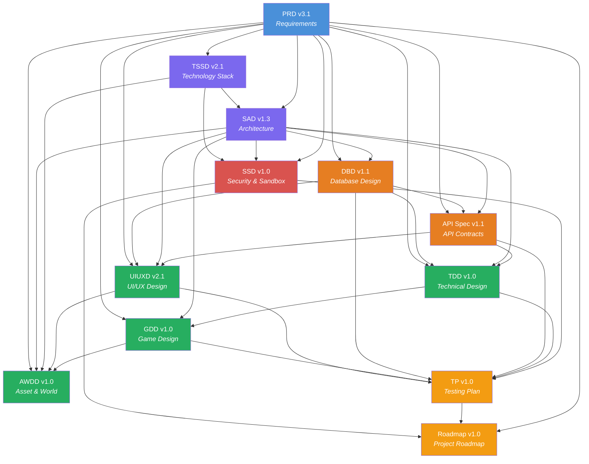

# SimOffice Documentation Suite

> **Project:** SimOffice — Browser-based 3D collaborative cybersecurity & debugging training simulation
> **Edition:** Phase 0 / Pilot (Single-College)
> **Last updated:** 2026-08-05

---

## Recommended Reading Order

The documents below are ordered dependency-first: each document builds on concepts, decisions, and contracts established by the ones above it. New developers and contributors should follow this order for the most coherent onboarding experience.

### Tier 1 — Vision & Requirements (Start Here)

| # | Document | Purpose |
|---|----------|---------|
| 1 | [PRD v3.1](SimOffice_PRD_v3_1.md) | **Start here.** Product vision, user personas, phased scope (MVP → Phase 3), feature requirements, non-functional requirements, and success metrics. Every downstream document traces back to this. |

### Tier 2 — Architecture, Technology & Security

| # | Document | Purpose | Key Dependencies |
|---|----------|---------|-----------------|
| 2 | [TSSD v2.1 (Pilot)](SimOffice_TSSD_v2_1_Pilot_Edition.md) | Technology stack selection and rationale — framework choices, hosting, sandbox isolation, CI/CD. Defines *what* technologies are used and *why*. | PRD |
| 3 | [SAD v1.3 (Pilot)](SimOffice_SAD_v1_3_Pilot_Edition.md) | Software architecture — component topology, data models, service boundaries, state machines, sequence flows, trust-zone sandboxing. Defines *how* the system is structured. | PRD, TSSD |
| 4 | [SSD v1.0 (Pilot)](SimOffice_SSD_v1_0_Pilot_Edition.md) | Security & sandbox design — unified threat model, trust-zone tamper resistance, resource ceilings, network isolation, 2-tier identity/auth, compliance gates, and security verification plan. | PRD, SAD, TSSD, TDD, API Spec, DBD |
| 5 | [Compliance Spec v1.0](SimOffice_Compliance_Spec_v1_0.md) | Privacy policy, AI prompt library guardrails, and content liability rules for scenario authoring. | PRD, SSD |

### Tier 3 — Contracts & Schemas

| # | Document | Purpose | Key Dependencies |
|---|----------|---------|-----------------|
| 6 | [DBD v1.1 (Pilot)](SimOffice_DBD_v1_1_Pilot_Edition.md) | Database design — full Postgres DDL, entity relationships, views, indexing strategy, retention/anonymization jobs. | PRD, SAD |
| 7 | [API Spec v1.1 (Pilot)](SimOffice_API_Spec_v1_1_Pilot_Edition.md) | REST + WebSocket API contracts — endpoints, request/response schemas, auth flows, error codes, real-time sync. | PRD, SAD, DBD |

### Tier 4 — Design & Implementation Detail

| # | Document | Purpose | Key Dependencies |
|---|----------|---------|-----------------|
| 8 | [TDD v1.0 (Pilot)](SimOffice_TDD_v1_0_Pilot_Edition.md) | Technical design — module breakdowns, algorithm pseudocode, state machines, background jobs, error handling. Bridges architecture to code. | PRD, SAD, DBD, API Spec |
| 9 | [GDD v1.0 (Pilot)](SimOffice_GDD_v1_0_Pilot_Edition.md) | Game design — character controller, camera, animation state machine, interactive objects, multiplayer movement sync. | PRD, SAD, TDD |
| 10 | [UIUXD v2.1 (Pilot)](SimOffice_UIUXD_v2_1_Pilot_Edition.md) | UI/UX design — screen specifications (26 screens), interaction flows, accessibility, Figma production structure. | PRD, SAD, API Spec, DBD |
| 11 | [AWDD v1.0 (Pilot)](SimOffice_AWDD_v1_0_Pilot_Edition.md) | Asset & world design — art direction, performance budgets, world layouts, prop/character/audio asset specs, production pipeline. | PRD, SAD, TSSD, GDD, UIUXD |

### Tier 5 — Verification, Execution & Quality

| # | Document | Purpose | Key Dependencies |
|---|----------|---------|------------------|
| 12 | [TP v1.0 (Pilot)](SimOffice_TP_v1_0_Pilot_Edition.md) | Testing plan — unit, integration, database, security PoC, E2E, device baseline, multiplayer sync, accessibility tests, CI pipeline, pre-pilot readiness checklist, and Phase 0 exit criteria measurement. | All upstream docs |
| 13 | [Roadmap v1.2 (Pilot)](SimOffice_Roadmap_v1_0_Pilot_Edition.md) | Project roadmap — Phase 0 detailed milestones (M0.1–M0.7), Phase 1–3 summaries, team structure, risk register, go/no-go gates, and success metrics tracking. | PRD, TP, SSD |
| 14 | [Phase 0 Effort Estimate v1.0](SimOffice_Phase0_Effort_Estimate_v1_0.md) | Revised Phase 0 effort sizing and schedule based on M0.1 Architecture Spike outcomes. | RM |
| 15 | [Prompt Library](AI_AGENT_PROMPT_LIBRARY.md) | Turnkey, high-precision prompts for AI coding agents to execute every milestone across Phase 0, 1, 2, and 3. | All 14 docs |

---

## Document Dependency Graph

---

## Suite Status

All 14 documents in the SimOffice Pilot Edition documentation suite (13 specification documents + 1 execution prompt library) have been authored, reviewed, and cross-validated.

| Count | Category |
|---|---|
| 1 | Vision & Requirements (PRD) |
| 4 | Architecture, Technology & Security (TSSD, SAD, SSD, Compliance Spec) |
| 2 | Contracts & Schemas (DBD, API Spec) |
| 4 | Design & Implementation (TDD, GDD, UIUXD, AWDD) |
| 4 | Verification, Planning & Prompting (TP, Roadmap, Effort Estimate, Prompt Library) |
| **15** | **Total** |

---

## Conventions

- **Version numbering:** `v<major>.<minor>` — major bumps indicate structural/scope changes; minor bumps are additive fixes.
- **Pilot Edition:** All v1.x pilot-edition documents are scoped to the single-college Phase 0 deployment. Production-scale concerns are documented as "production seams" within each document.
- **Cross-references:** Documents reference each other using `§<section>` notation (e.g., "PRD §8.3" means Section 8.3 of the PRD).
- **Conflict resolution:** The PRD is the ultimate source of truth. If a downstream document conflicts with the PRD, the PRD takes precedence (PRD §22).
