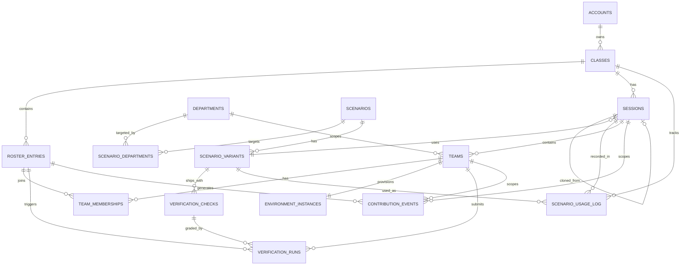

# SimOffice — Database Design Document (DBD)
## Pilot Edition

| | |
|---|---|
| **Document type** | Database Design Document — turns the requirement-level data model in PRD§15 and the preliminary ERD sketch in SAD v1.1 §6 into a real, constraint-enforced, tested schema. This is deliverable #3 of PRD§22's downstream-document list. Does not re-derive requirements (PRD v3.1) or re-decide technology (TSSD v2.1 Pilot Edition, SAD v1.1 Pilot Edition) — all three are fixed inputs here. |
| **Scope** | Schema for the single-college pilot deployment (PostgreSQL 17.x, self-hosted, TSSD v2.1 §5.1) implementing PRD§5.1's Phase 0 MVP — while deliberately not requiring rework for the Phase 1 department/sub-team expansion (§15's "Production seam"-style callouts below). |
| **Version** | 1.1 |
| **Status** | Ready to implement against. Full DDL in this document has been executed against a live PostgreSQL instance (§14 — Validation Performed), not merely hand-written. |

> **What changed in v1.1 (full changelog in [Section 20](#20-changelog-v10--v11)):** one additive fix, surfaced while the API Specification (v1.1) was writing a concrete contract for character customization and found nowhere in the schema to persist the result — PRD§12.2/§9.2 require appearance customization as MVP scope, persisted across sessions per §15.4, but `roster_entries` had no column for it. Fixed in §3.5/§6 with a single additive `appearance JSONB` column — no existing column, constraint, or index changes. Also marks §16 item 1 (roster-entry recognition mechanism) resolved, since API Specification v1.1 §3.2 closed it concretely.

> **Relationship to SAD v1.1 §6:** the SAD's Data Architecture section sketched a first-pass ERD to unblock the rest of the architecture (trust-zone design, sequence diagrams, NFR traceability) — it was explicitly scoped as architecture-level, not a finished schema. This document is the actual database design, and in the process of making it concrete and testable, four real gaps surfaced between the SAD's sketch and PRD v3.1's actual requirements. Each is fixed here and documented in §3, in the same spirit as PRD v3.1's and SAD v1.1's own changelogs — the schema is corrected, not silently patched around.

---

## Table of Contents

1. [Purpose & Inputs](#1-purpose--inputs)
2. [Design Principles & Conventions](#2-design-principles--conventions)
3. [Corrections & Clarifications Relative to SAD v1.1 §6](#3-corrections--clarifications-relative-to-sad-v11-6)
4. [Entity-Relationship Diagram](#4-entity-relationship-diagram)
5. [Entity Catalog](#5-entity-catalog)
6. [Full Schema (DDL)](#6-full-schema-ddl)
7. [Referential Integrity & Cascade Behavior](#7-referential-integrity--cascade-behavior)
8. [Data Lifecycle: Retention, Anonymization & Deletion](#8-data-lifecycle-retention-anonymization--deletion)
9. [Contribution Event Taxonomy](#9-contribution-event-taxonomy)
10. [Convenience Views](#10-convenience-views)
11. [Indexing Strategy](#11-indexing-strategy)
12. [Seed / Reference Data](#12-seed--reference-data)
13. [Scalability Notes — Pilot vs. Production Seam](#13-scalability-notes--pilot-vs-production-seam)
14. [Validation Performed](#14-validation-performed)
15. [Migration Strategy](#15-migration-strategy)
16. [Open Items & Downstream Dependencies](#16-open-items--downstream-dependencies)
17. [PRD Requirement Traceability Matrix](#17-prd-requirement-traceability-matrix)
18. [Sign-off Checklist](#18-sign-off-checklist)
19. [Glossary](#19-glossary)
20. [Changelog v1.0 → v1.1](#20-changelog-v10--v11)

---

## 1. Purpose & Inputs

This document answers "what exactly gets stored, in what shape, with what constraints?" — the question the PRD (what's required) and the SAD (how components talk to each other) both defer to a downstream deliverable (PRD§22 item 3: *"Database Design / ER Diagram — turning the requirement-level model in §15 into real entities and relationships, including the class/session/environment-instance hierarchy in §15.2–§15.6"*).

Three documents are fixed inputs and are not re-litigated here:

- **PRD v3.1** — every requirement referenced below is tagged `PRD§x.x`.
- **SAD v1.1 (Pilot Edition)** — component topology, trust-zone design, and the preliminary ERD (§6) are fixed context; corrections to that ERD specifically are called out in §3 below, not silently absorbed.
- **TSSD v2.1 (Pilot Edition)** — PostgreSQL 17.x, self-hosted via Docker, is the fixed engine. No ORM is fixed by TSSD, so this document specifies the schema as engine-native DDL (§2.4), which is ORM-agnostic and can be wrapped by whichever ORM/migration tool is chosen later without re-deciding the schema itself.

---

## 2. Design Principles & Conventions

### 2.1 Naming
- Tables: `snake_case`, plural (`sessions`, `roster_entries`, `verification_runs`).
- Columns: `snake_case`, singular. Foreign key columns are named `<referenced_singular>_id` (e.g., `class_id`, `roster_entry_id`) except where a table has more than one FK to the same target, in which case the column name is descriptive (`triggered_by_roster_entry_id`, `cloned_from_session_id`).
- This diverges slightly from SAD v1.1 §6.1's Mermaid diagram, which used singular `UPPER_CASE` entity names (`ACCOUNT`, `CLASS`) — that was ER-diagram notation, not a table-naming decision; this document fixes the actual SQL convention.

### 2.2 Primary keys
`UUID PRIMARY KEY DEFAULT gen_random_uuid()` on every table. `gen_random_uuid()` has been a Postgres core built-in (no extension required) since v13, so this carries no dependency beyond the fixed engine version. UUIDs are used because entity IDs are embedded directly in JWTs and API responses (SAD§9.3) — non-enumerable IDs are the safer default there, and it's the convention SAD's own sketch already assumed.

### 2.3 Timestamps
`TIMESTAMPTZ`, never naive `TIMESTAMP` — a multi-timezone deployment (even a single-college pilot may have remote/hybrid students) must not silently assume server-local time. `created_at` defaults to `now()`; tables that track a lifecycle also carry explicit nullable milestone timestamps (`started_at`, `ended_at`, `torn_down_at`, etc.) rather than overloading `updated_at`.

### 2.4 Enum-like columns: `TEXT + CHECK`, not native `ENUM` types
Every fixed-vocabulary column (`role`, `status`, `outcome_state`, `event_type`, etc.) is implemented as `TEXT` with a `CHECK` constraint, not a native Postgres `ENUM` type. This is a deliberate choice, not an oversight:
- The product is explicitly phased (PRD§5), and several vocabularies are stated to *grow* across phases — e.g., issue `category` gains `security_vulnerability` and `malicious_script` at Phase 2 (PRD§14). Postgres native `ENUM` types support adding values (`ALTER TYPE ... ADD VALUE`) but the operation has real restrictions (cannot run inside certain transaction blocks in older versions, cannot easily remove or reorder values), which makes iterative schema evolution across pilot → Phase 1 → Phase 2 more brittle than it needs to be.
- No ORM is fixed yet (§1) — some (Prisma) map awkwardly to native Postgres enums, others (TypeORM) map cleanly. `TEXT + CHECK` is the option that doesn't pre-commit the schema to an ORM decision that hasn't been made.
- Every such column's allowed values are documented inline as SQL comments and centrally in §5/§9, so this costs nothing in clarity versus a native enum.

### 2.5 JSONB for evolving, non-relational config
A small number of columns use `JSONB` deliberately: `sessions.config` (department-assignment-mode-specific knobs that expand every phase — PRD§12.3's manual/self-selected/auto-balanced modes, later sub-team split counts), `environment_instances.resource_limits` (the `ResourceLimits` shape from SAD§7.1/§7.4), and `contribution_events.metadata` / `verification_runs.diagnostic_details` (payload shape genuinely varies by `event_type`/check, §9). Everything with a stable, queried-on-its-own-terms shape (IDs, statuses, timestamps, foreign keys) stays a real typed column — JSONB is used only where the alternative is a schema migration every phase for a field nothing else needs to join or filter on.

### 2.6 Soft lifecycle over hard deletes
No table in this schema is ever hard-deleted by application logic during normal operation, with one narrow exception noted in §8. Accounts, classes, and roster entries are deactivated/archived/anonymized in place; environment instances and sessions move through explicit status columns. This is what makes the retention/anonymization design in §8 possible without orphaning historical debrief data.

---

## 3. Corrections & Clarifications Relative to SAD v1.1 §6

The SAD's ERD (§6.1) was sufficient to unblock the rest of the architecture document, but building it out into an actual, constraint-tested schema surfaced four places where the sketch doesn't fully hold up against PRD v3.1. Each is stated here with its reasoning, consistent with how PRD v3.1 and SAD v1.1 document their own corrections against earlier drafts.

### 3.1 Roster-entry persistence (the most significant fix)

**The gap:** PRD§15.2 states a student roster is *"associated with a class, not directly with individual sessions,"* and PRD§15.4/§12.2 require persistent cosmetics, XP, and session history — i.e., the *same* student record must be reused across every session of a class so a "return for a second session" metric (PRD§17) is even measurable. But SAD v1.1's own sequence diagram (§9.3, and again in §11.1/§11.3) shows a fresh `RosterEntry` row `INSERT`ed every time a student calls `POST /sessions/join` — which is a **session**-scoped join code, regenerated per session (PRD§12.1: *"auto-generated join code"* per session). Followed literally, this creates a brand-new, disconnected student identity every single session, which cannot satisfy "persistent across a term" no matter how the rest of the schema is built.

**The fix:** `roster_entries` is scoped to `class_id`, not `session_id`, and is created **once**, the first time a student is recognized in that class — via a lightweight, reusable `roster_passcode_hash` (PRD§15.1 explicitly names "code-based lightweight accounts" as one acceptable mechanism). On every subsequent session join — using that session's own join code, as PRD§12.1/§13.1 require — the API looks up the *existing* `roster_entries` row for that class (matched by passcode, or by the teacher pre-populating/selecting from a roster) rather than inserting a new one, and only inserts a new `team_memberships` row scoping that persistent identity to this session's team. The session-scoped, short-lived JWT (SAD§9.3) is unaffected by this fix — it still carries only a session+team-scoped token; it just now encodes a `roster_entry_id` that is stable across the student's whole time in the class, not reset every session.

### 3.2 Scenario vs. issue-variant normalization

**The gap:** SAD's `SCENARIO_VARIANT` entity folded scenario-level facts (`domain`, `department`, `fix_baseline_ref`) directly onto the variant row. But PRD§8.1 and §12.4 are explicit that one scenario (one codebase, one fix baseline) supports **multiple** issue variants and difficulty tiers — *"every scenario supports multiple difficulty tiers and multiple possible injected issues."* A flat model would duplicate `domain`/`fix_baseline_ref` across every variant of the same scenario, and — worse — gives no clean way to enforce "this variant's fix baseline is the same repo as its siblings," since there'd be nothing stopping two variants of "the same" scenario from disagreeing on their own copies of that field.

**The fix:** `scenarios` (the parent codebase: title, domain, fix baseline, departmental shape) and `scenario_variants` (the specific planted defect: difficulty, category, issue repo ref, briefing text) are split into a proper one-to-many relationship, joined through `scenario_id`. `scenario_departments` is a genuine many-to-many junction (a full-stack scenario targets several departments at once, per PRD§12.4's "full-stack vs. specialist" facet), rather than a single `department` string that can't represent a full-stack scenario at all.

### 3.3 Verification checks as first-class rows, not a flat result field

**The gap:** SAD's `VERIFICATION_RUN` had one flat `result` field and no reference to *which* check produced it. But PRD§8.3 requires **partial credit from narrower diagnostic checks** *("did the team correctly identify which file/function the issue is in")* — available from Phase 0, not deferred — and Phase 2's layered incidents need *"one verification check per injected issue, tracked independently, so the debrief can show 'found 2 of 3.'"* A single flat `result` column has no way to represent "passed the diagnostic check but not the full fix" or "found issue 2 of 3," and would require a breaking schema change the moment Phase 0's partial-credit requirement or Phase 2's layering actually gets built.

**The fix:** `verification_checks` is a proper child table of `scenario_variants` — one row per check the content author ships (`check_type` of `full_fix` or `diagnostic`, plus a nullable `issue_ordinal` reserved for Phase 2 layering). `verification_runs` references a specific `verification_check_id`, so a team's results are a real set of (check, result) pairs from day one — the debrief view in §10 aggregates them, and nothing about this table needs to change when Phase 2's layered incidents arrive.

### 3.4 Session lifecycle status vs. team outcome — separated

**The gap:** SAD v1.1's session-lifecycle state machine (§10) includes a session-level `Resolved` state (*"Active → Resolved: full verification passes"*). That's a reasonable shorthand for Phase 0, where single-department mode means the whole class is one team — but PRD§12.3/§13.3 are explicit that outcome is tracked **per team**, and Phase 1 introduces multiple teams per session that can resolve at different times with different outcomes. A session-level "Resolved" status can't represent "3 of 4 teams resolved, 1 unresolved" (exactly PRD§13.5's early-end scenario), which is not a hypothetical edge case — it's a named, required Phase 0 journey.

**The fix:** these are modeled as two separate, orthogonal facts. `sessions.status` tracks lifecycle mechanics only (`created → provisioning → active → ended → debriefed → torn_down`), with a separate `end_reason` (`time_limit_reached | teacher_ended_early | all_teams_resolved | abandoned_timeout`) recorded once. `teams.outcome_state` (`in_progress | resolved | unresolved`) is the per-team pedagogical result, exactly as SAD's own `TEAM` entity already correctly modeled it — this fix removes the redundant, conflicting session-level state rather than adding anything new.

### 3.5 Character appearance had nowhere to live (new in v1.1, surfaced by API Specification v1.1)

**The gap:** PRD§12.2/§9.2 require appearance customization ("bright color scheme and a cap," PRD§13.2) as **MVP scope**, persisted across sessions per PRD§15.4's "cosmetics/unlocks... tied to the account, not the session" — but `roster_entries` (§3.1's fix already put identity at the right scope) had no column to actually hold it. This wasn't one of the four v1.0 corrections against SAD v1.1 §6 — it surfaced later, while the API Specification was writing a concrete contract for character customization and found nowhere in the schema to persist the result.

**The fix:** a single additive column, `roster_entries.appearance JSONB NOT NULL DEFAULT '{}'::jsonb` (§6). Deliberately opaque JSON rather than typed columns or a `CHECK`-constrained enum — the *catalog* of valid appearance values (which color schemes, which accessories exist, which are gamification-unlocked per PRD§18) is a content/frontend concern that will grow purely as content over time, not as a schema change, so §2.4's `TEXT + CHECK` reasoning (for small, stable, code-meaningful vocabularies like `status` or `result`) deliberately does not extend to it. This is a pure addition — no existing column, constraint, or index changes; see §15 for the exact migration statement.

---

## 4. Entity-Relationship Diagram



*(Cardinality note: `SESSIONS ||--o| SESSIONS : cloned_from` is a self-referencing optional link — PRD§12.1's "reuse a previous session's configuration as a starting template.")*

---

## 5. Entity Catalog

| Entity | Purpose | Key traceability |
|---|---|---|
| `accounts` | Real, credentialed identity — teachers only at pilot scale | PRD§11.1, §15.1, §16.6 |
| `classes` | Persistent class/section, owned by a teacher, spans a term | PRD§15.2, §12.4, §17 |
| `roster_entries` | Persistent, class-scoped student identity (no login credential), incl. appearance | PRD§15.1, §15.2, §15.4, §12.2, §9.2 — see §3.1, §3.5 fixes |
| `departments` | Fixed dictionary: Frontend / Backend / DevOps / QA | PRD§10.1 |
| `scenarios` | Parent authored codebase ("company to work at") + fix baseline | PRD§8.1, §12.4 — see §3.2 fix |
| `scenario_departments` | Many-to-many: which department(s) a scenario targets | PRD§11.5.1, §12.4 |
| `scenario_variants` | One authored, planted defect + its symptom-only briefing | PRD§8.1, §8.4, §14 |
| `verification_checks` | Full-fix and diagnostic/partial-credit checks shipped with a variant | PRD§8.3, §8.5 — see §3.3 fix |
| `scenario_usage_log` | ~~"No repeat incident" tracking per class~~ **Deprecated** — redundant with `sessions` (see §16 item 6) | PRD§11.5.3 |
| `sessions` | One run — configuration + lifecycle state | PRD§7, §15.3, §12.13 — see §3.4 fix |
| `teams` | One department-scoped team per session; carries pedagogical outcome | PRD§12.3, §13.3 — see §3.4 fix |
| `team_memberships` | Session-scoped join record linking a persistent roster entry to a team | PRD§12.13 |
| `environment_instances` | One disposable, isolated sandbox per team | PRD§8.1, §8.6, §15.6 |
| `verification_runs` | Server-computed, tamper-resistant check results | PRD§8.3, §8.5 |
| `contribution_events` | Generic append-only event log: edits, chat, pings, emotes, presence | PRD§12.9, §15.5, §17 |

---

## 6. Full Schema (DDL)

The DDL below is exactly what was executed against a live PostgreSQL 16 instance during drafting (§14) — Postgres 16 and 17 share every construct used here (no version-specific syntax), so this applies unchanged to the fixed TSSD v2.1 target of PostgreSQL 17.x.

```sql
-- ============================================================================
-- SimOffice — Database Schema (Pilot Edition)
-- Target: PostgreSQL 17.x
-- ============================================================================

CREATE EXTENSION IF NOT EXISTS citext;  -- only extension needed, for case-insensitive email
-- gen_random_uuid() is built into Postgres core since v13 — no extension needed for it.

-- ----------------------------------------------------------------------------
-- 1. DEPARTMENTS (reference/lookup table)
-- ----------------------------------------------------------------------------
CREATE TABLE departments (
    id              UUID PRIMARY KEY DEFAULT gen_random_uuid(),
    code            TEXT NOT NULL UNIQUE,          -- 'frontend' | 'backend' | 'devops' | 'qa'
    display_name    TEXT NOT NULL,
    created_at      TIMESTAMPTZ NOT NULL DEFAULT now()
);

COMMENT ON TABLE departments IS
  'Fixed dictionary of the four disciplines (PRD §10.1). Phase 0 seeds/uses backend only; rows for the other three exist from day one so Phase 1 needs zero schema change (PRD §5.3).';

-- ----------------------------------------------------------------------------
-- 2. ACCOUNTS (teachers only, at pilot scale)
-- ----------------------------------------------------------------------------
CREATE TABLE accounts (
    id              UUID PRIMARY KEY DEFAULT gen_random_uuid(),
    role            TEXT NOT NULL DEFAULT 'teacher'
                        CHECK (role IN ('teacher', 'admin')),
    email           CITEXT NOT NULL UNIQUE,
    password_hash   TEXT NOT NULL,
    display_name    TEXT NOT NULL,
    created_at      TIMESTAMPTZ NOT NULL DEFAULT now(),
    updated_at      TIMESTAMPTZ NOT NULL DEFAULT now(),
    deactivated_at  TIMESTAMPTZ NULL
);

COMMENT ON TABLE accounts IS
  'Real, credentialed identity. PRD §15.1/§16.6: only teachers get one in the pilot — students use roster_entries (no login), content authors/admins are not modeled as accounts at pilot scale (PRD §11.5.5 — content pipeline is git/manifest-based, not an in-app role). deactivated_at implements PRD §11.1 deprovisioning without deleting a teacher''s historical classes/sessions.';

-- ----------------------------------------------------------------------------
-- 3. CLASSES (persistent class/section, PRD §15.2)
-- ----------------------------------------------------------------------------
CREATE TABLE classes (
    id                  UUID PRIMARY KEY DEFAULT gen_random_uuid(),
    teacher_account_id  UUID NOT NULL REFERENCES accounts(id) ON DELETE RESTRICT,
    name                TEXT NOT NULL,
    term_label          TEXT NULL,                  -- e.g. 'Fall 2026' — supports PRD §12.4/§17 reuse-across-terms
    created_at          TIMESTAMPTZ NOT NULL DEFAULT now(),
    archived_at         TIMESTAMPTZ NULL
);

CREATE INDEX idx_classes_teacher_account_id ON classes(teacher_account_id);

COMMENT ON TABLE classes IS
  'PRD §15.2: a class is first-class and persists across a term; a teacher owns one or more; a session always belongs to exactly one class. archived_at supports the §11.1 teacher-deprovisioning case without deleting rows.';

-- ----------------------------------------------------------------------------
-- 4. ROSTER_ENTRIES (persistent, class-scoped student identity)
-- ----------------------------------------------------------------------------
CREATE TABLE roster_entries (
    id                  UUID PRIMARY KEY DEFAULT gen_random_uuid(),
    class_id            UUID NOT NULL REFERENCES classes(id) ON DELETE RESTRICT,
    display_name        TEXT NOT NULL,
    roster_passcode_hash TEXT NOT NULL,              -- lightweight persistent credential, PRD §15.1
    appearance          JSONB NOT NULL DEFAULT '{}'::jsonb,  -- character customization, PRD §12.2/§9.2 — added in v1.1
    is_anonymized       BOOLEAN NOT NULL DEFAULT false,
    anonymized_at       TIMESTAMPTZ NULL,
    created_at          TIMESTAMPTZ NOT NULL DEFAULT now(),
    last_seen_at        TIMESTAMPTZ NULL
);

CREATE INDEX idx_roster_entries_class_id ON roster_entries(class_id);

COMMENT ON TABLE roster_entries IS
  'PRD §15.2/§15.4/§12.2: persistent per-CLASS student identity so cosmetics/XP/session-history/return-rate metrics (PRD §17) actually accumulate across a term. Row is created once, at first join to the class, and reused across every session of that class — see DBD §3.1. appearance is opaque JSON deliberately (§2.4''s TEXT+CHECK reasoning doesn''t apply to a cosmetic catalog that grows as content, not as schema) — see DBD §3.5 for why it wasn''t in v1.0.';

-- ----------------------------------------------------------------------------
-- 5. SCENARIOS (parent codebase; PRD §8.1 "project scenario")
-- ----------------------------------------------------------------------------
CREATE TABLE scenarios (
    id                      UUID PRIMARY KEY DEFAULT gen_random_uuid(),
    title                   TEXT NOT NULL,
    domain                  TEXT NOT NULL,               -- PRD §12.4, e.g. 'web_development', 'iot'
    departmental_shape      TEXT NOT NULL
                                CHECK (departmental_shape IN ('full_stack', 'specialist')),
    fix_baseline_repo_ref   TEXT NOT NULL,
    manifest_source_ref     TEXT NULL,                   -- git commit/tag the content package was imported from
    created_at              TIMESTAMPTZ NOT NULL DEFAULT now()
);

COMMENT ON TABLE scenarios IS
  'PRD §8.1/§12.4: the parent codebase ("company to work at"). Deliberately separate from scenario_variants — see DBD §3.2.';

-- ----------------------------------------------------------------------------
-- 6. SCENARIO_DEPARTMENTS (many-to-many: which department(s) a scenario targets)
-- ----------------------------------------------------------------------------
CREATE TABLE scenario_departments (
    scenario_id     UUID NOT NULL REFERENCES scenarios(id) ON DELETE CASCADE,
    department_id   UUID NOT NULL REFERENCES departments(id) ON DELETE RESTRICT,
    PRIMARY KEY (scenario_id, department_id)
);

COMMENT ON TABLE scenario_departments IS
  'PRD §11.5.1 metadata: "target department(s)". A specialist scenario has exactly one row here; a full-stack scenario has more than one. (Invariant enforced at the application layer, not by a DB constraint — see DBD §16.)';

-- ----------------------------------------------------------------------------
-- 7. SCENARIO_VARIANTS (an authored issue variant of a scenario, PRD §8.1/§8.4)
-- ----------------------------------------------------------------------------
CREATE TABLE scenario_variants (
    id                      UUID PRIMARY KEY DEFAULT gen_random_uuid(),
    scenario_id             UUID NOT NULL REFERENCES scenarios(id) ON DELETE RESTRICT,
    difficulty              TEXT NOT NULL
                                CHECK (difficulty IN ('beginner', 'intermediate', 'advanced')),
    category                TEXT NOT NULL
                                CHECK (category IN ('logic_bug', 'security_vulnerability',
                                                     'malicious_script', 'misconfiguration')),
    issue_repo_ref          TEXT NOT NULL,               -- broken-variant repo ref or diff-against-baseline ref
    briefing_text           TEXT NOT NULL,               -- the symptom-only mission briefing (PRD §10.3)
    created_at              TIMESTAMPTZ NOT NULL DEFAULT now()
);

CREATE INDEX idx_scenario_variants_scenario_id ON scenario_variants(scenario_id);
CREATE INDEX idx_scenario_variants_difficulty_category ON scenario_variants(difficulty, category);

COMMENT ON TABLE scenario_variants IS
  'PRD §8.1/§8.4/§14: one specific planted defect + its briefing text. difficulty/category are intrinsic tags of the variant, not of the session — see DBD §3.4 for the related session-status fix.';

-- ----------------------------------------------------------------------------
-- 8. VERIFICATION_CHECKS (checks shipped with a variant: full-fix + diagnostics)
-- ----------------------------------------------------------------------------
CREATE TABLE verification_checks (
    id                      UUID PRIMARY KEY DEFAULT gen_random_uuid(),
    scenario_variant_id     UUID NOT NULL REFERENCES scenario_variants(id) ON DELETE RESTRICT,
    check_type              TEXT NOT NULL
                                CHECK (check_type IN ('full_fix', 'diagnostic')),
    check_key               TEXT NOT NULL,               -- stable slug, e.g. 'full_fix', 'diagnostic_root_cause_file'
    issue_ordinal           INT NULL,                    -- Phase 2 layered incidents: which injected issue this targets
    harness_ref             TEXT NOT NULL,                -- protected trust-zone reference (PRD §8.5) — never a /workspace path
    description             TEXT NOT NULL,
    sort_order              INT NOT NULL DEFAULT 0,
    created_at              TIMESTAMPTZ NOT NULL DEFAULT now(),
    UNIQUE (scenario_variant_id, check_key)
);

CREATE INDEX idx_verification_checks_variant_id ON verification_checks(scenario_variant_id);

COMMENT ON TABLE verification_checks IS
  'PRD §8.3: one full_fix check plus zero-or-more diagnostic (partial-credit) checks per variant, and — Phase 2 — one full_fix check per issue_ordinal for layered incidents ("found 2 of 3"). See DBD §3.3.';

-- ----------------------------------------------------------------------------
-- 9. SCENARIO_USAGE_LOG ("no repeat incident" tracking, PRD §11.5.3)
--    ⚠️  DEPRECATED — this table is redundant with `sessions`, which already
--    records (class_id, scenario_variant_id) for every session and is never
--    hard-deleted. The API layer should query `sessions` directly to enforce
--    the "no repeat incident" constraint (PRD §11.5.3) instead of maintaining
--    this separate log. Retained in the DDL for backward compatibility; new
--    code MUST NOT write to this table. Remove in the next schema revision.
-- ----------------------------------------------------------------------------
CREATE TABLE scenario_usage_log (
    id                      UUID PRIMARY KEY DEFAULT gen_random_uuid(),
    scenario_variant_id     UUID NOT NULL REFERENCES scenario_variants(id) ON DELETE RESTRICT,
    class_id                UUID NOT NULL REFERENCES classes(id) ON DELETE RESTRICT,
    session_id              UUID NOT NULL,               -- FK added below, after sessions exists
    used_at                 TIMESTAMPTZ NOT NULL DEFAULT now()
);

CREATE INDEX idx_scenario_usage_log_variant_class ON scenario_usage_log(scenario_variant_id, class_id);

COMMENT ON TABLE scenario_usage_log IS
  '⚠️ DEPRECATED — redundant with sessions. See §16 item 6. PRD §11.5.3: the API should query sessions(class_id, scenario_variant_id) instead of this table.';

-- ----------------------------------------------------------------------------
-- 10. SESSIONS (one run, PRD §7/§15.3)
-- ----------------------------------------------------------------------------
CREATE TABLE sessions (
    id                      UUID PRIMARY KEY DEFAULT gen_random_uuid(),
    class_id                UUID NOT NULL REFERENCES classes(id) ON DELETE RESTRICT,
    scenario_variant_id     UUID NOT NULL REFERENCES scenario_variants(id) ON DELETE RESTRICT,
    join_code               VARCHAR(8) NOT NULL,
    department_mode         TEXT NOT NULL DEFAULT 'single_department'
                                CHECK (department_mode IN ('single_department', 'multi_department')),
    status                  TEXT NOT NULL DEFAULT 'created'
                                CHECK (status IN ('created', 'provisioning', 'active',
                                                   'ended', 'debriefed', 'torn_down')),
    end_reason              TEXT NULL
                                CHECK (end_reason IN ('time_limit_reached', 'teacher_ended_early',
                                                       'all_teams_resolved', 'abandoned_timeout')),
    time_limit_minutes      INT NOT NULL,
    max_roster_size         INT NULL,
    config                  JSONB NOT NULL DEFAULT '{}'::jsonb,
    cloned_from_session_id  UUID NULL REFERENCES sessions(id) ON DELETE SET NULL,
    created_at              TIMESTAMPTZ NOT NULL DEFAULT now(),
    started_at              TIMESTAMPTZ NULL,
    ended_at                TIMESTAMPTZ NULL
);

CREATE INDEX idx_sessions_class_id ON sessions(class_id);
CREATE INDEX idx_sessions_scenario_variant_id ON sessions(scenario_variant_id);
CREATE INDEX idx_sessions_status ON sessions(status) WHERE status NOT IN ('torn_down');
CREATE UNIQUE INDEX idx_sessions_join_code_active ON sessions(join_code) WHERE status NOT IN ('ended');

COMMENT ON TABLE sessions IS
  'PRD §7/§15.3/§12.13. status is lifecycle-only; per-team pedagogical outcome lives on teams.outcome_state, not here — see DBD §3.4.';

ALTER TABLE scenario_usage_log
    ADD CONSTRAINT fk_scenario_usage_log_session
    FOREIGN KEY (session_id) REFERENCES sessions(id) ON DELETE RESTRICT;

CREATE INDEX idx_scenario_usage_log_session_id ON scenario_usage_log(session_id);

-- ----------------------------------------------------------------------------
-- 11. TEAMS (one per department per session; PRD §12.3)
-- ----------------------------------------------------------------------------
CREATE TABLE teams (
    id                      UUID PRIMARY KEY DEFAULT gen_random_uuid(),
    session_id              UUID NOT NULL REFERENCES sessions(id) ON DELETE RESTRICT,
    department_id           UUID NOT NULL REFERENCES departments(id) ON DELETE RESTRICT,
    label                   TEXT NOT NULL,               -- e.g. 'Backend Team', 'Backend Team 2' (Phase 1 sub-teams)
    outcome_state           TEXT NOT NULL DEFAULT 'in_progress'
                                CHECK (outcome_state IN ('in_progress', 'resolved', 'unresolved')),
    created_at              TIMESTAMPTZ NOT NULL DEFAULT now()
);

CREATE INDEX idx_teams_session_id ON teams(session_id);
CREATE INDEX idx_teams_department_id ON teams(department_id);

COMMENT ON TABLE teams IS
  'PRD §12.3/§13.3: outcome_state is the per-team pedagogical result, tracked independently of session.status so multi-team sessions (Phase 1+) can have teams finish at different times/outcomes. See DBD §3.4.';

-- ----------------------------------------------------------------------------
-- 12. TEAM_MEMBERSHIPS (session-scoped join record for a persistent roster_entry)
-- ----------------------------------------------------------------------------
CREATE TABLE team_memberships (
    id                      UUID PRIMARY KEY DEFAULT gen_random_uuid(),
    team_id                 UUID NOT NULL REFERENCES teams(id) ON DELETE RESTRICT,
    roster_entry_id         UUID NOT NULL REFERENCES roster_entries(id) ON DELETE RESTRICT,
    joined_at               TIMESTAMPTZ NOT NULL DEFAULT now(),
    left_at                 TIMESTAMPTZ NULL,
    UNIQUE (team_id, roster_entry_id)
);

CREATE INDEX idx_team_memberships_team_id ON team_memberships(team_id);
CREATE INDEX idx_team_memberships_roster_entry_id ON team_memberships(roster_entry_id);

COMMENT ON TABLE team_memberships IS
  'PRD §12.13 late-join/reconnect: joined_at/left_at track presence across a session; the roster_entry itself persists in roster_entries regardless of this row.';

-- ----------------------------------------------------------------------------
-- 13. ENVIRONMENT_INSTANCES (one per team, PRD §8.1/§8.6/§15.6)
-- ----------------------------------------------------------------------------
CREATE TABLE environment_instances (
    id                      UUID PRIMARY KEY DEFAULT gen_random_uuid(),
    team_id                 UUID NOT NULL UNIQUE REFERENCES teams(id) ON DELETE RESTRICT,
    sandbox_provider        TEXT NOT NULL
                                CHECK (sandbox_provider IN ('e2b', 'gvisor')),
    provider_ref            TEXT NOT NULL,               -- opaque handle into the provider (SAD §7.1 EnvironmentRef)
    status                  TEXT NOT NULL DEFAULT 'provisioning'
                                CHECK (status IN ('provisioning', 'ready', 'error', 'torn_down')),
    resource_limits         JSONB NOT NULL,               -- {cpuCores, memoryMb, wallClockTimeoutMs} — SAD §7.4
    created_at              TIMESTAMPTZ NOT NULL DEFAULT now(),
    torn_down_at            TIMESTAMPTZ NULL
);

CREATE INDEX idx_environment_instances_status ON environment_instances(status) WHERE status <> 'torn_down';

COMMENT ON TABLE environment_instances IS
  'PRD §8.1 (one per team, UNIQUE team_id enforces this relationally) and §8.6 (resource_limits records what was actually applied at provision() time, per SAD §7.4). Contains no student PII by design (PRD §15.6).';

-- ----------------------------------------------------------------------------
-- 14. VERIFICATION_RUNS (server-computed results, PRD §8.3/§8.5)
-- ----------------------------------------------------------------------------
CREATE TABLE verification_runs (
    id                          UUID PRIMARY KEY DEFAULT gen_random_uuid(),
    team_id                     UUID NOT NULL REFERENCES teams(id) ON DELETE RESTRICT,
    verification_check_id       UUID NOT NULL REFERENCES verification_checks(id) ON DELETE RESTRICT,
    triggered_by_roster_entry_id UUID NULL REFERENCES roster_entries(id) ON DELETE SET NULL,
    result                      TEXT NOT NULL
                                    CHECK (result IN ('pass', 'fail', 'resource_limit_exceeded', 'error')),
    diagnostic_details          JSONB NOT NULL DEFAULT '{}'::jsonb,
    ran_at                      TIMESTAMPTZ NOT NULL DEFAULT now()
);

CREATE INDEX idx_verification_runs_team_id ON verification_runs(team_id);
CREATE INDEX idx_verification_runs_check_id ON verification_runs(verification_check_id);
CREATE INDEX idx_verification_runs_triggered_by ON verification_runs(triggered_by_roster_entry_id);

COMMENT ON TABLE verification_runs IS
  'PRD §8.3/§8.5/§8.6: server-computed only, never client-reported. verification_check_id (not just team_id) is what lets the debrief show "found 2 of 3" in Phase 2 layered incidents, and partial-credit diagnostic results in Phase 0. result includes resource_limit_exceeded as a distinct outcome, per PRD §8.6''s requirement that a ceiling breach be visible and not conflated with a legitimate check failure.';

-- ----------------------------------------------------------------------------
-- 15. CONTRIBUTION_EVENTS (generic event log, PRD §12.9/§15.5/§17)
-- ----------------------------------------------------------------------------
CREATE TABLE contribution_events (
    id                      UUID PRIMARY KEY DEFAULT gen_random_uuid(),
    session_id              UUID NOT NULL REFERENCES sessions(id) ON DELETE RESTRICT,
    team_id                 UUID NOT NULL REFERENCES teams(id) ON DELETE RESTRICT,
    roster_entry_id         UUID NULL REFERENCES roster_entries(id) ON DELETE SET NULL,
    event_type              TEXT NOT NULL
                                CHECK (event_type IN ('session_joined', 'session_left',
                                                       'desk_seated', 'desk_stood',
                                                       'code_edit_saved', 'check_run_triggered',
                                                       'ping_sent', 'emote_used', 'chat_message_sent')),
    metadata                JSONB NOT NULL DEFAULT '{}'::jsonb,
    occurred_at             TIMESTAMPTZ NOT NULL DEFAULT now()
);

CREATE INDEX idx_contribution_events_session_id ON contribution_events(session_id);
CREATE INDEX idx_contribution_events_team_id ON contribution_events(team_id);
CREATE INDEX idx_contribution_events_roster_entry_id ON contribution_events(roster_entry_id);
CREATE INDEX idx_contribution_events_type_time ON contribution_events(event_type, occurred_at);
CREATE INDEX idx_contribution_events_retention ON contribution_events(occurred_at) WHERE roster_entry_id IS NOT NULL;

COMMENT ON TABLE contribution_events IS
  'PRD §12.9 measurement mechanism + §15.5 chat-transcript retention + §17 engagement instrumentation, all on one generic append-only log. roster_entry_id is nullable to support the retention-window anonymization job (DBD §8) independent of any per-request deletion.';
```

---

## 7. Referential Integrity & Cascade Behavior

| Relationship | On delete of parent | Reasoning |
|---|---|---|
| `classes.teacher_account_id → accounts.id` | `RESTRICT` | An account is deactivated (§2.6), never deleted, while it owns classes — nothing to cascade in practice. |
| `roster_entries.class_id → classes.id` | `RESTRICT` | A class is archived, not deleted, while rosters reference it. |
| `sessions.class_id / scenario_variant_id` | `RESTRICT` | Historical sessions must never be silently orphaned by a class or content change. |
| `sessions.cloned_from_session_id → sessions.id` | `SET NULL` | The template link is a convenience (PRD§12.1); losing it if the original session is ever removed shouldn't block anything. |
| `scenario_departments.scenario_id → scenarios.id` | `CASCADE` | This junction row has no independent meaning without its scenario. |
| `teams.session_id / department_id` | `RESTRICT` | Same reasoning as sessions above. |
| `team_memberships.team_id / roster_entry_id` | `RESTRICT` | Membership history must survive; roster entries are anonymized in place (§8), never deleted. |
| `environment_instances.team_id` | `RESTRICT`, `UNIQUE` | Enforces the PRD§8.1 one-environment-per-team invariant relationally, not just by convention. |
| `verification_runs.team_id / verification_check_id` | `RESTRICT` | Grading history is permanent within the retention window (§8). |
| `verification_runs.triggered_by_roster_entry_id` | `SET NULL` | The *result* must survive a student's deletion request even if the attribution is stripped (§8, PRD§15.5). |
| `contribution_events.session_id / team_id` | `RESTRICT` | Event log rows always belong to a real session/team. |
| `contribution_events.roster_entry_id` | `SET NULL` | Same reasoning as `verification_runs.triggered_by_roster_entry_id` above — this is the same anonymization mechanism applied consistently everywhere a roster entry is referenced from history tables. |

**Design invariant:** every `RESTRICT` above reflects a genuine "this must never silently disappear" requirement (PRD§16.4 session integrity, PRD§15.5 retention). Nothing in this schema relies on `CASCADE` to clean up student-linked history — that would risk exactly the "corrupting other students' or teams' historical records" outcome PRD§15.5 explicitly warns against.

---

## 8. Data Lifecycle: Retention, Anonymization & Deletion

Implements PRD§15.5 and refines SAD v1.1 §6.3's retention description into working SQL. Two independent mechanisms exist, because they answer two different questions:

### 8.1 Scheduled anonymization (age-based, applies to everyone)

A nightly job nulls out `contribution_events.roster_entry_id` for events older than the configured retention window — regardless of whether anyone requested deletion — per PRD§15.5's *"retained only as long as needed... with an explicit maximum retention window."* Team-level aggregates (§10) are computed from `team_id`/`event_type`, so they remain intact after this runs; only individual attribution is stripped.

```sql
CREATE OR REPLACE FUNCTION anonymize_expired_contribution_events(retention_days INT DEFAULT 180)
RETURNS INT AS $$
DECLARE
    affected INT;
BEGIN
    UPDATE contribution_events
       SET roster_entry_id = NULL
     WHERE roster_entry_id IS NOT NULL
       AND occurred_at < now() - make_interval(days => retention_days);
    GET DIAGNOSTICS affected = ROW_COUNT;
    RETURN affected;
END;
$$ LANGUAGE plpgsql;
```

`retention_days` defaults to 180 as a placeholder — the actual number is a parameter of the compliance review required by PRD§16.6, not a value this document fixes.

### 8.2 On-request deletion (a specific student/guardian asks)

A student or guardian's deletion request (PRD§15.5) anonymizes the `roster_entries` row itself and strips attribution everywhere it's referenced from history tables — but never removes the row, and never touches `team_memberships`, because *"was on this team"* carries no PII once the display name is anonymized, and removing it would corrupt the team's shared historical roster for every other student in that debrief.

```sql
CREATE OR REPLACE FUNCTION anonymize_roster_entry(target_roster_entry_id UUID)
RETURNS VOID AS $$
BEGIN
    UPDATE roster_entries
       SET display_name = 'Deleted Student',
           roster_passcode_hash = 'invalidated',
           is_anonymized = true,
           anonymized_at = now()
     WHERE id = target_roster_entry_id;

    UPDATE contribution_events
       SET roster_entry_id = NULL
     WHERE roster_entry_id = target_roster_entry_id;

    UPDATE verification_runs
       SET triggered_by_roster_entry_id = NULL
     WHERE triggered_by_roster_entry_id = target_roster_entry_id;

    -- team_memberships intentionally NOT modified — see reasoning above.
END;
$$ LANGUAGE plpgsql;
```

### 8.3 Environment instances

`environment_instances` never needs an anonymization path — PRD§15.6 states they *"contain no student PII by design, only code artifacts,"* and this schema doesn't store any workspace file content in Postgres at all (that lives in the sandbox itself, per SAD§7). Rows are retained purely as an audit trail of what was provisioned and torn down, keyed by `team_id`, and `status = 'torn_down'` is the terminal state every environment reaches per the session-integrity requirement (PRD§16.4).

---

## 9. Contribution Event Taxonomy

`contribution_events` is a generic log by design (§3.3's sibling decision to `verification_checks`), so its `event_type` vocabulary and `metadata` shapes are specified here explicitly rather than left implicit, since an undocumented JSONB column is not something a second engineer (or a later API Specification document, PRD§22 item 4) can build against reliably.

| `event_type` | Typical actor | `metadata` shape (illustrative) | PRD traceability |
|---|---|---|---|
| `session_joined` | Any roster entry | `{}` | §17 session-duration/engagement |
| `session_left` | Any roster entry | `{"reason": "voluntary" \| "disconnect"}` | §17, §12.13 |
| `desk_seated` | Any roster entry | `{"deskId": "desk-1"}` | §12.9 "who's actively working" |
| `desk_stood` | Any roster entry | `{"deskId": "desk-1"}` | §12.9 |
| `code_edit_saved` | Any roster entry | `{"filePath": "services/payment/retry.ts"}` — file path and a lightweight diff stat only, never full code content, both because the code itself already lives in the environment instance (§8.3) and per the minimal-data principle (PRD§16.6) | §12.9 root-cause/fix attribution (computed retrospectively by correlating timestamps against the passing `verification_runs` row — not stored as a direct FK, since which edit "was the fix" isn't known until verification passes) |
| `check_run_triggered` | Any roster entry | `{"environmentInstanceId": "..."}` | §8.2 informal run-check |
| `ping_sent` | Any roster entry | `{"targetDeskId": "desk-3"}` or `{"targetRosterEntryId": "..."}` | §12.6, §12.9 secondary communication signal |
| `emote_used` | Any roster entry | `{"emoteType": "wave" \| "thumbsUp" \| "facepalm" \| "thinking"}` | §9.3, §17 engagement metric |
| `chat_message_sent` | Any roster entry | `{"channel": "team" \| "company", "message": "..."}` | §12.6, §15.5 chat-transcript retention, §12.11 debrief communication highlights |

**Volume note (pilot vs. production seam):** `code_edit_saved` is the highest-frequency event type in the taxonomy. The application layer should debounce this to per-save-checkpoint, not per-keystroke — this is an API-layer decision (PRD§22 item 4's API Specification), not a schema constraint, but it's flagged here because an un-debounced write pattern would be the first thing to strain this table at any scale beyond the pilot. At pilot concurrency (a handful of teams, TSSD v2.1 §4), a single unpartitioned table with the indexes in §11 is more than sufficient; time-based partitioning of `contribution_events` by month is the natural production seam if usage grows.

---

## 10. Convenience Views

Two read-side views back the teacher dashboard (PRD§12.10) and debrief screen (PRD§12.11). These are views, not stored tables — recomputed on read, never a second copy of the truth — which is the right tradeoff at pilot scale (TSSD v2.1's "no dashboard-based monitoring" reasoning, SAD§15) and keeps the retention job in §8 simple (nothing needs to update a derived table when it anonymizes an event).

```sql
CREATE OR REPLACE VIEW team_debrief_summary AS
WITH scenario_checks AS (
    SELECT 
        s.id AS session_id,
        COUNT(*) FILTER (WHERE vc.check_type = 'full_fix') AS total_full_fix,
        COUNT(*) FILTER (WHERE vc.check_type = 'diagnostic') AS total_diagnostic
    FROM sessions s
    JOIN scenario_variants sv ON sv.id = s.scenario_variant_id
    JOIN verification_checks vc ON vc.scenario_variant_id = sv.id
    GROUP BY s.id
)
SELECT
    t.id                AS team_id,
    t.session_id,
    t.department_id,
    d.display_name      AS department_name,
    t.label,
    t.outcome_state,
    COUNT(DISTINCT vc.id) FILTER (WHERE vr.result = 'pass' AND vc.check_type = 'full_fix') AS full_fix_checks_passed,
    sc.total_full_fix                                                                      AS full_fix_checks_total,
    COUNT(DISTINCT vc.id) FILTER (WHERE vr.result = 'pass' AND vc.check_type = 'diagnostic') AS diagnostic_checks_passed,
    sc.total_diagnostic                                                                    AS diagnostic_checks_total,
    MIN(vr.ran_at) FILTER (WHERE vr.result = 'pass')                                       AS first_pass_at
FROM teams t
JOIN departments d ON d.id = t.department_id
LEFT JOIN scenario_checks sc ON sc.session_id = t.session_id
LEFT JOIN verification_runs vr ON vr.team_id = t.id
LEFT JOIN verification_checks vc ON vc.id = vr.verification_check_id
GROUP BY t.id, t.session_id, t.department_id, d.display_name, t.label, t.outcome_state, sc.total_full_fix, sc.total_diagnostic;
```

```sql
-- NOTE: an earlier draft joined contribution_events and verification_runs
-- directly off roster_entries in one GROUP BY. That's a fan-out bug — two
-- independent one-to-many relations joined in the same query multiply
-- against each other (4 events x 2 matching runs counted as 8, not 2) —
-- caught by testing against a live instance (§14) and fixed below by
-- pre-aggregating each relation in its own CTE before combining.
CREATE OR REPLACE VIEW student_contribution_summary AS
WITH event_counts AS (
    SELECT
        roster_entry_id,
        session_id,
        team_id,
        COUNT(*) FILTER (WHERE event_type = 'code_edit_saved')   AS code_edits,
        COUNT(*) FILTER (WHERE event_type = 'chat_message_sent') AS chat_messages,
        COUNT(*) FILTER (WHERE event_type = 'ping_sent')         AS pings_sent,
        COUNT(*) FILTER (WHERE event_type = 'emote_used')        AS emotes_used
    FROM contribution_events
    WHERE roster_entry_id IS NOT NULL
    GROUP BY roster_entry_id, session_id, team_id
),
verification_counts AS (
    SELECT
        triggered_by_roster_entry_id AS roster_entry_id,
        team_id,
        COUNT(*) FILTER (WHERE result = 'pass') AS verifications_triggered_pass
    FROM verification_runs
    WHERE triggered_by_roster_entry_id IS NOT NULL
    GROUP BY triggered_by_roster_entry_id, team_id
)
SELECT
    re.id                AS roster_entry_id,
    re.display_name,
    t.session_id,
    tm.team_id,
    COALESCE(ec.code_edits, 0) AS code_edits,
    COALESCE(ec.chat_messages, 0) AS chat_messages,
    COALESCE(ec.pings_sent, 0) AS pings_sent,
    COALESCE(ec.emotes_used, 0) AS emotes_used,
    COALESCE(vc.verifications_triggered_pass, 0) AS verifications_triggered_pass
FROM team_memberships tm
JOIN roster_entries re ON re.id = tm.roster_entry_id
JOIN teams t ON t.id = tm.team_id
LEFT JOIN event_counts ec ON ec.roster_entry_id = tm.roster_entry_id AND ec.team_id = tm.team_id
LEFT JOIN verification_counts vc ON vc.roster_entry_id = tm.roster_entry_id AND vc.team_id = tm.team_id;
```

`student_contribution_summary` rows disappear for a given event once `contribution_events.roster_entry_id` is nulled by the retention job (§8.1) — this is intentional: the personal takeaway card (PRD§12.11) is a live-session feature, not a permanent record, while `team_debrief_summary`'s aggregates are unaffected by that anonymization since they're keyed on `team_id`, not on individual attribution.

---

## 11. Indexing Strategy

Every foreign key has a supporting index (listed inline in §6's DDL) — Postgres does not create these automatically for FK columns, and every FK here is a genuine join path (roster lookups, session dashboards, debrief aggregation), not an incidental reference.

Two additional choices worth calling out:

- **Partial indexes on `status`** (`sessions.status`, `environment_instances.status`) exclude the terminal state (`torn_down`) from the index. The overwhelming majority of queries against these columns are "what's currently active" — a dashboard poll, a teardown sweep — never "show me everything that's ever been torn down." A partial index keeps that index small and fast indefinitely as historical rows accumulate, rather than growing unboundedly with every past session.
- **Composite index on `contribution_events(event_type, occurred_at)`** supports any future per-type engagement query (§17's emote/chat-frequency metrics) without a full table scan.
- **Partial index on `contribution_events(occurred_at)`** (`idx_contribution_events_retention`) supports the retention job's age-based scan (§8.1) efficiently by only tracking events that haven't been anonymized yet.

---

## 12. Seed / Reference Data

`departments` is the only table that must be seeded before the application can run, since `scenario_departments` and `teams` both reference it by FK:

```sql
INSERT INTO departments (code, display_name) VALUES
  ('frontend', 'Frontend Studio'),
  ('backend', 'Backend Engine Room'),
  ('devops', 'DevOps Control Room'),
  ('qa', 'QA Testing Lab');
```

All four rows are seeded even though Phase 0 only ever creates `teams` scoped to `backend` (PRD§5.1) — this is the one deliberate piece of forward-provisioning in this schema: it means Phase 1's multi-department rollout (PRD§5.3) requires zero migration to `departments`, `scenario_departments`, or `teams` itself, only new `scenarios`/`scenario_variants` content and application-layer department-routing logic.

`scenarios` / `scenario_variants` / `verification_checks` are populated by an import step reading the git-based content package (TSSD v2.1's `content/<scenario>/manifest.yaml` structure, SAD§18's repository layout) **after** that package has already passed the two-part review gate in PRD§11.5.2 — the database only ever contains already-approved content; the review itself happens in the content repo's pull-request process, not as in-app state (see §16).

---

## 13. Scalability Notes — Pilot vs. Production Seam

Consistent with SAD v1.1's "Production seam" callouts (§17 of that document), this schema is deliberately built so scaling up extends it rather than redesigning it:

| Pilot design | Production evolution | Why the seam already exists here |
|---|---|---|
| Self-hosted PostgreSQL, single VPS (TSSD§2) | Managed Cloud SQL for PostgreSQL | Identical schema — SAD v1.1 §17 already names this as "a migration, not a redesign," and nothing in this document assumes self-hosting. |
| `departments` seeded with all four rows, only `backend` used | Frontend/DevOps/QA rooms come online (PRD§5.3) | No schema change — only new `scenarios`/`scenario_variants` rows and new `teams` referencing the already-seeded department rows. |
| `verification_checks.issue_ordinal` present but unused | Phase 2 layered incidents (PRD§5.4, §8.3) | Column already exists; Phase 2 only needs application logic to populate it and aggregate "found N of M" from the existing `verification_runs` join. |
| Single unpartitioned `contribution_events` table | High-volume, multi-institution event log | Natural seam is monthly range partitioning on `occurred_at`, callable without touching any FK or index definition above the table level. |
| No `institutions` entity (`accounts` owns `classes` directly) | Multi-institution rollout, Institution Admin role (PRD§11.3, explicitly out of scope for v1 per PRD§20) | Adding `institutions ||--o{ accounts}` later is an additive FK on `accounts`, not a redesign of anything below it. |

---

## 14. Validation Performed

This is not a purely theoretical schema — every statement in §6, §8, and §10 was executed against a live PostgreSQL 16 instance during drafting (the fixed target is 17.x; nothing here uses version-specific syntax between the two). Specifically:

1. **Full DDL applied cleanly** — all 15 tables, all constraints, all indexes, in dependency order, with zero errors.
2. **End-to-end seed data inserted** through the full session lifecycle: department → account → class → roster entry → scenario → scenario variant → verification checks → session → scenario usage log → team → team membership → environment instance → verification runs → contribution events — confirming every FK chain in §4/§7 actually holds together, not just on paper.
3. **Four negative tests confirmed constraints are real, not just declared:** an invalid `sessions.status` value was rejected by its `CHECK`; a duplicate `join_code` among active sessions was rejected by its partial unique index; a second `environment_instance` for an already-provisioned team was rejected by the `UNIQUE` constraint on `team_id` (enforcing the PRD§8.1 one-per-team invariant relationally); and deleting a `class` with dependent `roster_entries` was rejected by the `RESTRICT` foreign key.
4. **The two views in §10 were queried against seed data and their output checked by hand.** This caught a genuine fan-out bug in an earlier draft of `student_contribution_summary` (a direct join of two independent one-to-many relations was silently multiplying counts — 8 instead of 2) before it reached this document; the fix (pre-aggregating in separate CTEs) is what's shown in §10, and was re-verified to produce correct counts.
5. **Both retention functions in §8 were executed against seed data**, confirming `anonymize_roster_entry` correctly nulls attribution in `contribution_events`/`verification_runs` while leaving `team_memberships` and the debrief view's aggregates untouched, and confirming `anonymize_expired_contribution_events` only affects rows older than its threshold, leaving recent rows alone.
6. **v1.1 re-validation (new):** the fresh-install path (§6's DDL with `appearance` included directly) was re-run end to end against a clean instance — all 15 tables, the full seed lifecycle, and both views — with zero errors, and `appearance` confirmed to default to `{}` and accept a real write/read round-trip. Separately, the §15 upgrade statement was tested against a table built in the *pre-v1.1 shape* (no `appearance` column) with pre-existing rows already in it, confirming the migration applies cleanly and every existing row picks up the new default without disturbing its other data — the scenario an already-running pilot database would actually be in.

---

## 15. Migration Strategy

No ORM or migration tool is fixed by TSSD v2.1 (§1) — this document is deliberately expressed as plain, engine-native SQL so that choice doesn't need to be made before the schema can be implemented. Two equally valid paths from here:

- **Plain numbered SQL migration files** (e.g., `001_departments.sql`, `002_accounts.sql`, ... following §6's dependency order), applied via a minimal runner (`node-pg-migrate`, or even a shell script looping `psql -f`) — consistent with TSSD v2.1's stated preference for lightweight, pilot-appropriate tooling over heavier infrastructure (§9 of that document, re: Terraform).
- **An ORM's own migration generator** (TypeORM, Prisma, Drizzle, etc.), pointed at this schema as the source of truth, if a specific ORM is chosen for the NestJS backend (SAD§4). This document's job is done either way — the schema itself doesn't change based on that choice, only how it's applied.

Whichever path is chosen, `departments` (§12) must be seeded before any other insert that references it.

**Upgrading an existing v1.0 database to v1.1:** §6's `roster_entries` DDL now includes `appearance` directly (correct for a fresh install), but a database already built from v1.0 needs the equivalent migration applied instead of re-running `CREATE TABLE`:

```sql
ALTER TABLE roster_entries ADD COLUMN appearance JSONB NOT NULL DEFAULT '{}'::jsonb;
```

Purely additive — no existing row, column, constraint, or index is affected; re-validated against a live instance with existing seed data present (§14).

---

## 16. Open Items & Downstream Dependencies

1. ~~**Roster-entry recognition mechanism**~~ — **Resolved in API Specification v1.1 §3.2**: a short, human-friendly passcode, generated on first join and echoed back on every later join; omitting it deliberately starts a fresh roster entry rather than attempting recovery.
2. **`scenario_departments`' specialist/full-stack invariant** (exactly one row for specialist, more than one for full-stack) is documented but not DB-enforced (§6's comment on that table) — a Postgres `CHECK` can't express an aggregate count constraint without a constraint trigger, and a trigger was judged not worth the complexity at pilot scale/content volume (one scenario in Phase 0, per PRD§11.5.4). Worth revisiting if the content library (§13) grows enough that a manifest import bug could slip through silently.
3. **Content-review-gate state is intentionally absent from this schema** (§12) — PRD§11.5.2's correctness/pedagogical review happens in the content repository's own PR process (TSSD's git+GitHub-Actions pipeline), not as in-app workflow state. If a bespoke content-authoring UI is ever built (PRD§20 flags this as a candidate future enhancement, not a v1–v3 dependency), a `review_status`/`reviewed_by`/`reviewed_at` set of columns on `scenario_variants` would need to be added at that point — flagged here so it isn't mistaken for an oversight later.
4. **`sessions.config` JSONB's actual shape** (department-assignment mode specifics, sub-team split counts) is deliberately left open — it's Phase 1+ surface (PRD§12.3) that doesn't need to be pinned down for the Phase 0 single-department build this document targets, and pinning it prematurely risks the same kind of flattening mistake corrected in §3.2/§3.3.
5. ~~**Abandoned-session inactivity window**~~ — **Resolved in TDD v1.0 §7.2**: the concrete number behind `end_reason = 'abandoned_timeout'` is implemented as a 20-minute threshold check.
6. **`scenario_usage_log` table is deprecated** — the `sessions` table already records `(class_id, scenario_variant_id)` for every session and is never hard-deleted (§8), making `scenario_usage_log` entirely redundant. The API layer should query `SELECT 1 FROM sessions WHERE class_id = $1 AND scenario_variant_id = $2` to enforce PRD §11.5.3's "no repeat incident" constraint. The table is retained in the DDL for backward compatibility but should be removed in the next schema revision.
7. **Cross-entity boundary constraints** — the schema does not enforce via foreign keys that a `roster_entry` joining a `team_membership` belongs to the same `class_id` as the `session` (and therefore the `team`). A student from Class A could theoretically be inserted into a team belonging to a Class B session. This invariant **must** be validated at the API layer: on `POST /sessions/join` and any team-assignment logic, the server must verify that `roster_entries.class_id` matches `sessions.class_id` before creating a `team_memberships` row. A Postgres constraint trigger is not used here because the cross-table join required makes it fragile and expensive at write time — application-layer enforcement with clear error codes (e.g., `ROSTER_CLASS_MISMATCH`) is the recommended approach.

---

## 17. PRD Requirement Traceability Matrix

| PRD requirement | Implementing table(s)/mechanism |
|---|---|
| §7 — session/run concept | `sessions` |
| §8.1 — one environment per team, isolation | `environment_instances` (`UNIQUE team_id`) |
| §8.3 — verification, partial credit, layered "found N of M" | `verification_checks`, `verification_runs` |
| §8.5 — tamper-resistant, server-computed verification | `verification_runs.result` is never client-writable (API-layer enforcement); `verification_checks.harness_ref` is never a `/workspace` path |
| §8.6 — resource ceilings, visible ceiling-breach outcome | `environment_instances.resource_limits`; `verification_runs.result = 'resource_limit_exceeded'` |
| §10.1 — four departments | `departments` |
| §11.1 — teacher account provisioning/deprovisioning | `accounts.deactivated_at` |
| §11.5.1 — scenario metadata, target department(s) | `scenarios`, `scenario_departments` |
| §11.5.3 — no repeated incident per class | `sessions` (class_id + scenario_variant_id); `scenario_usage_log` deprecated |
| §12.1 — session config, reuse-as-template | `sessions.config`, `sessions.cloned_from_session_id` |
| §12.2 — persistent identity across sessions | `roster_entries` scoped to `class_id` (§3.1 fix) |
| §12.2/§9.2 — character appearance customization | `roster_entries.appearance` (§3.5 fix, new in v1.1) |
| §12.3 — department/team assignment modes | `teams.department_id`, `sessions.department_mode` |
| §12.4 — domain/difficulty/departmental-shape browsing | `scenarios.domain`, `scenario_variants.difficulty`, `scenarios.departmental_shape` |
| §12.9 — contribution-tracking measurement mechanism | `contribution_events`, `verification_runs.triggered_by_roster_entry_id` |
| §12.10 — teacher dashboard status list | `team_debrief_summary` view |
| §12.11 — debrief, personal takeaway card | `team_debrief_summary`, `student_contribution_summary` views |
| §12.13 — late join, disconnect/reconnect, desk conflict | `team_memberships.joined_at/left_at` |
| §13.3 — non-punitive unresolved outcome, distinct from resolved/in-progress | `teams.outcome_state` |
| §14 — difficulty/category taxonomy | `scenario_variants.difficulty`, `scenario_variants.category` |
| §15.2 — class/institution hierarchy | `classes`, `roster_entries.class_id` |
| §15.5 — retention & deletion | §8's two functions |
| §15.6 — environment instances contain no PII | `environment_instances` schema itself (no file content, no student-identifying fields) |
| §15.7 — content library as versioned entities | `scenarios`, `scenario_variants`, `scenario_departments` |
| §16.4 — session-integrity teardown | `sessions.status`/`environment_instances.status` terminal states |
| §16.6 — minimal personal data | `roster_entries` has no email/photo/real-name requirement; `contribution_events.metadata` avoids storing full code content |
| §17 — engagement/return-rate/satisfaction metrics | `contribution_events` (session_joined/left, emote_used, chat_message_sent), `roster_entries.last_seen_at` |

---

## 18. Sign-off Checklist

- [ ] Full DDL (§6) applied to the actual pilot Postgres instance, not just the validation instance used while drafting this document.
- [ ] `departments` seed data (§12) loaded before any dependent insert.
- [ ] Retention window default (180 days, §8.1) replaced with the number the PRD§16.6 compliance review actually produces.
- [x] Roster-entry recognition mechanism (§16 item 1) resolved in API Specification v1.1 §3.2.
- [ ] `ALTER TABLE roster_entries ADD COLUMN appearance...` (§15) applied to any database already built from v1.0, before the character-customization endpoint (API Specification v1.1 §11.1) is deployed against it.
- [ ] `anonymize_expired_contribution_events` scheduled as an actual recurring job (cron/pg_cron/application scheduler — mechanism not fixed here), not left as a callable-but-unscheduled function.
- [ ] Migration approach (§15) chosen and the numbered/ORM migration files generated from this document's DDL, not re-authored from scratch.

---

## 19. Glossary

- **Scenario** — the parent, authored codebase (fix baseline + metadata); distinct from a **scenario variant**, which is one specific planted defect within it (PRD§8.1, DBD§3.2).
- **Verification check** — one authored, gradable check shipped with a scenario variant; a variant ships one `full_fix` check and zero-or-more `diagnostic` (partial-credit) checks (PRD§8.3, DBD§3.3).
- **Roster entry** — the persistent, class-scoped, non-credentialed student identity (PRD§15.1/§15.2, DBD§3.1) — reused across every session of its class, not recreated per session.
- **Team membership** — the session-scoped record of a roster entry participating in one particular session's team; ephemeral per session, unlike the roster entry itself.
- **Contribution event** — one row in the generic, append-only activity log backing contribution tracking, engagement metrics, and chat-transcript retention (PRD§12.9/§15.5/§17, DBD§9).
- **Production seam** — (borrowed from SAD v1.1's glossary) a point in this schema explicitly designed to extend, not be redesigned, when scaling past the single-college pilot (DBD§13).

---

## 20. Changelog v1.0 → v1.1

Surfaced while writing API Specification (v1.0) — PRD§12.2/§9.2/§15.4 require persistent appearance customization, but the schema lacked a field to store it (API Spec §14.2).

| Area | Change |
|---|---|
| §3.5 | New subsection documenting the gap and fix: PRD§12.2/§9.2's persistent character appearance had no column to live in |
| §5 | `roster_entries` entity catalog row updated: traceability now includes PRD§9.2, references the new §3.5 fix |
| §6 | `roster_entries` DDL gains `appearance JSONB NOT NULL DEFAULT '{}'::jsonb`; table comment updated |
| §15 | Added the exact `ALTER TABLE` statement for upgrading an existing v1.0 database |
| §16 | Item 1 (roster-entry recognition mechanism) marked resolved, pointing to API Specification v1.1 §3.2 |
| §17 | New traceability row for PRD§12.2/§9.2 → `roster_entries.appearance` |
| §18 | Sign-off checklist updated: recognition-mechanism item checked off; new item added for applying the migration to any pre-existing v1.0 database |
| Throughout | Version bumped to 1.1; re-validated against a live PostgreSQL instance — both the fresh-install path and, separately, the upgrade path against a pre-existing v1.0-shaped table with real data in it (§14, item 6) |
