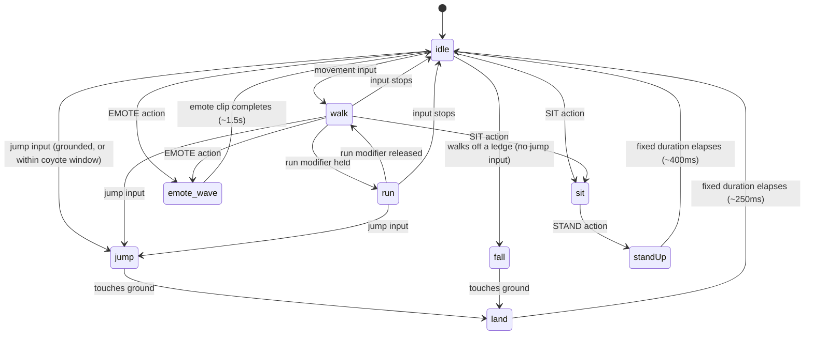

# SimOffice — Game Design Document (GDD)
## Pilot Edition

| | |
|---|---|
| **Document type** | Game Design Document — the 3D mechanics layer: character movement, camera, interaction systems, animation, multiplayer movement sync, and audio-cue behavior. Turns PRD§9's "bouncy, toy-like characters" and PRD§10.2's "walk up, prompt, interact, visible state change" into exact, buildable mechanics. |
| **Scope boundary** | This document owns **mechanics** — how things move, respond, and feel. It deliberately does **not** own room layouts, dimensions, prop placement, art direction, or asset lists — that's the Asset & World Design Document's job (not yet written). Where this document needs to reference a room or prop to explain a mechanic (e.g., "the desk" for the sit interaction), it treats that reference as a placeholder any room layout can satisfy, not a design decision about the room itself. |
| **Version** | 1.0 |
| **Status** | Ready to implement against for Phase 0. One section (§7) proposes a candidate resolution to PRD§9.6's still-open accessibility design spike — labeled as a candidate, not a substitute for that required review. |
| **Inputs** | PRD v3.1, SAD v1.3, TDD v1.0, UIUXD v2.1, DBD v1.1, API Specification v1.1 (Pilot Editions) |

---

## Table of Contents

1. [Purpose & Inputs](#1-purpose--inputs)
2. [Design Principles](#2-design-principles)
3. [Character Controller](#3-character-controller)
4. [Camera System](#4-camera-system)
5. [Interaction System](#5-interaction-system)
6. [Multiplayer Movement Sync](#6-multiplayer-movement-sync)
7. [Onboarding Course — A Candidate Accessibility-First Design](#7-onboarding-course--a-candidate-accessibility-first-design)
8. [Audio Cue Design](#8-audio-cue-design)
9. [Performance & Hardware Baseline Tie-In](#9-performance--hardware-baseline-tie-in)
10. [Progression Hooks (Phase 1+, Light Treatment)](#10-progression-hooks-phase-1-light-treatment)
11. [Validation Performed](#11-validation-performed)
12. [Open Items & Cross-Document Notes](#12-open-items--cross-document-notes)
13. [Traceability Matrix](#13-traceability-matrix)
14. [Sign-off Checklist](#14-sign-off-checklist)
15. [Glossary](#15-glossary)
16. [Changelog](#16-changelog)

---

## 1. Purpose & Inputs

PRD§9's Avatar system and §10.2's interactive-object loop describe *what* the game should feel like — toy-like, bouncy, socially visible, keyboard-accessible — without specifying the actual numbers, states, and algorithms that produce that feel. SAD v1.3 §12 established that a single input-mapping layer routes `move, jump, sit, interact, emote` from raw input to game action, and that `PlayerState` (§8.2) carries `x/y/z/animState/seated/deskId/connected` as server-synced schema — this document defines exactly what populates those fields and exactly what each named action does. TDD v1.0 owns implementation-level algorithm detail for everything *except* movement/animation, which it explicitly left as design-stage placeholders (`animState: string`, no movement physics) — this document fills that in, and TDD's next revision should narrow its types to match (§12).

---

## 2. Design Principles

Mechanics-level principles, distinct from UIUXD v2.1 §3's UI-behavior principles (P1–P8) — these govern *how things move and respond*, not *how screens are laid out*.

| # | Principle | Source | What it rules out |
|---|---|---|---|
| M1 | No mechanic anywhere a student is *required* to go may demand precision timing | PRD§9.6 | Frame-perfect jumps, narrow timing windows, anything gating required progress on reflexes |
| M2 | Physics reads as playful and forgiving, never punishing | PRD§9.1 ("bouncy, slightly exaggerated... comedic") | Realistic fall damage, hard failure states from movement, punishing collision response |
| M3 | Every socially-relevant state change is server-synced and visible to the whole room, not client-local | PRD§10.2 | An animation state (sitting, emoting) that only the acting player's own client knows about |
| M4 | Movement, camera, and interaction never block multiplayer awareness | UIUXD v2.1 P2 (extended to mechanics) | A "cutscene" camera lock, a movement freeze during a menu, anything that pulls a player out of the shared space |
| M5 | The client is trusted for movement and cosmetic state — never for anything graded | PRD§8.5, SAD§7.2 | Any temptation to route movement through the same tamper-resistant path verification results require; that path exists for a specific reason (§6 explains why movement doesn't need it) |
| M6 | Every mechanic must degrade gracefully on Chromebook-class hardware | PRD§16.2 | Physics or animation complexity that only reads as "smooth" on above-baseline machines, with no tiered fallback |

---

## 3. Character Controller

### 3.1 Movement

| Parameter | Value | Reasoning |
|---|---|---|
| Walk speed | 3.5 m/s | Baseline "crossing a room at a normal pace" speed — calibrated to room scale, not fixed further here since exact room dimensions are the Asset & World Design Document's call |
| Run speed | 6.0 m/s | Roughly 1.7x walk — fast enough to feel like a deliberate choice, not fast enough to blow past contextual prompts (§5.1) before they can appear |
| Run trigger | Held modifier key (Shift), not a toggle | A held key is simpler to reason about for a first-time player than a toggle with an implicit "am I running right now?" state; also trivially keyboard-native (M1) |
| Turn/strafe | Standard WASD-relative movement, camera-relative | Matches virtually every keyboard 3D movement convention a student is likely to already know from other games, minimizing onboarding friction |
| Jump | Fixed arc, ~1.1s total airtime, apex ~0.9m | Generous, not realistic — see §7 for the accessibility reasoning behind these specific numbers |
| Coyote time | 150ms grace window after leaving a ledge where a jump input still registers | Standard platformer-accessibility technique (M1) — a jump input that arrives just after the character has walked off an edge still succeeds, rather than requiring the input to land within the exact frame the character was still grounded |
| Jump input buffering | 150ms window before landing where a jump input is queued and fires on landing | Companion technique to coyote time — removes the need to time a jump input to the exact frame of landing |
| Step-up (auto-traversal) | Obstacles/ledges ≤ 0.4m are walked over automatically, no jump input needed | Directly implements PRD§9.3's "climb small steps, hop over low obstacles" as an *automatic* character-controller behavior, not a player-triggered action — removes an entire category of required-precision interaction (M1) by not requiring interaction at all for small height changes |

### 3.2 Physics & "bounciness"

PRD§9.1 asks for *"bouncy, slightly exaggerated physics: characters wobble on landing, squash-and-stretch when jumping, and can bump into each other... in a harmless, comedic way."* Implemented as animation-layer effects on top of a simple kinematic character controller (capsule collider, no full rigid-body simulation) — full physics simulation per character is unnecessary cost against M6's hardware constraint, and the visual "bounciness" PRD asks for is achievable more cheaply as scripted squash-and-stretch:

- **Jump squash-and-stretch:** a brief non-uniform scale animation (stretch vertically on launch, squash on landing) layered over the skeletal animation, not a physics-driven deformation — cheap on any hardware tier, and more art-directable than a simulated effect.
- **Landing wobble:** the brief `land` animation state (§3.3) plays a settle/wobble animation clip; its duration (§3.3) is what makes landing read as "having weight" without actually simulating weight.
- **Character-to-character collision:** a soft push-apart response (characters displace each other gently, never hard-stop or block each other's path) — collision *against the environment* (walls, props) is solid; collision *against other characters* is deliberately soft, which is both the "comedic bump" PRD asks for and a practical usability decision (a hard-blocking crowd of students around one desk would be actively bad UX in a classroom-sized room).

### 3.3 Animation state machine

Validated as real TypeScript (§11) — not just a diagram. `AnimState` is the concrete vocabulary `PlayerState.animState` (SAD§8.2, TDD§5) should hold; TDD v1.0 left this field as an untyped `string`, which this document now defines (see §12 for the follow-up needed in TDD).



*(`emote_wave` stands in for all four emote states — `emote_thumbsUp`, `emote_facepalm`, `emote_thinking` follow the identical entry/exit shape, omitted from the diagram for readability.)*

```typescript
export function nextAnimState(
  current: AnimState,
  input: MovementInput,
  physics: PhysicsState,
  action: ActionEvent | null,
): AnimState {
  // Explicit actions take priority over ambient movement — sitting down
  // interrupts a walk-cycle immediately, not after it finishes.
  if (action) {
    switch (action.type) {
      case 'SIT': return 'sit';
      case 'STAND': return 'standUp'; // caller advances standUp -> idle after its fixed duration
      case 'EMOTE':
        // Queuing is handled at the controller/input layer, not in the state machine.
        if (current.startsWith('emote_')) return current;
        return `emote_${action.emote}` as AnimState;
    }
  }

  // Held states aren't overridden by ambient movement input each tick — a
  // seated character doesn't fall back to 'idle' from a moment of residual
  // input buffering.
  if (current === 'sit' || current.startsWith('emote_') || current === 'land' || current === 'standUp') return current;

  // Jump inputs are consumed by the physics layer, which updates verticalVelocity before calling nextAnimState.
  if (!physics.grounded) return physics.verticalVelocity > 0 ? 'jump' : 'fall';

  const moving = input.moveVector.x !== 0 || input.moveVector.z !== 0;
  if (!moving) return 'idle';
  return input.runHeld ? 'run' : 'walk';
}
```

**Server-sync note (M3):** `animState` is computed client-side (movement is client-authoritative, §6) but broadcast as part of `PlayerState`'s synced schema — every other client sees the same state a moment later, which is what makes "teammates see the character seated, the monitor glowing" (PRD§10.2) actually true, not just true for the seated student's own screen.

---

## 4. Camera System

**Type:** Third-person spring-arm follow camera — the camera trails behind and above the character on a virtual arm that pulls in when it would clip through geometry, rather than clipping through walls or props.

| Parameter | Value | Reasoning |
|---|---|---|
| Follow distance | 4.5m default | Close enough to read facial/character detail and nearby contextual prompts, far enough to see teammates and room context around the player |
| Follow height offset | 2.0m above character root | Slight downward-looking angle — reads the floor/desks/props clearly without feeling like a drone shot |
| Camera collision | Spring-arm shortens on collision with static geometry, lerps back out once clear | Standard technique that prevents the single most common third-person-camera complaint (clipping through walls) without needing per-room camera volumes as a level-design dependency |
| Rotation control | Mouse-drag (click and drag) *or* dedicated keyboard keys (arrow keys, independent of WASD movement) | Two independent input paths to the same action, per SAD§12's input-mapping requirement — camera rotation is exactly the kind of action that's easy to accidentally wire mouse-only and then fail M1/keyboard-accessibility in review |
| Zoom | Fixed at Phase 0 (no player-adjustable zoom) | Not required by any PRD source; adding a player-adjustable zoom is a low-risk, low-priority addition, not a Phase 0 requirement — flagged as a nice-to-have, not built into the baseline spec |

### 4.1 Seated camera transition

When a character sits (`SIT` action, §3.3), the camera transitions from the free follow behavior to a fixed, closer angle framing the character and the in-world monitor together — this is what gives the workstation's DOM overlay (SAD§12's hybrid layer, UIUXD SCR-14) a stable visual anchor to align against; a freely-orbiting camera behind a fixed-position DOM overlay would visibly drift apart from the "monitor" it's supposed to represent. The transition itself is a short (~0.5s) eased camera move, not an instant cut — an instant cut would read as a scene change, which contradicts M4 (never pulling a player out of the shared space) more than a smooth transition does. Standing up (`STAND` action) reverses the same transition back to free follow.

### 4.2 Entry Camera Path (new in v1.1)

The building exterior scene (AWDD §4.0) uses a **scripted, non-interactive camera path** — distinct from the in-world follow camera of §4 in that the user does not control it. It fires once, on auth success, and transitions the user from the exterior environment into the Lobby.

**This camera is not the same system as the §4 follow camera** — it runs during the pre-auth phase (before a player character exists) and hands off to the §4 follow camera the moment the Lobby spawn completes.

| Parameter | Value | Reasoning |
|---|---|---|
| Start position | 15–20m in front of the entrance, eye level (~1.7m), facing the entrance | Frame width that makes the whole facade visible — SimOffice branding, entrance doors, access panel — without the building feeling distant |
| End position | 1–2m inside the entrance threshold, aligned with the Lobby spawn point (AWDD §4.1) | Seamless handoff: the fly-through ends exactly where the player character spawns, so the perspective doesn't jump |
| Travel axis | Straight Z-axis advance — directly toward and through the entrance | No lateral drift or arc; a straight-in approach reads clearly as "entering a building" without ambiguity |
| Duration | 2.0 seconds | Long enough to feel intentional and cinematic; short enough not to feel like a forced wait. Runs concurrently with post-auth world loading — it adds no measured latency to the join flow |
| Easing | Ease-in for the first 0.4s, linear through, slight ease-out for the last 0.3s | The ease-in is the "doors opening and beginning to walk" feel; the ease-out is "settling into the building"; pure linear feels mechanical for something designed as an arrival moment |
| Trigger | `Auth-success` signal from the access panel form (UIUXD SCR-00) | Fires immediately on auth success, not after a delay — the animation and post-auth loading begin simultaneously |
| Door state | Doors begin opening the instant the camera starts moving. `closed → opening → open` over 0.5s (AWDD §5.3) | Camera motion and door motion are synchronized by design — the doors open *because* the user is entering, not as a separate preceding event |
| Interrupt | Not interruptible — the 2s duration is too short for interruption to be meaningful | Consistent with M4: this camera is not "pulling the player out of shared space" because no shared space exists yet (they haven't spawned). This is the arrival; M4 governs the in-world camera after that. |
| Reduced-motion fallback | If `prefers-reduced-motion: reduce` or device is Tier 0 and sustaining <30fps at entry, the camera path is replaced with an instant cut: exterior → Lobby spawn position, doors jump to open state (PRD§10.4, PRD§16.5) | The fallback must not degrade the auth outcome, only the transition effect |

**Handoff to §4 follow camera:** At the moment the fly-through completes, the player character is spawned at the Lobby spawn point and the §4 spring-arm follow camera initializes at the fly-through's end position (facing the same direction). The player sees no positional jump. The two camera systems share a continuous viewpoint across the handoff — what was the fly-through's end position is the follow camera's initial position.

---

## 5. Interaction System

### 5.1 Generic interaction loop

Every interactive object (PRD§10.2) follows the same mechanical loop, matching UIUXD's SCR-09 component:

1. **Proximity check:** a fixed-radius trigger volume around each interactive object (baseline: 2.0m — a placeholder the Asset & World Design Document may adjust per object type, since a notice board's readable range and a desk's usable range aren't necessarily identical, but 2.0m is the sensible Phase 0 default for both).
2. **Prompt appears:** SCR-09's contextual prompt renders, keyboard-key label included (M1).
3. **Interact key pressed:** default binding `E` (also routed through the input-mapping layer per SAD§12, so any future control-remapping surface only has to touch one place).
4. **Object responds:** state change, server-synced, visible to the whole room (M3) — never a client-local-only effect.

### 5.2 Desk / workstation interaction

- **Sit:** interact while in range of an unoccupied desk → `SIT` action (§3.3) → seated camera transition (§4.1) → workstation overlay appears (UIUXD SCR-14).
- **Conflict resolution:** already fully specified as a server-side algorithm in TDD v1.0 §5 (`handleSitAtDesk` — synchronous check-then-set against an in-memory desk registry, "first valid call wins," deterministic because a Colyseus room's message handlers process one at a time). This document adds only the *feel* on top of that already-correct logic: the losing student's client receives the `DESK_OCCUPIED` rejection (API Spec v1.1 §13) and, rather than showing an error, plays a short redirect — the character's movement target automatically retargets toward the nearest free desk (`nearestFreeDeskId`, already returned by the existing algorithm) and the contextual prompt re-appears there. No new server logic is introduced here; this is purely the client-side response to an existing, already-validated contract.
- **Stand:** interact again (or a dedicated "stand" key, since a seated player's normal movement keys are otherwise idle) → `STAND` action → camera reverses (§4.1) → workstation overlay dismisses.

### 5.3 Notice board interaction

- **Passive/glance state:** legible from a distance (per PRD§10.2, no interaction required to notice new content — the chime + highlight flash, §8, functions independent of the interaction system).
- **Full-focus state:** interact within range → camera briefly frames the board (same eased-transition technique as §4.1, shorter distance) → full briefing text renders (UIUXD SCR-10) → interact again (or move away) exits.

### 5.4 Emote system

Four emotes (PRD§9.3: wave, thumbs up, facepalm, thinking) bound directly to number keys **1–4**, not a radial menu or multi-step selection — PRD's own framing (*"communicate quickly without breaking focus to type"*) argues directly against any interaction that takes more than one input to fire. Pressing a number key while any emote is already playing queues the new one to start as soon as the current clip's fixed duration (§3.3) elapses, rather than being dropped — a rapid double-press shouldn't silently do nothing.

### 5.5 Ping system

Aim (camera-forward raycast against the room's floor/props) + a dedicated ping key (default `Q`) drops a marker at the aimed location, visible to teammates for a bounded duration (**flagged as an open item in UIUXD v2.1 §13 item 3 — not fixed by PRD; this document proposes 8 seconds** as a starting default: long enough to be noticed and walked toward, short enough not to clutter the room with stale markers during a long session). Keyboard-only alternative: without precise mouse aim, the ping keybind targets the nearest interactive object or teammate in the character's forward view cone — a coarser but fully keyboard-operable fallback (M1), consistent with SAD§12's requirement that every pointer-reachable action have a keyboard-equivalent path, not merely a keyboard *binding* for the same precise-aim requirement.

---

## 6. Multiplayer Movement Sync

**Decision: movement is client-authoritative.** Each client simulates its own character's movement locally (using §3's controller) and periodically sends its position/animState to the server, which relays it to other clients in the room. Other clients do not simulate a remote player's physics at all — they only interpolate between received position snapshots (§11's validated `RemotePlayerInterpolator`).

**This is a deliberate contrast with §6's sibling decision in TDD v1.0** (verification results are server-computed and server-authoritative, never client-reported) — and the two decisions don't conflict, they apply to different things for a clear reason (M5): a verification result determines a graded, persisted outcome (PRD§8.5's tamper-resistance requirement exists specifically because something is being *graded*); a character's position on screen determines nothing gradable. There is no incentive for a student to falsify their own avatar's position, and the cost of building server-authoritative movement with reconciliation (the standard approach when a client *can't* be trusted) buys nothing here. This is stated explicitly so it's never mistaken for an inconsistency — the trust boundary is drawn around what's graded, not around "anything server-related."

| Parameter | Value | Reasoning |
|---|---|---|
| Position send rate | 15Hz (every ~67ms) | Frequent enough to interpolate smoothly at M6's 30fps floor target (§9), infrequent enough to keep bandwidth trivial at pilot concurrency ("a handful of teams," SAD§7.4) |
| Interpolation buffer | 100ms | Small, fixed extrapolation window (§11's validated interpolator) — trades a little positional accuracy for not visibly lagging a full network tick behind |
| animState sync | Sent alongside each position snapshot, not on a separate channel | One schema update per tick keeps this simple; animState changes (sit, emote) are infrequent enough relative to the 15Hz position rate that a dedicated lower-latency channel isn't warranted |

---

## 7. Onboarding Course — A Candidate Accessibility-First Design

PRD§9.6 states this explicitly as *"a design requirement, not yet a solved design"* and requires a dedicated accessibility spike before the onboarding course is considered final. This section proposes a candidate design for that spike to evaluate — **not a substitute for the spike itself.**

**The core proposal: every traversal challenge has an always-available bypass.** Rather than trying to tune every jump/obstacle to be individually keyboard-friendly enough to satisfy "no precision timing" (a moving target, hard to verify as actually solved), the course layout guarantees a walk-only path exists from start to finish that never requires a jump input at all — obstacles (small jumps, hops) sit alongside, not across, the guaranteed path, as optional flavor a confident player can take for fun without ever being required to. This directly satisfies PRD§9.6's exact wording — *"every path a student must take... must be completable via keyboard-only input without requiring precision timing"* — by construction: if a no-jump path always exists, the *required* path is definitionally the accessible one, and every jump becomes genuinely optional rather than a gate that merely needs to be "generous enough."

This is layered on top of, not instead of, §3.1's generous jump mechanics (coyote time, input buffering, auto-step) — those make the *optional* jump obstacles themselves keyboard-friendly for a player who chooses to attempt them, while the guaranteed bypass makes the *required* path accessible regardless of how well-tuned any individual jump turns out to be in practice.

**What this candidate design does not resolve, and the spike still needs to determine:** the exact obstacle layout and course geometry (Asset & World Design Document's job, once this document's bypass principle is accepted as a constraint on that layout); whether screen-reader or switch-access users need anything beyond keyboard operability (PRD§9.6 only specifies keyboard-only completion, not a broader assistive-technology audit); and real user testing with the actual target population, which no design document can substitute for.

---

## 8. Audio Cue Design

Every audio cue in Phase 0 pairs with a visual/in-world equivalent living **on the object itself**, per PRD§16.5's exact requirement (tightened in UIUXD v2.1 §10 item 2) — not a separate caption overlay.

| Cue | Trigger | Audio character | Visual/in-world equivalent |
|---|---|---|---|
| Notice board update chime | Teacher pushes an announcement (API§5.6) | Soft, single-note, non-alarming | The board's own highlight-flash + glow (PRD§10.2) — the object's state change *is* the equivalent, not an additional element |
| Verification pass confirmation | A `submit-verification` check returns `pass` (UIUXD SCR-21) | Short, upbeat, distinct from the notice-board chime | The relevant in-world prop settling/confirming (room-specific; Asset & World Design Document's call which prop) |
| Emote sound (optional, light) | An emote plays | Brief, character-appropriate (a "hmm" for thinking, etc.) | The emote's own animation is inherently visual — no separate cue needed beyond the sound itself being optional flavor, not conveying information the animation doesn't already convey |
| Entrance doors open | `Auth-success` signal (SCR-00); door-open animation begins (AWDD §5.3) | Soft, smooth pneumatic slide, ~0.5s. Non-alarming. (Asset spec: AWDD §7.) | The door visibly sliding open (AWDD §5.3's animation) — the audio is supplementary to the visual motion, per PRD§16.5 |
| Exterior ambient | SCR-00 `Idle` state; running continuously before any auth input | Very quiet background presence: distant HVAC hum, faint outdoor ambience. (Asset spec: AWDD §7.) | The exterior scene itself — the building, the light spill from interior, the ambient-life animations (AWDD §4.0) — is the continuous visual equivalent; audio provides an additional sensory layer, not information the scene lacks without it |

**A screen-wide attention-directing cue is proposed as an addition, not a substitute:** for a cue whose object isn't currently in the player's view (e.g., the notice board updates while a student is seated at a desk on the other side of the room), a subtle directional indicator (an edge-of-screen glow or arrow toward the object) draws attention toward it. This doesn't reproduce the requirement's "on the object, not a separate overlay" language — the actual caption-equivalent content still lives on the object when the player looks at it — it only solves the separate problem of *noticing* that something changed somewhere off-screen, which PRD§16.5 doesn't explicitly address either way. Flagged in §12 as worth confirming isn't over-scoping the requirement.

---

## 9. Performance & Hardware Baseline Tie-In

PRD§16.2 targets standard school-issued laptops and Chromebook-class devices as the *primary* hardware profile, not an edge case, with a 30fps floor hypothesis on baseline hardware and tiered visual settings as the mitigation for weaker devices. This document's mechanics are chosen consistent with that constraint (M6) — every decision in §3–§6 favors cheap, scripted, or interpolated effects over simulated ones specifically because of this target:

- Kinematic character controller, not rigid-body physics per character (§3.2).
- Scripted squash-and-stretch instead of simulated soft-body deformation (§3.2).
- A 15Hz network send rate (§6) rather than a higher rate that would cost more bandwidth for no perceptible smoothness gain once interpolation is in place.

**This document does not produce the actual measured minimum-spec numbers** — that's PRD§22 item 8's Device/Performance Baseline Test Plan & Report, a separate, still-blocking Phase 0 deliverable. This document's job is to make sure the mechanics it specifies are the kind of thing that *can* hit that target, not to run the test.

---

## 10. Progression Hooks (Phase 1+, Light Treatment)

PRD§18's XP/badges/cosmetic-unlock system is Phase 1+ almost entirely (UIUXD v2.1 §12 parks the corresponding screens). Noted here only for continuity, matching UIUXD's parking pattern:

- **Emote/animation system (§3.3) already generalizes** to future cosmetic unlocks without change — a new unlocked emote is a new `AnimState` value and a new keybind slot, not a redesign of the state machine.
- **`contribution_events`' existing `emote_used` event (DBD§9)** is already sufficient instrumentation for a future "best team communicator" badge (PRD§18) — no new tracking mechanism needed when that phase arrives.

---

## 11. Validation Performed

Two artifacts in this document were written as real, type-checked TypeScript (`strict: true`), not just prose/diagrams:

1. **The animation state machine (§3.3)** — `nextAnimState`, a pure function, checked for exhaustiveness against the full `AnimState`/`ActionEvent` union types. Confirms the state machine as specified has no unhandled case and no ambiguous transition.
2. **The remote-player interpolator (§6)** — `RemotePlayerInterpolator`, confirmed to type-check cleanly against the same `strict` configuration used for TDD v1.0's validation, for consistency of rigor across documents.

Both files are dependency-free (no engine-specific types), matching TDD v1.0's validation approach of checking logical correctness independent of the actual Babylon.js/Colyseus package types, which the real implementation will compile against directly.

---

## 12. Open Items & Cross-Document Notes

1. **TDD v1.0 §5's `PlayerState.animState` should be narrowed** from `string` to this document's `AnimState` union in TDD's next revision — a small, mechanical type-tightening, not a design change; given here so it isn't lost: `type AnimState = 'idle' | 'walk' | 'run' | 'jump' | 'fall' | 'land' | 'sit' | 'standUp' | 'emote_wave' | 'emote_thumbsUp' | 'emote_facepalm' | 'emote_thinking'`.
2. **Ping duration (§5.5, 8 seconds)** resolves UIUXD v2.1 §13 item 3, which flagged this as unfixed by any source document — stated here as this document's proposed default, not a value pulled from a PRD requirement, since none exists.
3. **The screen-wide attention-directing cue (§8)** is a proposed addition beyond what PRD§16.5 explicitly requires — worth a quick confirmation that it doesn't conflate two different needs (an equivalent for the cue's *content* vs. a way to *notice* it happened) in a way a stricter reading of the requirement wouldn't want.
4. **Camera zoom (§4)** is fixed at Phase 0, flagged as a plausible low-risk future addition rather than a gap — not blocking anything.
5. **§7's bypass-path proposal is a candidate for the required accessibility spike (PRD§9.6), not a resolution of it.** The spike remains a blocking Phase 0 deliverable regardless of how reasonable this document's proposal is.

---

## 13. Traceability Matrix

| Section | PRD / prior-doc source |
|---|---|
| §3.1 Movement | PRD§9.3 (walk/run/jump/traversal), §9.6 (accessibility constraints on the same) |
| §3.2 Physics | PRD§9.1 ("bouncy... comedic") |
| §3.3 Animation states | PRD§9.3, SAD§8.2 (`PlayerState.animState`), TDD v1.0 §5 (left undefined) |
| §4 Camera | SAD§12 (hybrid workstation overlay requires a stable camera anchor) |
| §5.1 Generic interaction loop | PRD§10.2 |
| §5.2 Desk interaction | PRD§10.2 (desk behavior), TDD v1.0 §5 (conflict-resolution algorithm, reused not redesigned) |
| §5.3 Notice board | PRD§10.2, §10.3 |
| §5.4 Emotes | PRD§9.3 |
| §5.5 Pings | PRD§12.6, resolving UIUXD v2.1 §13 item 3 |
| §6 Movement sync | SAD§8.2 (`PlayerState` schema), contrasted with SAD§7.2/TDD§6's trust-zone decisions |
| §7 Onboarding | PRD§9.4, §9.6 (candidate resolution) |
| §8 Audio | PRD§16.5, UIUXD v2.1 §10 item 2 |
| §9 Performance | PRD§16.2 |
| §10 Progression | PRD§18 |
| §4.2 Entry camera path | PRD§10.4, AWDD §4.0/§5.3, UIUXD SCR-00, TDD§9 (engine init phase), SAD§12 (pre-auth canvas) |

---

## 14. Sign-off Checklist

- [ ] §7's bypass-path proposal reviewed and either accepted, modified, or replaced by the required accessibility spike (PRD§9.6) — not skipped because this document proposed something reasonable-sounding.
- [ ] TDD v1.0's `PlayerState.animState` type updated per §12 item 1.
- [ ] Movement/camera numbers in §3–§4 treated as starting values to tune during implementation, not final commitments — consistent with how TDD v1.0 treated its own numeric defaults (retry backoff, debounce windows).
- [ ] §8's screen-wide attention cue proposal confirmed in scope (or explicitly cut) before implementation, per §12 item 3.
- [ ] Every mechanic in this document spot-checked on actual Chromebook-class hardware once available, ahead of or alongside the Device/Performance Baseline Test Plan (PRD§22 item 8).
- [ ] §4.2 entry camera path: confirm that fly-through end position aligns with Lobby spawn point (AWDD §4.1 spawn area note) so there is no position jump at the §4 follow-camera handoff.

---

## 15. Glossary

- **Coyote time** — a short grace window after a character leaves a ledge during which a jump input still registers, as if still grounded (§3.1).
- **Input buffering** — a short window before landing during which a jump input is queued rather than dropped, firing the instant the character lands (§3.1).
- **Client-authoritative movement** — a client's own position is treated as ground truth and relayed to others, contrasted with server-authoritative movement (not used here) where the server simulates and corrects the client (§6).
- **Spring-arm camera** — a follow camera on a virtual arm that shortens on collision with geometry to avoid clipping through walls (§4).

---

## 16. Changelog

**v1.0 — first version.** Establishes the character controller, camera, interaction, and multiplayer movement-sync mechanics for Phase 0, validates the animation state machine and remote-player interpolation as real TypeScript, and proposes (without finalizing) a bypass-path candidate design for PRD§9.6's still-open accessibility spike. Flags one small follow-up for TDD v1.0 (§12 item 1) and resolves one open item from UIUXD v2.1 (§13 item 3, ping duration).

**v1.1 — entry camera path (new §4.2, extended §8, §13, §14, §16).** Adds the scripted entry camera fly-through (PRD v3.2 §10.4, AWDD v1.1 §4.0). Key changes: §4.2 specifies the pre-auth camera as a 2-second, non-interactive, straight-Z-axis advance from 15–20m in front of the entrance to the Lobby spawn point, with easing profile, door synchronization timing, reduced-motion fallback, and a clean handoff protocol to the §4 follow camera; §8 audio table extended with entrance-doors-open and exterior-ambient cues (asset specs delegated to AWDD §7); §13 traceability extended with §4.2 row; §14 sign-off checklist extended with fly-through/spawn-alignment verification item.
