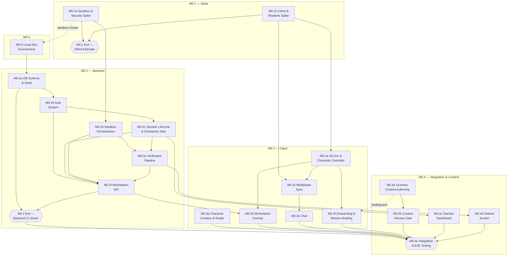

# SimOffice — Phase 0 Milestone Breakdown v1.2

> **Status:** Draft · **Edition:** Pilot (Single-College Phase 0) · **Solo build**
> **Supersedes:** Roadmap v1.1
> **Unchanged from Roadmap v1.0:** §3.3 (risk register), M0.5–M0.7 (see §10 below for why)
> **Last updated:** 2026-08-05

---

## 0. What changed and why

Roadmap v1.0's Phase 0 milestones bundled unrelated units of work under single gates — M0.2 "Backend Core" put the highest-risk item in the whole project (sandbox orchestration, an external-system integration with no doc pointer) in the same bucket as cron jobs. M0.3 "Client Core" put backend-adjacent networking code next to pure animation work. Both had one acceptance table and no stated in-scope/out-of-scope boundary, so "done" was ambiguous until every row in an 8-row table was checked.

This document fixes that by splitting each fat milestone into one milestone per coherent unit of work. Rules followed throughout:

- **No spec re-transcription.** This document decomposes and sequences; it does not restate the actual interface/field/state detail from SAD, TDD, DBD, API Spec, GDD, or SSD. Each milestone gets a **Doc pointer**, not a copy. That detail gets pulled fresh, one milestone at a time, when you actually run the meta-prompt from the Execution Kit.
- **Gaps are flagged, not filled.** Roadmap v1.0 didn't cite a section for every deliverable. Where it didn't, this document says so explicitly instead of inventing a plausible-sounding pointer. See §9.
- **Acceptance criteria are quoted verbatim** from Roadmap v1.0 — same words, just attached to a narrower milestone.
- **Sequencing assumes one person**, not parallel work streams. §2–§3 give a dependency graph and a suggested build order instead of the original's "streams that don't fully parallelize" framing.
- **One real bug in the original surfaced by this exercise:** the Docker Compose stack was deliverable #7 of M0.4 — i.e., scheduled near the *end* of Phase 0. That means all of M0.2/M0.3 would've been built without a reproducible local environment. It's been pulled out to a new **M0.0**, built first.

---

## 1. Numbering key

| Pattern | Meaning |
|---|---|
| `M0.0` | New pre-milestone, not in Roadmap v1.0 |
| `M0.Xa`, `M0.Xb`, … | Sub-milestone split out of original `M0.X`, letter suffix added. Parent number kept for traceability back to Roadmap v1.0. |
| `{Gate}` | A go/no-go checkpoint, not a build deliverable — nothing to implement, only to verify |

---

## 2. Revised dependency graph — Phase 0

---

## 3. Suggested solo build order

Not strict serial execution — M0.4a (content) runs in the background from day one, and a few tracks can interleave when you want a change of pace from whatever's blocking.

1. **M0.0** — Local dev environment (Postgres/Valkey/nginx/app-server skeleton first; add the sandbox-orchestrator service once M0.1a picks a provider)
2. **M0.1a** and **M0.1b** — interleave freely, independent domains. Start **M0.4a** (content authoring) in the background any time from here.
3. **M0.1 Exit** gate
4. **M0.2a → M0.2b → M0.2c** (DB → Auth → Session, strictly sequential)
5. **M0.2d** (Sandbox Orchestration) — can actually start right after M0.1a, in parallel with 4. It's the highest-risk backend item; don't leave it for last.
6. **M0.2e → M0.2f**
7. **M0.2 Exit** gate
8. **M0.3a** — can start as early as step 2 (right after M0.1b), in parallel with the whole M0.2 track, if you want to context-switch between backend and client across days
9. **M0.3b, M0.3c, M0.3d, M0.3e** — d needs M0.2f done first
10. **M0.3f** — needs M0.4a's briefing text ready
11. **M0.4b** (Content Review) — whenever M0.4a wraps
12. **M0.4c, M0.4d**
13. **M0.4e** — Integration & E2E Testing, the real "Phase 0 engineering complete" gate
14. → Roadmap v1.0 M0.5 (Pre-Pilot Readiness), unchanged

---

## 4. M0.0 — Local Development Environment *(new)*

#### M0.0 — Docker Compose Stack

- **Purpose:** A reproducible local environment so M0.2/M0.3 aren't built against an ad hoc, manually-run setup.
- **In scope:** nginx, app-server, postgres, valkey, sandbox-orchestrator services; `docker compose up` starts all cleanly.
- **Out of scope:** TLS/certificates (that's Roadmap v1.0 M0.5 item 4, pilot-domain-specific); production/managed hosting (Phase 1+ per TSSD graduation triggers).
- **Depends on:** Nothing, for postgres/valkey/nginx/app-server skeleton — start immediately. The sandbox-orchestrator service definition specifically depends on **M0.1a** (which provider — E2B or gVisor — gets chosen).
- **Doc pointer:** SAD §5 (verbatim from Roadmap v1.0 M0.4 item 7 — this deliverable moved here, pointer unchanged).
- **Acceptance criterion (verbatim, Roadmap v1.0 M0.4 item 7):** "nginx + app-server + postgres + valkey + sandbox-orchestrator all start cleanly (SAD §5)"

---

## 5. M0.1 — Architecture Spike

#### M0.1a — Sandbox & Security Spike

- **Purpose:** Resolve the sandbox-technology unknown before any backend engineering commits to an interface built around it.
- **In scope:** Sandbox PoC, trust-zone PoC, egress control confirmation — all three test the same subsystem (the sandbox) and share a pass/fail outcome (which provider, if either, is viable).
- **Out of scope:** Building the actual `SandboxProvider` interface used by the app (that's M0.2d) — this is feasibility only, throwaway code is fine.
- **Depends on:** Nothing. Can run on a throwaway test VPS, doesn't need M0.0.
- **Doc pointer:** Trust-zone PoC → SSD §14.1 PoC #1. Egress control → SSD §15 item 1. Sandbox PoC → SAD v1.3 §7.1.
- **Acceptance criteria:**
  - "E2B or gVisor sandbox provisions, runs student code, enforces resource ceilings, tears down — on a test VPS matching the pilot target (SAD v1.3 §7.1)"
  - "Verification harness injected via injection-over-mount; student code cannot read/write/delete the harness (SSD §14.1 PoC #1)"
  - "E2B free-tier egress restriction validated, OR gVisor confirmed as default (SSD §15 item 1)"

#### M0.1b — Client & Realtime Spike

- **Purpose:** Resolve the Babylon.js performance unknown and the Colyseus sync unknown before client engineering commits.
- **In scope:** Babylon.js scene PoC, Colyseus room PoC — both are quick feasibility checks on developer hardware, no production code.
- **Out of scope:** The actual character controller and multiplayer sync features (M0.3a, M0.3c) — this is "does the tech work at all," not "is it built."
- **Depends on:** Nothing.
- **Doc pointer:** Environment → GDD v1.0 §4, AWDD v1.0 §3. Controller → GDD v1.0 §3. Multiplayer sync → GDD v1.0 §3.4.
- **Acceptance criteria:**
  - "Basic office room, character controller, camera — renders at ≥30 FPS on developer hardware (GDD v1.0 §3, GDD v1.0 §4, AWDD v1.0 §3)"
  - "Two browser tabs join the same room; avatar movement syncs in real time (GDD v1.0 §3.4)"

#### {M0.1 Exit} — Revised Effort Estimate

- **Purpose:** Go/no-go gate for the rest of Phase 0.
- **Depends on:** M0.1a and M0.1b both complete.
- **Gate condition (verbatim, Roadmap v1.0 M0.1):** "Proceed to M0.2 only if all PoC items pass. If the sandbox PoC fails to meet isolation requirements, re-evaluate sandbox technology before proceeding."
- **Acceptance criterion (verbatim, item 6):** "Phase 0 schedule firmed based on spike outcomes (PRD §22 item 10)"

---

## 6. M0.2 — Backend Core

#### M0.2a — Database Schema & Seed

- **Purpose:** Foundational — almost every other backend milestone reads/writes these tables.
- **In scope:** Full DDL applied, seed data, views, retention functions.
- **Out of scope:** Any application logic that uses the schema (that's every other M0.2 sub-milestone).
- **Depends on:** M0.0 (Postgres running).
- **Doc pointer:** DBD §6, §8, §10.
- **Acceptance criterion (verbatim, item 7):** "Full DDL applied, seed data loaded, views and retention functions working (DBD §6, §8, §10)"

#### M0.2b — Auth System & Roster Management

- **Purpose:** Everything else in the backend sits behind this, and handles student identity creation/persistence.
- **In scope:** Teacher login, student join-code flow, JWT issuance, guard enforcement, character appearance persistence.
- **Out of scope:** Session creation itself (M0.2c) — auth issues the token; session lifecycle consumes it.
- **Depends on:** M0.2a.
- **Doc pointer:** Auth & Guards → TDD v1.0 §8. Character appearance endpoint → API Spec v1.1 §11.1.
- **Acceptance criteria:** 
  - "Teacher login + student join-code flow; JWT issuance and guard enforcement (TDD v1.0 §8)"
  - "Character appearance update endpoint implemented (API Spec v1.1 §11.1)"

#### M0.2c — Session Lifecycle & Scheduled Jobs

- **Purpose:** The core session state machine, plus the two cron jobs that are really just edge-transitions of that same state machine (retention sweep, abandoned-session handling) — kept together because they're the same domain logic, not because they're mechanically similar.
- **In scope:** `create → start → provision → active → end → teardown` state machine; retention sweep and abandoned-session cron jobs.
- **Out of scope:** Anything that *calls into* the sandbox during `provision`/`active` (that's M0.2d/e) — this milestone owns the state machine, not what happens inside each state.
- **Depends on:** M0.2a, M0.2b.
- **Doc pointer:** State machine → API Spec §5. Scheduled jobs → TDD §7.
- **Acceptance criteria (verbatim, items 1 & 6):**
  - "create → start → provision → active → end → teardown state machine works end-to-end (API Spec §5)"
  - "Retention sweep and abandoned-session cron jobs implemented (TDD §7)"

#### M0.2d — Sandbox Orchestration

- **Purpose:** The single highest-risk deliverable in Phase 0 (external-system integration, per the original risk register) — isolated into its own milestone instead of sitting alongside cron jobs.
- **In scope:** `SandboxProvider` interface for the chosen provider — `provision()`, `readFile()`, `writeFile()`, `runCheck()`, `runVerification()`, `teardown()`.
- **Out of scope:** The verification-outcome logic that consumes `runVerification()`'s result (M0.2e); any HTTP-layer exposure of these methods (M0.2f).
- **Depends on:** M0.1a (provider choice). Not dependent on M0.2a–c — can be built in parallel with the DB/auth/session track.
- **Doc pointer:** SAD v1.3 §7.1.
- **Acceptance criterion:** "SandboxProvider interface implemented for chosen provider; provision(), readFile(), writeFile(), runCheck(), runVerification(), teardown() all functional (SAD v1.3 §7.1)"

#### M0.2e — Verification Pipeline

- **Purpose:** Turns raw sandbox check results into a session outcome.
- **In scope:** `submitVerification()` — runs checks sequentially, derives outcome, broadcasts results.
- **Out of scope:** The sandbox calls themselves (M0.2d); the HTTP endpoint that triggers this (M0.2f).
- **Depends on:** M0.2c (session context), M0.2d (sandbox calls to run).
- **Doc pointer:** TDD §3.4.
- **Acceptance criterion (verbatim, item 4):** "submitVerification() runs checks sequentially, derives outcome, broadcasts results (TDD §3.4)"

#### M0.2f — Workstation API

- **Purpose:** The HTTP surface the client actually talks to — the integration point for everything else in M0.2.
- **In scope:** File read/write/run-check/submit-verification endpoints, working against a real sandbox (not mocked).
- **Out of scope:** The client UI that calls these endpoints (M0.3d).
- **Depends on:** M0.2b, M0.2c, M0.2d, M0.2e — this is the last backend sub-milestone by design.
- **Doc pointer:** API Spec §7.
- **Acceptance criterion (verbatim, item 5):** "File read/write/run-check/submit-verification endpoints working against a real sandbox (API Spec §7)"

#### {M0.2 Exit} — Backend CI Green

- **Purpose:** Consolidated gate — was item 8 in the original flat table, reframed here as what it actually is: a gate on M0.2a–f, not a parallel deliverable.
- **Depends on:** M0.2a through M0.2f all complete.
- **Acceptance criterion (verbatim, item 8):** "All §4–§6 tests from TP v1.0 passing in CI"

---

## 7. M0.3 — Client Core

#### M0.3a — 3D Environment & Character Controller

- **Purpose:** Kept together deliberately — a controller is untestable without a scene to move through, and a scene is unverifiable as "navigable" without a controller.
- **In scope:** Single Backend department room with workstation desks; walk/run/jump/sit with animation state machine.
- **Out of scope:** Multiplayer (other avatars) — that's M0.3c; this is single-player scene + controller only.
- **Depends on:** M0.1b.
- **Doc pointer:** Environment → GDD §4, AWDD §3. Controller → GDD §3.
- **Acceptance criteria (verbatim, items 2 & 3):**
  - "Single Backend department room with workstation desks, navigable (GDD §4, AWDD §3)"
  - "Walk/run/jump/sit with animation state machine (GDD §3)"

#### M0.3b — Character Creation & Roster

- **Purpose:** The appearance-selection flow and its persistence.
- **In scope:** Appearance selection UI; storage on the roster entry.
- **Out of scope:** The roster display itself (that's part of M0.4c, Teacher Dashboard).
- **Depends on:** A roster-write backend endpoint implemented in M0.2b.
- **Doc pointer:** API Spec v1.1 §11.1.
- **Acceptance criterion:** "Appearance selection flow → stored on roster entry via PATCH endpoint (API Spec v1.1 §11.1)"

#### M0.3c — Multiplayer Sync

- **Purpose:** Other players become visible and move.
- **In scope:** Colyseus room integration on top of the M0.3a controller.
- **Out of scope:** Chat (M0.3e), which depends on this but isn't part of it.
- **Depends on:** M0.1b, M0.3a.
- **Doc pointer:** GDD §3.4.
- **Acceptance criterion (verbatim, item 4):** "Colyseus room integration — other players' avatars visible and moving (GDD §3.4)"

#### M0.3d — Workstation Overlay

- **Purpose:** The diegetic code editor — file tree, editor, run/submit — wired to real backend calls.
- **In scope:** Overlay opens on sit; functional file tree, editor, run/submit buttons.
- **Out of scope:** The verification-result display logic beyond pass/fail (debrief detail is M0.4d).
- **Depends on:** M0.2f (the endpoints it calls), M0.3a (the "sit" trigger).
- **Doc pointer:** Layout → UIUXD v2.1 SCR-14. Overlay architecture → SAD v1.3 §12.
- **Acceptance criterion:** "Diegetic code editor opens on sit as HTML overlay; file tree, editor, run/submit buttons functional (UIUXD v2.1 SCR-14, SAD v1.3 §12)"

#### M0.3e — Chat

- **Purpose:** Standalone feature, small enough to isolate cleanly.
- **In scope:** Text chat, proximity or department-wide.
- **Out of scope:** Cross-department "huddle" tools — that's Phase 2 (M2.3 in the original Roadmap).
- **Depends on:** M0.3c (room infrastructure).
- **Doc pointer:** PRD §12.6.
- **Acceptance criterion (verbatim, item 6):** "Text chat (proximity or department-wide) operational (PRD §12.6)"

#### M0.3f — Onboarding & Mission Briefing

- **Purpose:** Two minimal, low-complexity UI features grouped because both are simple, content-driven, and naturally come last — after the systems they introduce already work.
- **In scope:** "First day" tutorial corridor teaching move/jump/sit/interact; minimal HUD/notice-board briefing display.
- **Out of scope:** The actual briefing text content — that's authored in M0.4a, this milestone just renders it.
- **Depends on:** M0.3a (what the tutorial teaches), M0.4a (briefing text to display).
- **Doc pointer:** Tutorial → PRD §9.4. Briefing → PRD §12.7.
- **Acceptance criteria (verbatim, items 7 & 8):**
  - "Minimal 'first day' corridor teaching move/jump/sit/interact (PRD §9.4)"
  - "Minimal display (HUD overlay or simplified notice board) showing briefing text (PRD §12.7)"

> **Note:** M0.3 has no exit gate of its own. Its outputs are gated together with M0.2's at **M0.4e** — the original M0.4 already required 2+ simultaneous students end-to-end, which necessarily exercises both tracks at once.

---

## 8. M0.4 — Integration & Content

#### M0.4a — Scenario Content Authoring

- **Purpose:** A genuinely separate work stream from engineering — different discipline, no code dependency. Runs from day one, in the background.
- **In scope:** 1 scenario, 1 variant, Beginner, Backend, logic bug — broken codebase, fix baseline, verification checks, briefing text. Must adhere to prompt library constraints and use synthetic code.
- **Out of scope:** The review process itself (M0.4b).
- **Depends on:** Nothing.
- **Doc pointer:** Scenario requirements → PRD §11.5.4. Compliance & Content Liability → Compliance Spec v1.0 §3. Prompts → AI_AGENT_PROMPT_LIBRARY.md §2.
- **Acceptance criteria:** 
  - "1 scenario, 1 variant, Beginner, Backend, logic bug — broken codebase + fix baseline + verification checks + briefing text (PRD §11.5.4)"
  - "Scenario uses no real-world company names, individuals, or copyrighted code (Compliance Spec v1.0 §3)"

#### M0.4b — Content Review Gate

- **Purpose:** Correctness + pedagogical sign-off, plus legal/content-liability review before the scenario is used anywhere else.
- **Depends on:** M0.4a.
- **Doc pointer:** PRD §11.5.2, PRD §19.
- **Acceptance criteria:**
  - "Scenario passes both correctness and pedagogical review gate (PRD §11.5.2)"
  - "Scenario passes content-liability/legal review for malicious-script or security content (PRD §19)"

#### M0.4c — Teacher Dashboard

- **Purpose:** Minimal roster/status visibility for the teacher.
- **In scope:** Who's joined, who's seated, who's submitted.
- **Out of scope:** Debrief content (M0.4d); spectator mode (Phase 2).
- **Depends on:** M0.2c (session/roster status).
- **Doc pointer:** PRD §12.10 (minimal).
- **Acceptance criterion (verbatim, item 5):** "Simple roster/status list — who's joined, who's seated, who's submitted (PRD §12.10 minimal)"

#### M0.4d — Debrief Screen

- **Purpose:** Closes the loop on a session's outcome, resolved or not.
- **In scope:** Team summary, per-student contribution, both resolved and unresolved outcomes.
- **Depends on:** M0.2e (verification outcome data).
- **Doc pointer:** PRD §12.11, §13.3.
- **Acceptance criterion (verbatim, item 6):** "Team summary + student contribution for both resolved and unresolved outcomes (PRD §12.11, §13.3)"

#### {M0.4e} — Integration & E2E Testing

- **Purpose:** The real "Phase 0 engineering complete" gate — everything else in Phase 0 has to exist first.
- **In scope:** Full happy-path journey with 2+ simultaneous students; failure/edge paths (late join, disconnect/reconnect, desk conflict, unresolved debrief, session timeout).
- **Depends on:** M0.2 Exit, all of M0.3, M0.4a–d.
- **Doc pointer:** TP v1.0 §8.1 (happy path), §8.2 (edge paths).
- **Acceptance criteria (verbatim, items 3 & 4):**
  - "TP v1.0 §8.1 full journey passes with 2+ simultaneous students"
  - "Late join, disconnect/reconnect, desk conflict, unresolved debrief, session timeout — all pass (TP v1.0 §8.2)"

---

## 9. Doc-pointer gaps (Resolved in v1.2)

Roadmap v1.1 identified five doc-pointer gaps. As of v1.2, all gaps have been resolved against the v2.x/v3.x specifications and incorporated directly into the milestones above:

- **M0.1a (Sandbox PoC):** Resolved to `SAD v1.3 §7.1`.
- **M0.1b (Client & Realtime Spike):** Resolved to `GDD v1.0 §3`, `GDD v1.0 §3.4`, `GDD v1.0 §4`, and `AWDD v1.0 §3`.
- **M0.2d (Sandbox Orchestration):** Resolved to `SAD v1.3 §7.1`.
- **M0.3b (Character Creation & Roster):** Backend dependency resolved by adding `PATCH /roster-entries/{rosterEntryId}/character` to M0.2b; client doc pointer resolved to `API Spec v1.1 §11.1`.
- **M0.3d (Workstation Overlay):** Resolved to `UIUXD v2.1 SCR-14` and `SAD v1.3 §12`.

---

## 10. Why M0.5–M0.7 are unchanged

These are checklists and evaluation gates, not build work — each item (security PoC pass/fail, device baseline measurement, TLS config, compliance sign-off, session data collection, exit-criteria scoring) already has an independent, self-contained pass condition. None of them hides a disproportionate-complexity item the way "sandbox orchestration next to cron jobs" did in the original M0.2. Splitting them wouldn't reduce ambiguity — it would just add IDs. Left as-is in Roadmap v1.0.

---

## 11. Document History

| Version | Date | Changes |
|---|---|---|
| v1.2 | 2026-08-05 | Resolved all Phase 0 doc-pointer gaps identified in v1.1 using the latest v2.x/v3.x specifications. Integrated new Compliance Spec v1.0 requirements into M0.4 content authoring milestones. |
| v1.1 | 2026-08-04 | Split Roadmap v1.0's M0.1–M0.4 (11 bundled deliverables across 4 milestones) into 21 scoped sub-milestones + 3 exit gates + 1 new pre-milestone (M0.0), each with explicit in/out scope, dependencies, and doc pointer. Flagged 5 missing doc-pointer gaps instead of inventing them. Replaced parallel-team work-stream framing with a solo build order. |