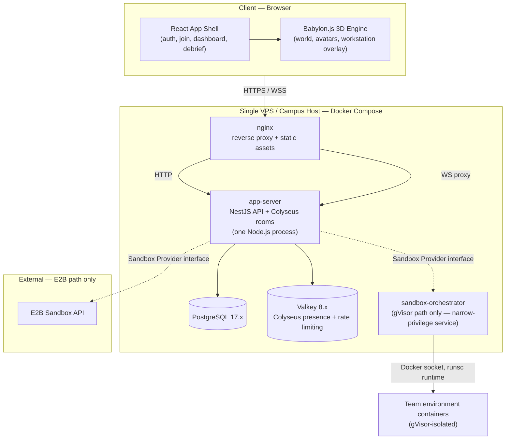
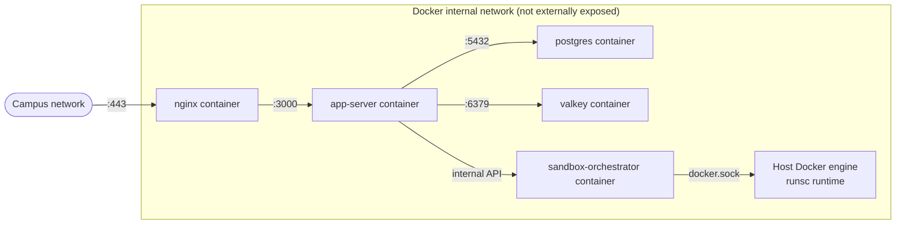
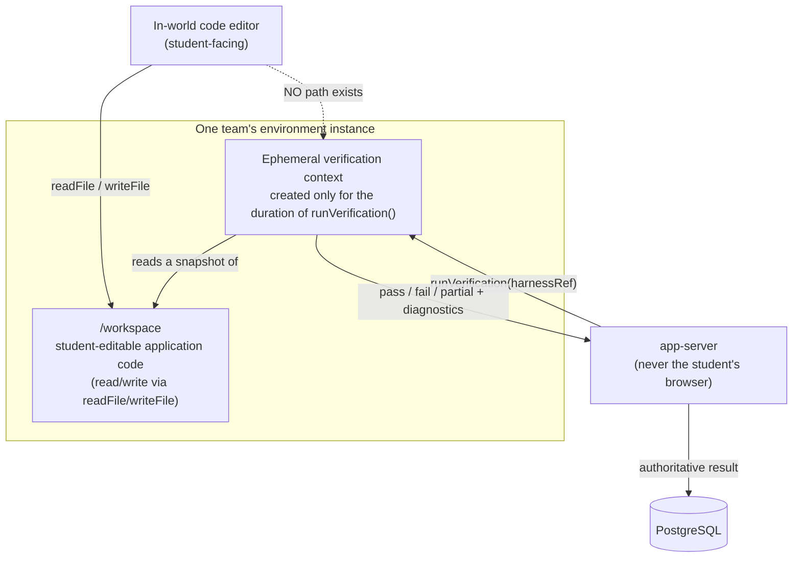
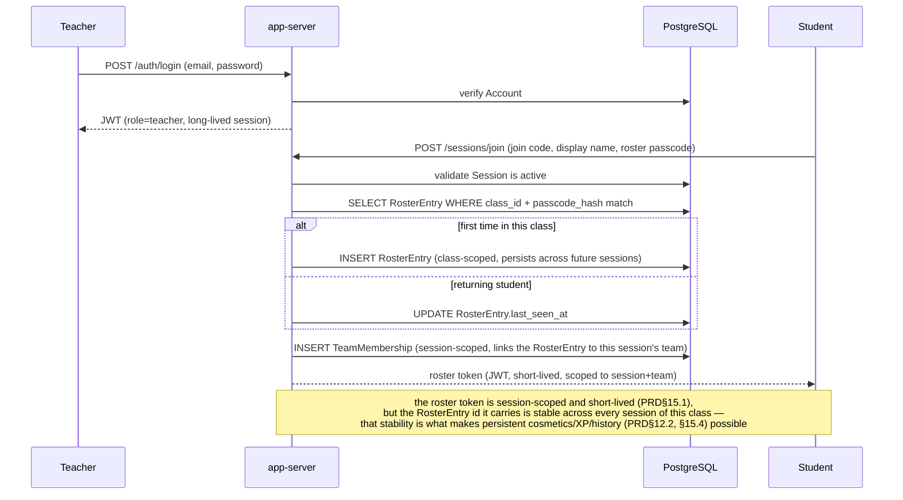
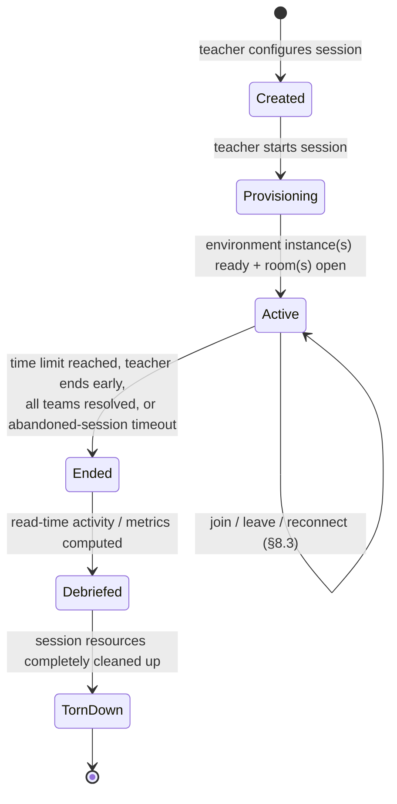
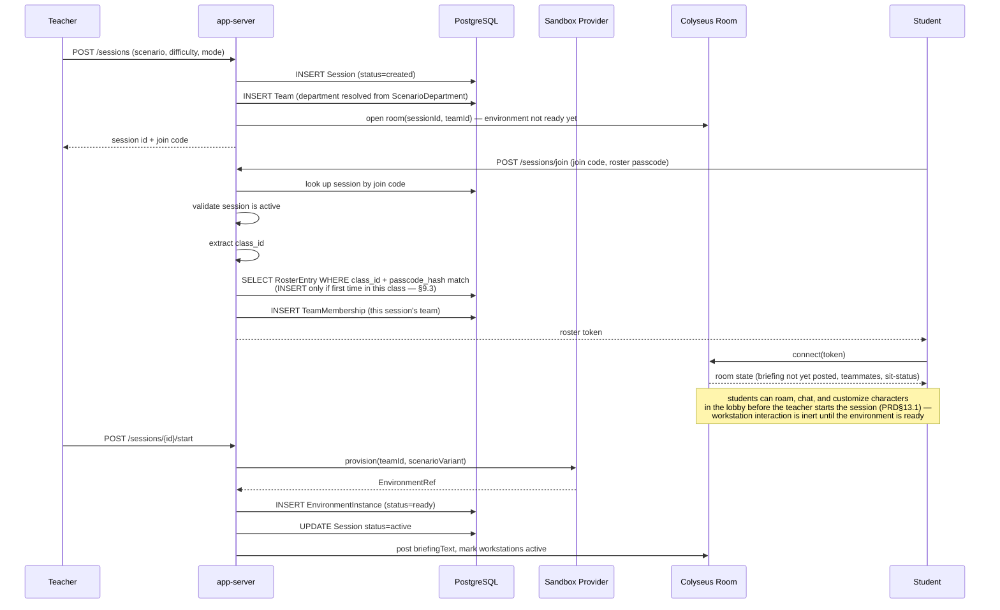
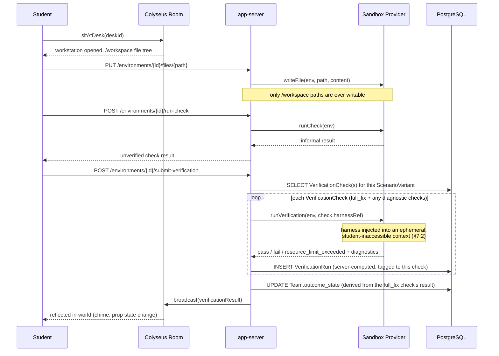
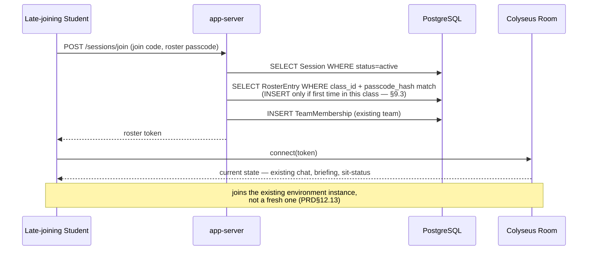
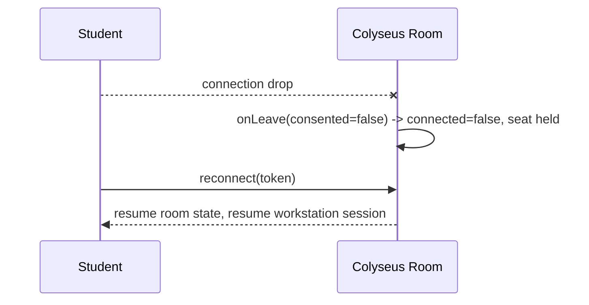
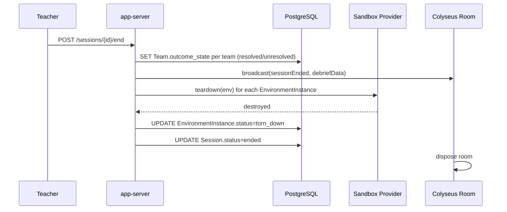

# SimOffice — System Architecture Document (SAD)
## Pilot / Demo Edition

| | |
|---|---|
| **Document type** | System Architecture Document — defines component topology, data model, service boundaries, and sequence flows. Does not re-derive requirements (PRD v3.1) or re-decide technology (TSSD v2.1, Pilot Edition) — both are fixed inputs here. |
| **Scope** | Architecture for the single-college pilot/demo deployment defined in TSSD v2.1 (Pilot Edition), implementing PRD v3.1 §5.1's Phase 0 MVP. |
| **Relationship to a future production architecture** | Not a separate document yet. Every section below flags, inline, exactly where the design would split differently at TSSD v1.0's multi-institution scale (look for **"Production seam"** callouts) — so scaling up is an extension of this document, not a replacement for it. |
| **Version** | 1.3 |
| **Status** | Ready to implement against. |

> **What changed in v1.3 (full changelog in [Section 23](#23-changelog-v12--v13)):** one correction, surfaced while writing the API Specification (v1.0) — §11.1's sequence diagram created `Team` and opened the Colyseus room at session *start*, but PRD§13.1's teacher journey requires students to be present in a lobby, customizing characters, before the teacher starts the session. `Team` creation and room opening now happen at session *creation* (§8.1, §11.1); only environment provisioning — the expensive part — stays at `start`. Also resolves Open Item 8 from §19 (roster-entry recognition UX), which the API Specification closed concretely.
>
> **What changed in v1.2 (full changelog in [Section 22](#22-changelog-v11--v12)):** four corrections surfaced while turning this document's §6 data-architecture sketch into the actual Database Design Document (DBD v1.0) — §6's ERD is rebuilt around a persistent, class-scoped `RosterEntry` instead of one created fresh per session-join (§6.1, §9.3, §11.1, §11.3); `Scenario` and `ScenarioVariant` are split into a proper one-to-many relationship instead of one flattened entity (§6.1); verification checks are now first-class rows instead of a flat result field, so partial credit and Phase 2's layered "found N of M" don't require a later breaking change (§6.1, §11.2); and the session-lifecycle state machine (§10) no longer has a session-level "Resolved" state that conflates with the per-team outcome multi-team sessions actually need (PRD§13.3/§13.5). This document's own data-architecture section was the one place SAD v1.1 got ahead of PRD v3.1's actual requirements — see the DBD for the full reasoning behind each fix.
>
> **What changed in v1.1 (full changelog in [Section 21](#21-changelog-v10--v11)):** corrected an overstated fault-isolation claim in §14 and added the process-supervision mechanism it was missing; added a resource-ceiling design (§7.4, new) implementing PRD§8.6; and closed an open question in §19 on whether E2B's free tier actually satisfies PRD§8.1's egress requirement.

---

## Table of Contents

1. [Purpose & Inputs](#1-purpose--inputs)
2. [Architecture Goals & Constraints](#2-architecture-goals--constraints)
3. [High-Level Component Diagram](#3-high-level-component-diagram)
4. [Component Responsibility Matrix](#4-component-responsibility-matrix)
5. [Deployment Topology](#5-deployment-topology)
6. [Data Architecture](#6-data-architecture)
7. [Trust-Zone & Sandbox Architecture](#7-trust-zone--sandbox-architecture)
8. [Real-Time Multiplayer Architecture](#8-real-time-multiplayer-architecture)
9. [API Architecture](#9-api-architecture)
10. [Session Lifecycle State Machine](#10-session-lifecycle-state-machine)
11. [Key Sequence Diagrams](#11-key-sequence-diagrams)
12. [Frontend Architecture](#12-frontend-architecture)
13. [Security Architecture](#13-security-architecture)
14. [Error Handling & Resilience Patterns](#14-error-handling--resilience-patterns)
15. [Observability Architecture](#15-observability-architecture)
16. [NFR-to-Mechanism Traceability](#16-nfr-to-mechanism-traceability)
17. [Scalability Seams — Where Production Diverges](#17-scalability-seams--where-production-diverges)
18. [Repository Structure](#18-repository-structure)
19. [Open Architecture Decisions & Risks](#19-open-architecture-decisions--risks)
20. [Glossary](#20-glossary)
21. [Changelog v1.0 → v1.1](#21-changelog-v10--v11)
22. [Changelog v1.1 → v1.2](#22-changelog-v11--v12)
23. [Changelog v1.2 → v1.3](#23-changelog-v12--v13)

---

## 1. Purpose & Inputs

This document answers "how are the pieces arranged, and how do they talk to each other?" — the question neither the PRD (what's required) nor the TSSD (what it's built with) answers. Two documents are fixed inputs and are not re-litigated here:

- **PRD v3.1** — every requirement referenced below is tagged `PRD§x.x`.
- **TSSD v2.1 (Pilot Edition)** — every technology named below (Babylon.js, React, Colyseus, NestJS, PostgreSQL, Valkey, E2B/gVisor, self-rolled auth, single VPS/Docker Compose, nginx, Sentry) is a fixed selection, not a decision point.

Where this document makes a design choice the PRD/TSSD didn't already force (e.g., "should the API and the multiplayer server be one process or two?"), that choice is stated explicitly with its reasoning, not left implicit.

**Note on §6 (Data Architecture):** the entity model in §6 is now a summary consistent with the **Database Design Document (DBD) v1.1**, which is the authoritative source for the full schema (DDL, constraints, indexes, retention logic, and the reasoning behind each entity). Where v1.1 of this document sketched the data model ahead of that downstream deliverable existing, four corrections surfaced once it was built out and tested — see the v1.2 changelog (§22) and the DBD's own §3 for the full reasoning. §6 below reflects the corrected model; treat the DBD as the deeper reference for anything §6 doesn't spell out.

**Note on §9/§11 (API Architecture, Sequence Diagrams):** full request/response contracts now live in the **API Specification v1.1**, which is the authoritative source for endpoint-level detail — §9's resource-group table and §11's sequence diagrams remain accurate at the level they operate (which components call which, in what order) but are intentionally not as granular as that document. Building the API Specification surfaced one gap in §11.1's sequencing, fixed in v1.3 — see §23.

---

## 2. Architecture Goals & Constraints

| Goal/constraint | Source | Architectural consequence |
|---|---|---|
| Single VPS or on-campus host, near-zero cost | TSSD v2.1 §5.1, §7 | Favor a small number of coarse-grained services over a microservice sprawl; Docker Compose, not Kubernetes |
| One provisioned, isolated environment per team; no path to real systems | PRD§8.1, §16.4 | A dedicated Sandbox Provider abstraction, isolated at the OS/kernel level regardless of which concrete provider (E2B or self-hosted gVisor) is active |
| Verification check in a protected, student-unwritable, server-computed trust zone | PRD§8.5 | The verification harness is never part of the student-writable filesystem view; it is injected transiently by the backend at check-run time (§7.2) |
| Real-time multiplayer sync, late join, disconnect/reconnect, desk conflicts | PRD§12.2, §12.13 | Colyseus room-per-team model with native reconnection, used as designed rather than replaced with custom logic |
| No popup-style UI; everything in-world | PRD§16.1 | A "diegetic overlay" frontend pattern (§12) rather than modal dialogs, even where the underlying implementation is ordinary HTML |
| Keyboard-only full functionality | PRD§9.6, §16.5 | An input-mapping abstraction layer between raw input events and in-game actions |
| Minimal personal data; no third-party IdP for students | PRD§15.1, §16.6 | Two distinct identity paths: a real `Account` for teachers, a lightweight, credential-free `RosterEntry` (persistent per class, PRD§15.2/§15.4) accessed via a short-lived session token for students — never merged |
| Session-integrity teardown; abandoned-session cleanup | PRD§16.4, §12.13 | Explicit teardown step is a first-class part of the session lifecycle state machine (§10), not a side effect |
| Per-environment resource ceiling; one team's runaway code can't degrade another's session or the platform (new in v1.1) | PRD§8.6 | `ResourceLimits` on every provisioned environment (§7.4), enforced by the container/sandbox runtime, independent of provider |

---

## 3. High-Level Component Diagram



**Key architectural decision (not forced by TSSD, made here):** the REST API and the Colyseus multiplayer server run as **one Node.js process** (`app-server`), not two. Colyseus attaches its WebSocket handling to the same HTTP server NestJS uses. This is the right call *specifically at pilot scale* — one container is less to operate on a single VPS, and Colyseus's own guidance supports attaching to an existing HTTP server. **Production seam:** at TSSD v1.0 scale, this splits into two independently-scalable services (a stateless API tier behind a load balancer, and a Colyseus tier scaled via its own horizontal-scaling story backed by Valkey) — nothing here is designed in a way that would prevent that split later, since the two responsibilities are already organized into separate NestJS modules internally (§4).

---

## 4. Component Responsibility Matrix

| Component | Responsibility | Does *not* do |
|---|---|---|
| **nginx** | TLS termination, reverse-proxy HTTP/WS traffic to `app-server`, serve the built React/Babylon.js static bundle | Business logic, session state |
| **app-server (NestJS side)** | Auth, session/class/roster CRUD, content-library access, verification-result persistence, teacher dashboard read APIs | Real-time presence/state sync, code execution |
| **app-server (Colyseus side)** | Room-per-team real-time state (who's seated, chat, ping events, live briefing pushes), reconnection handling | Persisting long-term records (delegates to Postgres via the NestJS side), running student code |
| **Sandbox Provider (interface)** | Single abstraction with two implementations (`E2BProvider`, `GVisorProvider`); provisions/tears down environment instances, reads/writes `/workspace` files, runs informal checks, runs the protected verification harness | Deciding *when* to provision/verify — that's orchestrated by `app-server` |
| **sandbox-orchestrator** (gVisor path only) | The *only* component with Docker socket access; exposes a narrow internal API (`create`, `writeFile`, `runCheck`, `runVerification`, `destroy`) to `app-server` over the internal Docker network | Anything beyond container lifecycle — no business logic, no direct external exposure |
| **PostgreSQL** | System of record: accounts, classes, rosters, sessions, teams, environment-instance metadata, verification runs, contribution events, content-library records | Real-time fan-out (that's Colyseus/Valkey's job) |
| **Valkey** | Colyseus presence/pub-sub backing, auth rate-limiting counters | Durable data (nothing here is the only copy of anything important) |

---

## 5. Deployment Topology



Only **port 443 on `nginx`** is exposed to the campus network. Every other container — including the sandbox-orchestrator, which is the one component with host-level Docker socket access — sits on an internal Docker Compose network with no external port mapping. This is the concrete implementation of the "narrow-privilege service" design named in TSSD v2.1 §5.3: even if `app-server` were compromised via some unrelated vulnerability, it only has the orchestrator's narrow internal API surface, never direct Docker socket access itself.

**Volumes:** `postgres-data`, `valkey-data` (named Docker volumes, backed up via the `pg_dump` habit established in TSSD v2.1 §5.2), plus a `content-library` bind mount for scenario repositories (PRD§11.5).

**Production seam:** this single-host topology becomes a Kubernetes topology (TSSD v1.0 §14) with the app-server tier and Colyseus tier as separate Deployments, a managed Postgres/Valkey, and the sandbox-orchestrator's responsibility absorbed into a dedicated GKE Sandbox node pool — the internal-API boundary between `app-server` and the orchestrator is exactly the seam that split becomes.

---

## 6. Data Architecture

### 6.1 Entity-Relationship Diagram

**Corrected in v1.2** — see §22 for what changed and why; full DDL, constraints, and indexes live in DBD v1.1, not here.

```mermaid
erDiagram
    ACCOUNT ||--o{ CLASS : owns
    CLASS ||--o{ ROSTER_ENTRY : contains
    CLASS ||--o{ SESSION : has
    SESSION }o--|| SCENARIO_VARIANT : uses
    SESSION ||--o{ TEAM : contains
    TEAM ||--o{ TEAM_MEMBERSHIP : has
    ROSTER_ENTRY ||--o{ TEAM_MEMBERSHIP : joins
    TEAM ||--|| ENVIRONMENT_INSTANCE : provisions
    TEAM ||--o{ VERIFICATION_RUN : submits
    ROSTER_ENTRY ||--o{ VERIFICATION_RUN : triggers
    ROSTER_ENTRY ||--o{ CONTRIBUTION_EVENT : generates
    SESSION ||--o{ CONTRIBUTION_EVENT : scopes
    TEAM ||--o{ CONTRIBUTION_EVENT : scopes
    SCENARIO ||--o{ SCENARIO_VARIANT : has
    SCENARIO ||--o{ SCENARIO_DEPARTMENT : targets
    SCENARIO_VARIANT ||--o{ VERIFICATION_CHECK : ships_with
    VERIFICATION_CHECK ||--o{ VERIFICATION_RUN : grades

    ACCOUNT {
        uuid id PK
        string role
        string email
        string password_hash
        timestamp created_at
        timestamp deactivated_at
    }
    CLASS {
        uuid id PK
        uuid teacher_account_id FK
        string name
        timestamp created_at
    }
    ROSTER_ENTRY {
        uuid id PK
        uuid class_id FK
        string display_name
        string roster_passcode_hash
        json appearance
        boolean is_anonymized
        timestamp created_at
    }
    SESSION {
        uuid id PK
        uuid class_id FK
        uuid scenario_variant_id FK
        string join_code
        string department_mode
        string status
        string end_reason
        int time_limit_minutes
        timestamp started_at
        timestamp ended_at
    }
    TEAM {
        uuid id PK
        uuid session_id FK
        uuid department_id FK
        string label
        string outcome_state
    }
    TEAM_MEMBERSHIP {
        uuid id PK
        uuid team_id FK
        uuid roster_entry_id FK
        timestamp joined_at
        timestamp left_at
    }
    ENVIRONMENT_INSTANCE {
        uuid id PK
        uuid team_id FK
        string sandbox_provider
        string provider_ref
        string status
        json resource_limits
        timestamp created_at
        timestamp torn_down_at
    }
    VERIFICATION_CHECK {
        uuid id PK
        uuid scenario_variant_id FK
        string check_type
        string check_key
        int issue_ordinal
        string harness_ref
    }
    VERIFICATION_RUN {
        uuid id PK
        uuid team_id FK
        uuid verification_check_id FK
        uuid triggered_by_roster_entry_id FK
        string result
        json diagnostic_details
        timestamp ran_at
    }
    CONTRIBUTION_EVENT {
        uuid id PK
        uuid session_id FK
        uuid team_id FK
        uuid roster_entry_id FK
        string event_type
        json metadata
        timestamp occurred_at
    }
    SCENARIO {
        uuid id PK
        string title
        string domain
        string departmental_shape
        string fix_baseline_repo_ref
    }
    SCENARIO_VARIANT {
        uuid id PK
        uuid scenario_id FK
        string difficulty
        string category
        string briefing_text
        string issue_repo_ref
        timestamp created_at
    }
    DEPARTMENT {
        uuid id PK
        string code
        string name
    }
    SCENARIO_DEPARTMENT {
        uuid scenario_id FK
        uuid department_id FK
    }
```

### 6.2 Design notes tying entities back to PRD requirements

- **`ACCOUNT` vs `ROSTER_ENTRY` is a deliberate split, not an oversight.** Only teachers get an `ACCOUNT` row (real credentials, PRD§11.1). Students get a `ROSTER_ENTRY` scoped to a class, with no login credential of their own — directly implementing PRD§15.1's "lightweight, roster-based identity rather than broad personal data collection."
- **`ROSTER_ENTRY` is created once per class, not once per session (corrected in v1.2).** PRD§15.2/§15.4 and §12.2 require identity, cosmetics, XP, and session history to persist across every session of a class — a "return for a second session" metric (PRD§17) is meaningless otherwise. `ROSTER_ENTRY` rows are looked up (via the lightweight `roster_passcode_hash`, PRD§15.1's "code-based lightweight accounts" option) the first time a student is recognized in a class, and reused on every subsequent session of that class. The session-scoped join code (still auto-generated per session, PRD§12.1) governs *which live run a student enters*; it does not govern *who they are* — that's the class-scoped `ROSTER_ENTRY`. §9.3, §11.1, and §11.3 below reflect this.
- **`ROSTER_ENTRY.appearance` (added in v1.3)** stores PRD§12.2/§9.2's character-appearance customization (color scheme, accessories) as opaque JSON, persisted on the same class-scoped row as everything else about a student's identity, per PRD§15.4. The *catalog* of valid appearance values is a frontend/content concern, not modeled here — see API Specification v1.1 §11.1.
- **`SCENARIO` vs `SCENARIO_VARIANT` is a deliberate split (corrected in v1.2).** PRD§8.1/§12.4 are explicit that one authored codebase supports multiple difficulty tiers and multiple planted defects. `SCENARIO` holds the codebase-level facts (title, domain, fix baseline, departmental shape); `SCENARIO_VARIANT` holds one specific planted defect (difficulty, category, briefing text). `SCENARIO_DEPARTMENT` is the many-to-many junction implementing "target department(s)" (PRD§11.5.1) — a specialist scenario has one row here, a full-stack scenario has more than one.
- **`VERIFICATION_CHECK` is now a first-class entity (corrected in v1.2).** A flat result field on `VERIFICATION_RUN` can't represent PRD§8.3's partial credit ("did the team correctly identify which file/function") or Phase 2's layered "found 2 of 3" — both need a per-check result, not a per-team one. Each `SCENARIO_VARIANT` ships one `full_fix` check and zero-or-more `diagnostic` checks; `VERIFICATION_RUN` now references the specific check it graded, and `issue_ordinal` is reserved (unused at Phase 0) for Phase 2's one-check-per-injected-issue requirement.
- **`CONTRIBUTION_EVENT` is the generic event log** that implements PRD§12.9's measurement mechanism: every edit, chat message, ping, and verification trigger writes one of these rows, tagged to the `roster_entry_id` that caused it (and, since v1.2, also to `team_id` directly, avoiding a join through `TEAM_MEMBERSHIP` for the debrief's primary read pattern). The debrief screen (§13.3 in the PRD) reads and aggregates this table rather than relying on self-reported contribution.
- **`sessions` implements the "no repeat incident" requirement** (PRD§11.5.3) — before assigning a scenario variant to a new session, the API queries `sessions` by `class_id` and `scenario_variant_id` for prior use against the same class. (Note: `scenario_usage_log` is deprecated per DBD v1.1 §16 item 6).
- **`ENVIRONMENT_INSTANCE.status`** tracks the lifecycle (`provisioning` → `ready` → `error` → `torn_down`) that the session-end sequence (§11.6) is responsible for driving to completion — an environment instance left in any state other than `torn_down` after a session ends is a session-integrity bug (PRD§16.4), not an acceptable end state.

### 6.3 Retention & deletion (PRD§15.5)

At pilot scale, retention is a scheduled job (not a managed data-lifecycle policy): a nightly script marks `CONTRIBUTION_EVENT` rows older than the configured retention window for anonymization (null out `roster_entry_id`, keep aggregate counts) rather than hard-deleting them outright, preserving team-level debrief history without retaining individual attribution indefinitely. A student/guardian deletion request anonymizes the `ROSTER_ENTRY` row itself in place (display name replaced, passcode invalidated) and nulls the same attribution fields on `CONTRIBUTION_EVENT`/`VERIFICATION_RUN` — the row is never hard-deleted, and `TEAM_MEMBERSHIP` is left untouched, since "was on this team" carries no PII once the display name is anonymized and removing it would corrupt other students' shared team history. See DBD v1.1 §8 for the exact, tested SQL implementing both mechanisms.

---

## 7. Trust-Zone & Sandbox Architecture

This is the most safety-critical part of the system — it directly implements PRD§8.5, added specifically because verification tampering is "a predictable classroom behavior, not a hypothetical one."

### 7.1 The Sandbox Provider interface

```typescript
interface ResourceLimits {           // new in v1.1 — implements PRD§8.6
  cpuCores: number;                  // e.g. 1
  memoryMb: number;                  // e.g. 512
  wallClockTimeoutMs: number;        // applies per runCheck/runVerification call
}

interface SandboxProvider {
  provision(teamId: string, scenarioVariant: ScenarioVariant, limits: ResourceLimits): Promise<EnvironmentRef>;
  readFile(env: EnvironmentRef, path: string): Promise<string>;
  writeFile(env: EnvironmentRef, path: string, content: string): Promise<void>;
  runCheck(env: EnvironmentRef): Promise<CheckResult>;               // informal, student-triggerable; ceiling-enforced
  runVerification(env: EnvironmentRef, harnessRef: string): Promise<VerificationResult>; // protected; ceiling-enforced
  teardown(env: EnvironmentRef): Promise<void>;
}
```

Two concrete implementations exist behind this interface — `E2BProvider` and `GVisorProvider` (TSSD v2.1 §5.3) — and **every other component in the system talks only to this interface**, never to E2B's SDK or Docker directly. This is what makes the E2B-vs-self-hosted choice a hosting decision rather than an application-rewrite decision, and it's the same abstraction TSSD v1.0 §10 flagged as a required PoC/design item. **`ResourceLimits` is new in v1.1**, added because the interface previously described isolation (no path *out*) without describing capacity ceilings (no starving the host from *within*) — see §7.4.

### 7.2 The trust-zone separation itself



**The design principle is "injection over mount," not "read-only mount."** The verification harness is never copied into `/workspace` at all — the student's code-editing API (`readFile`/`writeFile`) has no path that resolves to it, so there is nothing to discover, read, or delete even by a motivated student, rather than relying on file permissions to block tampering after the fact. The harness is injected by `app-server` (never by anything the student's browser can trigger directly) into a short-lived, separate execution context at verification time, run against a snapshot of the current `/workspace` state, and destroyed afterward. **The result written to PostgreSQL is the only value the frontend ever displays** — the client never reports its own "I passed" claim, satisfying PRD§8.5's "not trusted from a client-reported result" requirement exactly.

### 7.3 Two concrete realizations of the same trust zone

| | `E2BProvider` | `GVisorProvider` |
|---|---|---|
| `/workspace` | E2B sandbox filesystem, exposed via SDK file operations | A bind-mounted volume inside a `runsc`-runtime container |
| Ephemeral verification context | A separate E2B sandbox session, or a scoped exec call within a fresh sandbox instance, never sharing a handle with the student's editing session | A short-lived second container (or a `docker exec` into an isolated namespace) launched by `sandbox-orchestrator`, with the harness copied in immediately before the run and the container destroyed immediately after |
| Privilege boundary | Enforced by E2B's own Firecracker isolation + SDK session scoping | Enforced by `runsc` kernel-level isolation + `sandbox-orchestrator` being the only component with Docker socket access (§5) |
| Resource ceiling (new in v1.1) | Set via the E2B SDK's sandbox resource configuration at `provision()` time (vCPU/RAM per sandbox, plus an application-level wall-clock timeout wrapped around each `runCheck`/`runVerification` call, since E2B's own session-length cap is coarser than the per-check ceiling this needs) | Set as Docker resource constraints (`--cpus`, `--memory`) passed by `sandbox-orchestrator` at container-create time, with the wall-clock ceiling enforced the same way — a timeout wrapped around the `docker exec`/`runCheck` call that kills and reports rather than hangs |

### 7.4 Resource ceilings — implementing PRD§8.6 (new in v1.1)

The trust-zone design in §7.1–§7.3 answers "can a team's environment reach or tamper with something it shouldn't." It does not answer "can a team's environment *starve* something it shouldn't" — and at pilot scale (TSSD v2.1 §5.1), every team's environment, the `app-server` process, PostgreSQL, and Valkey all run on the same single VPS. A runaway loop or accidental fork bomb in student code — an expected occurrence in a debugging exercise, not an edge case — competing unbounded for CPU/memory on that host would degrade the session for every other team and the platform itself, independent of whether the network/filesystem isolation in §7.1 is working perfectly.

- **Enforcement point:** resource limits are set at `provision()` time (see the `ResourceLimits` type in §7.1) and are the same regardless of which provider is active — this is a property of the Sandbox Provider interface, not something either implementation can opt out of.
- **Starting pilot-scale defaults (to be tuned against the actual VPS spec chosen in TSSD v2.1 §5.1, not treated as final):** 1 vCPU / 512MB per team environment; a 30-second wall-clock ceiling on `runCheck` and `runVerification` calls specifically, separate from and shorter than the environment's overall session-length lifetime.
- **On ceiling breach:** the specific call is terminated and reported to the student as a distinct, visible outcome (PRD§8.6) — surfaced through the same `environmentError` room broadcast pattern used for other Sandbox Provider failures (§14) — not a silent hang and not conflated with "the check legitimately failed."
- **What this does not require:** a general-purpose multi-tenant resource scheduler. At pilot concurrency (up to 50 concurrent sessions with 20 teams each, per PRD§16.3), static per-environment caps enforced by the container runtime (or E2B's own sandbox configuration) are sufficient; dynamic bin-packing/quota management is a TSSD v1.0-scale (Kubernetes resource quotas) concern, flagged as a Production seam.

---

## 8. Real-Time Multiplayer Architecture

**PRD requirements:** §12.2 (live sync), §9.3 (proximity interactions), §10.2 (shared object state), §12.13 (resilience).

### 8.1 Room-to-team mapping

One Colyseus room instance = one team's live session state. This is a direct, intentional mirror of PRD§8.1's "one provisioned environment instance per team" — the room and the sandbox environment are two separate objects (one real-time state, one code-execution sandbox), keyed by the same `team_id`, but **their lifecycles are no longer identical (corrected in v1.3 — see §22).** The room opens as soon as the `Team` row exists, at session creation, so students can be present in a lobby (moving, chatting, customizing characters) before the teacher starts the session, per PRD§13.1; the sandbox environment is provisioned only at session start, since it's the expensive part. Both are torn down together at session end (§11.5) — only their *opening* is staggered, not their teardown.

### 8.2 Room state schema (representative, not exhaustive)

```typescript
class TeamRoomState extends Schema {
  @type({ map: PlayerState }) players = new MapSchema<PlayerState>();
  @type("string") briefingText: string;
  @type("string") outcomeState: string; // "in_progress" | "resolved" | "unresolved"
  @type("string") environmentId: string; // synced to clients upon successful environment provisioning
  @type([ChatMessage]) chatLog = new ArraySchema<ChatMessage>();
}

class PlayerState extends Schema {
  @type("string") rosterEntryId: string;
  @type("number") x: number;
  @type("number") y: number;
  @type("number") z: number;
  @type("string") animState: string;   // idle, walk, jump, sit, emote
  @type("boolean") seated: boolean;
  @type("string") deskId: string;
  @type("boolean") connected: boolean; // false = "stepped away", not removed
}
```

### 8.3 Resilience handling (PRD§12.13)

- **Desk conflict:** `sitAtDesk(deskId)` is a server-authoritative room method — the first valid call wins; a second student's call against an already-occupied `deskId` is rejected with an immediate response the client uses to redirect toward the nearest free desk (implements the deterministic conflict rule from PRD§10.2).
- **Disconnect/reconnect:** Colyseus 0.17's native `onLeave(consented: boolean)` distinguishes an intentional leave from a dropped connection; on an unintentional drop, `PlayerState.connected` flips to `false` (character shown as "stepped away," desk *not* freed) rather than removing the player, and the client's automatic reconnection flow resumes the same room session on reconnect.
- **Late join:** joining after session start attaches to the *existing* room (and the existing environment instance, §7) rather than spinning up a fresh one — see the sequence in §11.4.
- **Abandoned session:** a scheduled check (cron-style, run from within `app-server` at pilot scale) flags sessions with no room activity and no teacher action past a configured inactivity window, driving them through the same end-of-session teardown path as an explicit end (§11.6).

---

## 9. API Architecture

Full request/response schemas are a follow-on API Specification deliverable (as PRD§22 already anticipated); this section fixes the resource boundaries and auth model an architecture document is responsible for.

### 9.1 REST resource groups

| Resource group | Representative endpoints | Auth required |
|---|---|---|
| Auth | `POST /auth/login` (teacher), `POST /sessions/join` (student, join-code based) | — |
| Classes & Roster | `POST /classes`, `GET /classes/{id}/roster` | Teacher JWT |
| Sessions | `POST /sessions`, `POST /sessions/{id}/start`, `POST /sessions/{id}/end`, `GET /sessions/{id}/status` | Teacher JWT |
| Environments | `GET /environments/{id}/files`, `GET /environments/{id}/files/{path}`, `PUT /environments/{id}/files/{path}`, `POST /environments/{id}/run-check`, `POST /environments/{id}/submit-verification` | Student roster token, scoped to their own team's environment only |
| Content Library | `GET /scenarios`, `GET /scenarios/{id}` | Teacher JWT |
| Dashboard | `GET /sessions/{id}/dashboard` (roster/status list, PRD§12.10) | Teacher JWT |
| Debrief | `GET /sessions/{id}/debrief` | Teacher JWT + student roster token (own session only) |

### 9.2 WebSocket protocol

Colyseus's own room-join and schema-sync protocol is used as-is (join with `{ roomId, token }`, receive schema patches per §8.2) — no custom WebSocket protocol is built alongside it.

### 9.3 Auth flow

**Corrected in v1.2** — see §22. The previous version of this diagram inserted a fresh `RosterEntry` on every session join, which cannot support PRD§15.2/§15.4's requirement that a student's identity, cosmetics, XP, and session history persist across every session of their class. `RosterEntry` is now looked up (or created, if this is the student's first time in this class) by class + passcode, and reused across sessions; only a `TeamMembership` row is created fresh per session.



Both token types are standard signed JWTs validated by `app-server`; there is no external identity provider in the pilot topology (TSSD v2.1 §5.4) — this is a deliberate simplification, not a placeholder for a missing integration. The exact student-facing UX for "prove you're the same Rahul as last week" (re-enter a passcode, pick your name from a teacher-visible roster, etc.) is left to the API Specification/UI-UX documents (PRD§22 items 4/6) — this diagram fixes only the data-model consequence: one persistent `RosterEntry` per student per class.

**Pre-auth note (new in v1.4):** The form through which the teacher submits `POST /auth/login` and the student submits `POST /sessions/join` is not a conventional web form — it is the access panel in the building exterior scene (PRD§10.4, UIUXD SCR-00), floating as a DOM overlay over the Babylon.js entry canvas. The API contract for these two endpoints is unchanged by this redesign; only the client-side surface that collects and submits the credentials differs.

---

## 10. Session Lifecycle State Machine

**Corrected in v1.2** — see §22. The v1.1 version of this machine had a session-level `Resolved` state ("Active → Resolved: full verification passes"), which only makes sense in Phase 0's single-team-per-session case. PRD§12.3/§13.3 track outcome **per team**, and PRD§13.5's early-end journey requires a session to end with *some* teams resolved and others not — a session-level "Resolved" state can't represent that. This machine now tracks session **lifecycle mechanics only**; per-team pedagogical outcome is a separate, orthogonal state on each `Team` (`in_progress` / `resolved` / `unresolved`), unaffected by which path the session itself took to `Ended`.



`Session.end_reason` (`time_limit_reached` | `teacher_ended_early` | `all_teams_resolved` | `abandoned_timeout`) records *why* the session ended, set once at the `Active → Ended` transition. It answers "why did this run stop," not "did the team succeed" — that's `Team.outcome_state`, tracked independently per team so a multi-team session (Phase 1+) can have some teams resolved and others unresolved at the same moment the session itself ends (exactly PRD§13.5's required journey). The debrief and torn_down states are explicitly represented in the `sessions.status` enum (DBD v1.1 §6). Every path still reaches teardown — `EnvironmentInstance.status` handles its own lifecycle (`provisioning` → `ready` → `error` → `torn_down`) when the session ends, which is the architectural guarantee behind PRD§16.4's session-integrity requirement.

---

## 11. Key Sequence Diagrams

### 11.1 Session creation & join

**Pre-auth note (new in v1.4):** Before Step 1 below (the teacher's `POST /auth/login`), the Babylon.js entry scene is already running on the client (TDD§9.1, `initEntryScene()`). The sequence below begins at the point of first API contact; the client-side experience that precedes it — the building exterior, the scripted camera, the access panel form — is fully governed by TDD§9.1 and GDD§4.2. No backend action occurs before the form is submitted.



### 11.2 Workstation interaction and verification (the trust-zone-critical flow)



**Corrected in v1.2:** the previous version of this flow recorded one flat pass/fail per submission with no reference to *which* check produced it, which can't support PRD§8.3's partial credit (a diagnostic check can pass independently of the full-fix check) or Phase 2's layered-incident debrief ("found 2 of 3"). Each `VerificationRun` row is now tagged to a specific `VerificationCheck`; `Team.outcome_state` is derived specifically from the `full_fix`-type check's result, not from an undifferentiated "verification result."

### 11.3 Late join



### 11.4 Disconnect / reconnect



### 11.5 Session end / early end / teardown



---

## 12. Frontend Architecture

The client is split into three layers that compose, not three separate apps:

- **`[3D/Entry]` Babylon.js entry scene** *(new in v1.4, PRD§10.4)* — rendered immediately on page load, before any authentication. The Babylon.js engine starts on a full-viewport canvas at this phase and renders the building exterior. The React App Shell's access panel form floats over this canvas as a DOM overlay. This phase ends when the entry camera fly-through completes (GDD§4.2) and the player character spawns. Full design: TDD v1.2 §9.1.
- **React App Shell** — everything PRD§16.1's "no popup UI" rule doesn't govern, because it happens *before* a student is inside the 3D world: the access panel form (teacher login / student join-by-code), character creation form, the teacher's roster/status dashboard (PRD§12.10), and the post-session debrief screen.
- **Babylon.js 3D Engine** — the engine that started as the `[3D/Entry]` layer is **not re-created** when a session becomes active; it is promoted from entry-scene mode to in-world mode by `initGameWorld()` (TDD§9.1). The world-state (avatar movement/physics, all in-world object interactions per PRD§10.2) is added to the existing engine instance, not a new one. This is architecturally significant: there is only one Babylon.js engine lifecycle from page load to session end.

**The workstation code editor is the one place the Shell and 3D Engine layers deliberately blur, on purpose.** PRD§8.2 requires the code editor to feel like "the in-world monitor," not a separate tab — architecturally, this is implemented as an HTML overlay (a real code-editing component, e.g. CodeMirror) that is shown only while the character is seated, position-anchored to align with the 3D monitor's on-screen framing. It is still ordinary DOM content technically, but it never behaves like a modal popup: it appears/disappears with the sit/stand action, is scoped to the desk's context, and teammates continue to be visible in peripheral 3D view around it — satisfying PRD§16.1 as a *feel* requirement even though the underlying implementation is DOM, not a 3D-rendered texture.

**Input handling** is abstracted through a single input-mapping layer between raw keyboard/pointer events and in-game actions (move, jump, sit, interact, emote) — every action reachable by mouse/pointer must also have a keyboard binding routed through this same layer, which is what makes PRD§9.6's keyboard-only accessibility requirement enforceable in code review (a new interaction that only wires up a pointer event and skips the input-mapping layer is a visible, catchable omission) rather than an easily-missed manual checklist item.

---

## 13. Security Architecture

- **Network exposure:** only `nginx:443` is reachable from the campus network (§5); every other container is internal-only.
- **Docker socket privilege isolation:** if the `GVisorProvider` path is used, only `sandbox-orchestrator` ever touches `/var/run/docker.sock` — `app-server` talks to it only through the narrow internal API in §4, never directly.
- **Trust-zone separation:** §7 — the verification harness is never in the student-writable path; results are server-computed and server-authoritative.
- **Identity separation:** teachers get real `Account` rows with credentials; students get persistent-but-credential-free `RosterEntry` rows (class-scoped, reused across sessions — §9.3) accessed via short-lived, session-scoped tokens — the two are never merged into one identity model (§9.3, PRD§15.1).
- **Secrets handling:** DB credentials, JWT signing key, and (if used) the E2B API key are supplied via a `.env` file excluded from version control at pilot scale — a real secrets manager is a TSSD v1.0-scale concern (Production seam), not needed for a single-VPS pilot, but the `.env` file itself must never be committed, which is enforced via `.gitignore` and a CI check.
- **Rate limiting:** login and session-join endpoints are rate-limited via Valkey-backed counters to blunt basic credential/join-code guessing, appropriately lightweight for pilot scale.

---

## 14. Error Handling & Resilience Patterns

- **Sandbox Provider failures** (provisioning timeout, verification-run crash) surface as a typed error the API translates into a specific room broadcast (`environmentError`), not a silent failure — the frontend shows an explicit "something went wrong, retry" state rather than an indefinite spinner.
- **Colyseus room crashes — corrected in v1.1.** Module boundaries (§3's "Key architectural decision") organize the code, but they are *not* a process-isolation mechanism — NestJS and Colyseus share one Node.js event loop and one process, so an uncaught exception or unhandled rejection thrown inside a room handler can crash the entire `app-server`, REST side included. The actual mitigation, at pilot scale, is three concrete layers, not an assumed property of the module split: (1) every Colyseus room lifecycle callback (`onJoin`, `onMessage`, `onLeave`, `onDispose`) is wrapped in its own try/catch that logs to Sentry and degrades that one room rather than letting the exception propagate; (2) a top-level `process.on('uncaughtException'/'unhandledRejection')` handler logs and triggers a controlled process exit rather than an undefined-state hang; (3) `app-server` runs under a supervisor (`pm2` or the container runtime's own restart policy) that auto-restarts it on exit, and Colyseus's native reconnection (§8.3) lets in-progress students resume their room session across that restart. This combination is what actually delivers "one bad room doesn't sink the whole server" — the module boundary alone does not.
- **Database unavailability** surfaces as a clear 503 from the API rather than a hung request; the frontend distinguishes "server unreachable" from "your action failed" in its error messaging.

---

## 15. Observability Architecture

Per TSSD v2.1 §5.7: Sentry captures both client-side (Babylon.js/React) and server-side (`app-server`) errors, tagged with `session_id`/`team_id` where available so an error can be traced back to a specific live pilot session. No dashboard-based monitoring exists at this scale — the teacher/operator is physically present during pilot sessions and is the monitoring system, consistent with TSSD v2.1's reasoning for dropping Grafana/Prometheus/Datadog at this scope.

---

## 16. NFR-to-Mechanism Traceability

| PRD NFR | Architectural mechanism |
|---|---|
| §16.1 — no popup UI | Diegetic HTML overlay pattern (§12), anchored to 3D scene state, not modal dialogs |
| §16.2 — device baseline | Single-department scene loading only (Backend room, PRD§5.1); no elevator/multi-floor loading overhead yet |
| §16.3 — concurrency | Room-per-team Colyseus model; horizontal-scaling seam identified in §17 |
| §16.4 — isolation / session-integrity | Sandbox Provider abstraction (§7) + explicit, unconditional teardown step in every path of the session state machine (§10) |
| §16.5 — accessibility | Single input-mapping layer enforced for all interactions (§12) |
| §16.6 — privacy/minimal data | Two-tier identity model — real `Account` for teachers, persistent-but-lightweight `RosterEntry` (no login credential, class-scoped) for students, accessed via a short-lived, session-scoped token (§9.3) |
| §8.5 — tamper-resistant verification | Injection-over-mount trust-zone design (§7.2), server-computed and server-authoritative result |
| §12.13 — resilience | Colyseus native reconnection, deterministic desk-conflict resolution, late-join-into-existing-room (§8.3, §11.3–§11.4) |
| §8.6 — resource ceilings (new in v1.1) | `ResourceLimits` on every `SandboxProvider.provision()` call; per-check wall-clock timeout; ceiling breach surfaced as a distinct `environmentError` outcome (§7.4) |

---

## 17. Scalability Seams — Where Production Diverges

This architecture was deliberately organized so that scaling to TSSD v1.0's multi-institution production stack means **extending** these boundaries, not redrawing them:

| Pilot design | Production evolution | Why the seam already exists here |
|---|---|---|
| `app-server` = one process (API + Colyseus) | Split into two independently-scaled services | Already organized as two separate module boundaries internally (§3, §14) |
| Docker Compose, single VPS | Kubernetes (GKE), multiple nodes | Same container images; only the orchestration layer changes |
| `sandbox-orchestrator` (gVisor, one host) | Dedicated GKE Sandbox node pool | Same Sandbox Provider interface (§7.1); only the `GVisorProvider`'s implementation target changes from "this host's Docker" to "a node pool" |
| Self-hosted Postgres/Valkey | Managed Cloud SQL / Memorystore | Same schema, same engines — a migration, not a redesign |
| Self-rolled teacher auth | Auth0 with SSO connectors | The `Account`/JWT model already exists; swapping the credential-verification step for an OIDC redirect doesn't touch anything downstream of "we have a valid teacher JWT" |
| Manual observation | Grafana/Prometheus/Loki → Datadog | Sentry's `session_id`/`team_id` tagging (§15) is already structured to feed a future dashboard without re-instrumenting |

---

## 18. Repository Structure

```
simoffice/
├── apps/
│   ├── client/                      # React + Babylon.js
│   │   ├── src/
│   │   │   ├── shell/                # login, join, dashboard, debrief (React)
│   │   │   ├── engine/               # Babylon.js scene, avatar, world, workstation overlay
│   │   │   └── api/                  # typed API client
│   │   └── vite.config.ts
│   └── server/                      # app-server: NestJS + Colyseus, one process
│       ├── src/
│       │   ├── modules/
│       │   │   ├── auth/
│       │   │   ├── classes/
│       │   │   ├── sessions/
│       │   │   ├── teams/
│       │   │   ├── content-library/
│       │   │   ├── verification/
│       │   │   └── rooms/            # Colyseus room definitions
│       │   ├── sandbox/
│       │   │   ├── sandbox-provider.interface.ts
│       │   │   ├── e2b.provider.ts
│       │   │   └── gvisor.provider.ts
│       │   └── main.ts
├── services/
│   └── sandbox-orchestrator/         # present only if GVisorProvider is active
├── content/                          # scenario packages (PRD§11.5)
│   └── backend-payment-bug-001/
│       ├── fix-baseline/
│       ├── issue-variants/
│       ├── verification/             # never copied into a running /workspace
│       └── manifest.yaml
├── infra/
│   ├── docker-compose.yml
│   ├── nginx/
│   └── SETUP.md
└── .github/workflows/                 # tests + scenario correctness gate (TSSD §20)
```

---

## 19. Open Architecture Decisions & Risks

1. **Full REST request/response schemas** are intentionally not fixed here — a follow-on API Specification document should formalize §9's resource groups into concrete contracts before implementation of each module begins.
2. **JWT expiry/refresh policy** for both teacher and student roster tokens is not yet decided — a short-lived roster token with no refresh (re-join via the code if it expires mid-session) is the simplest pilot-appropriate default; confirm this doesn't create a disruptive re-auth mid-session in practice.
3. **`E2BProvider` vs `GVisorProvider` as the pilot default** remains an open call per TSSD v2.1 §5.3 — this document supports either behind the same interface, but implementation should pick one to build first rather than building both in parallel.
4. **Verification harness "ephemeral context" mechanics** need one concrete decision per provider (a second E2B sandbox session vs. a second `runsc` container) before §7.2 can be implemented — flagged as the same PoC item TSSD v1.0 §25.5 and TSSD v2.1 §10 already named.
5. **Abandoned-session inactivity window** (§8.3) — **Resolved in TDD v1.0 §7.2**: 20 minutes of no room activity, checked every 5 minutes.
6. **E2B free-tier egress restriction — open, verify before committing (new in v1.1).** PRD§8.1 requires no network path from an environment to the public internet beyond a scenario's declared dependencies. E2B's Firecracker-level isolation is confirmed (§7.3), but whether the *free/hobby tier specifically* exposes a configurable egress allowlist (vs. just "isolated from other sandboxes and the host") is not yet confirmed against E2B's current documentation. If it does not, `GVisorProvider` (where `sandbox-orchestrator` can enforce network policy directly, §5) becomes the PRD§8.1-compliant default rather than an equally-weighted alternative — resolve this before finalizing item 3 above, not after.
7. **Concrete `ResourceLimits` values** (§7.4) are given as starting defaults, not final numbers — should be tuned once the actual VPS spec (TSSD v2.1 §5.1) is chosen and once real student code (not synthetic tests) has been run against them.
8. ~~**Roster-entry recognition UX (new in v1.2)**~~ — **Resolved in API Specification v1.1 §3.2**: a short, human-friendly passcode (e.g. `WOLF-42`), generated on first join and echoed back on every join thereafter; omitting it on a later join deliberately starts a fresh roster entry rather than attempting recovery, an accepted pilot-scale simplification since there's no email tied to a roster entry to send a reset link to. See that document for the full contract.

---

## 20. Glossary

- **Environment instance** — the sandboxed, isolated copy of a scenario's codebase provisioned per team (PRD§8.1); distinct from a Colyseus room, and provisioned later than it (at session start, not creation — §11.1) but torn down alongside it at session end.
- **Trust zone** — the separation between student-editable application code and the protected, server-only verification harness (PRD§8.5, §7 of this document).
- **Room** — a Colyseus server-side object holding one team's real-time multiplayer state.
- **Roster entry** — the lightweight, non-credentialed student identity scoped to a class (PRD§15.1), distinct from a teacher's `Account`.
- **Sandbox Provider** — the interface (§7.1) behind which `E2BProvider` and `GVisorProvider` are interchangeable implementations.
- **Production seam** — a point in this architecture explicitly designed to extend, not be replaced, when scaling to TSSD v1.0.

---

## 21. Changelog v1.0 → v1.1

| Area | Change |
|---|---|
| §7.1 | Added `ResourceLimits` to the `SandboxProvider` interface (`provision()` now takes a limits argument) |
| §7.3 | Added a resource-ceiling row to the E2B/gVisor comparison table |
| §7.4 (new) | New subsection specifying how per-environment CPU/memory/wall-clock ceilings are enforced, implementing PRD§8.6 |
| §14 | Corrected an overstated claim that module boundaries alone isolate a Colyseus room crash from the REST API within one Node process; replaced with the actual three-layer mitigation (per-callback try/catch, top-level uncaught-exception handling, process supervisor with auto-restart) |
| §16 | Added an NFR-traceability row for PRD§8.6 |
| §19 | Added item 6 (E2B free-tier egress restriction needs verification before finalizing the provider default) and item 7 (resource-limit defaults need tuning against real hardware/code) |
| Throughout | Cross-references bumped to PRD v3.1 and TSSD v2.1 |

---

## 22. Changelog v1.1 → v1.2

All four changes below were surfaced while building the Database Design Document (DBD v1.0) — turning §6's architecture-level ERD sketch into a real, constraint-tested schema is what exposed each gap. Full reasoning for each fix lives in DBD v1.0 §3; this changelog records what changed in *this* document as a result.

| Area | Change |
|---|---|
| §1 | Added a note pointing to DBD v1.0 as the authoritative source for the data model; §6 is now a summary consistent with it, not the original source |
| §6.1 | ERD rebuilt: `RosterEntry` no longer implied session-scoped; `Scenario` split from `ScenarioVariant` with a new `ScenarioDepartment` junction; new `VerificationCheck` entity between `ScenarioVariant` and `VerificationRun`; `Session.difficulty` removed (redundant with `ScenarioVariant.difficulty` once a variant is selected); `Session.end_reason` and `Team.department_id` added |
| §6.2 | Design notes rewritten to explain the corrected `RosterEntry`, `Scenario`/`ScenarioVariant`, and `VerificationCheck` modeling, each tagged "corrected in v1.2" |
| §6.3 | Retention/deletion description updated to reflect anonymize-in-place rather than an unspecified "cascade"; points to DBD v1.0 §8 for the tested SQL |
| §9.3 | Auth flow sequence diagram corrected: `RosterEntry` is looked up by class + passcode and created only on first join to a class, not re-inserted on every session join |
| §10 | Session lifecycle state machine corrected: removed the session-level `Resolved` state; session `status` now tracks lifecycle only (`Created → Provisioning → Active → Ended → Debriefed → TornDown`), with a new `end_reason` field; per-team pedagogical outcome is `Team.outcome_state`, tracked separately |
| §11.1 | Session creation & join sequence corrected to match §9.3's lookup-or-create `RosterEntry` logic |
| §11.2 | Verification sequence corrected: each `VerificationRun` is now tagged to a specific `VerificationCheck` rather than recording one flat team-level result, enabling partial credit and Phase 2's layered "found N of M" without a future breaking change |
| §11.3 | Late-join sequence corrected to match §9.3's lookup-or-create `RosterEntry` logic |
| §2, §13, §16 | Three descriptions of `RosterEntry` as "ephemeral" corrected to "persistent per class, accessed via a short-lived session token" — the token is ephemeral, the identity is not |
| §19 | Added item 8: the student-facing UX for proving return identity (passcode re-entry, roster picker, etc.) is a new open item created by the §9.3 fix, deferred to the API Specification/UI-UX documents |
| Throughout | Version bumped to 1.2; §20's `Roster entry` glossary definition (already correctly described as class-scoped) was left unchanged — it was the sequence diagrams and ERD that had drifted from it, not the glossary |

---

## 23. Changelog v1.2 → v1.3

One correction, surfaced while writing the API Specification (v1.1) — turning §11's sequence-diagram-level design into real, callable endpoint contracts is what exposed the gap. Full reasoning lives in API Specification v1.1's front-matter and §14.1; this changelog records what changed in *this* document as a result.

| Area | Change |
|---|---|
| §1 | DBD reference bumped to v1.1; added a note pointing to API Specification v1.1 as the authoritative source for endpoint-level detail |
| §6.1 | `ROSTER_ENTRY` ERD block gains an `appearance` field, mirroring DBD v1.1's new additive column |
| §6.2 | New design note explaining `ROSTER_ENTRY.appearance` (PRD§12.2/§9.2/§15.4) |
| §8.1 | Room-to-team mapping note corrected: room and environment no longer share one "provisioned together" lifecycle — the room opens at session creation, the environment provisions at session start; both still torn down together at session end |
| §11.1 | Session creation & join sequence corrected: `INSERT Team` and `open room(...)` moved from the `POST /sessions/{id}/start` step to the `POST /sessions` step; `POST /sessions/{id}/start` now only provisions the environment and posts the briefing text, activating already-open workstations rather than creating the team from scratch |
| §19 | Open item 8 (roster-entry recognition UX) marked resolved, pointing to API Specification v1.1 §3.2's passcode mechanism |
| §20 | Glossary entry for `Environment instance` corrected to reflect that it's provisioned later than the room, not alongside it |
| Throughout | Version bumped to 1.3 |

---

## 24. Changelog v1.3 → v1.4

This revision adds the building exterior / entry scene as a first-class architectural layer in the frontend, consistent with PRD v3.2 §10.4. No backend changes, no API contract changes, no database schema changes.

| Area | Change |
|---|---|
| §12 | Rewrote the frontend architecture description from a two-layer model (React Shell + Babylon.js 3D Engine) to a three-layer model, adding **`[3D/Entry]` Babylon.js entry scene** as the first layer. Clarified that the Babylon.js engine is never re-created: the engine that starts in entry-scene mode is promoted (not replaced) to in-world mode by `initGameWorld()` (TDD§9.1). |
| §9.3 | Added a pre-auth note clarifying that the login and join forms live inside the building exterior's access panel DOM overlay, not a conventional web form. The API contracts for `POST /auth/login` and `POST /sessions/join` are unchanged. |
| §11.1 | Added a pre-auth note above the sequence diagram explaining that the Babylon.js entry scene is already running on the client before Step 1, and that no backend action occurs before the form is submitted. |
| Throughout | Version bumped to 1.4 |
