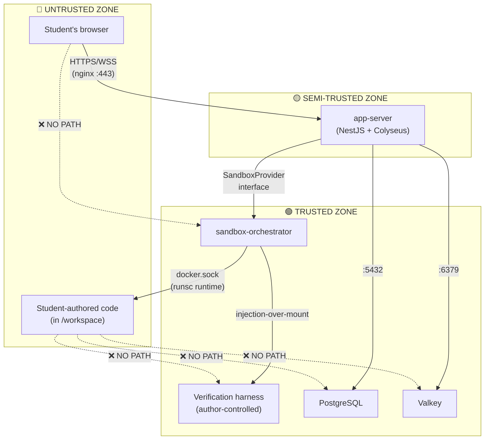

# SimOffice — Security & Sandbox Design v1.0 (Pilot Edition)

> **Status:** Draft · **Edition:** Pilot (Single-College Phase 0)
> **Last updated:** 2026-08-02

---

## 1. Purpose & Inputs

This document consolidates every security-relevant design decision scattered across the SimOffice documentation suite into a single, auditable reference. It is **not** a restatement — it is the canonical security view, connecting threat model → architectural mechanism → implementation detail → verification, so a security reviewer or new developer can evaluate the system's security posture without reading nine documents.

**Inputs (upstream documents):**

| Document | Security-relevant sections |
|---|---|
| [PRD v3.1](SimOffice_PRD_v3_1.md) | §8.5 (tamper resistance), §8.6 (resource ceilings), §15 (data model/accounts), §16.4 (isolation/session integrity), §16.6 (privacy/compliance) |
| [SAD v1.3 (Pilot)](SimOffice_SAD_v1_3_Pilot_Edition.md) | §5 (deployment topology), §7 (trust-zone/sandbox), §9.3 (auth flow), §13 (security architecture), §14 (error handling) |
| [TSSD v2.1 (Pilot)](SimOffice_TSSD_v2_1_Pilot_Edition.md) | §5.3 (sandbox selection), §5.4 (auth), §8 (security considerations) |
| [TDD v1.0 (Pilot)](SimOffice_TDD_v1_0_Pilot_Edition.md) | §3.4 (verification submission), §6 (sandbox provider implementation), §8 (auth/token) |
| [API Spec v1.1 (Pilot)](SimOffice_API_Spec_v1_1_Pilot_Edition.md) | §2–3 (auth/identity), §7 (workstation operations), §13 (error codes) |
| [DBD v1.1 (Pilot)](SimOffice_DBD_v1_1_Pilot_Edition.md) | §7 (FK/integrity constraints), §8 (retention/anonymization), §16 item 7 (cross-entity boundary) |

**This document does NOT replace** the sections above — they remain the implementation-level source of truth. This document provides the unified threat model, the security architecture map, and the verification plan that ties them together.

---

## 2. Threat Model

SimOffice is a **classroom product used by students (potentially minors)** running **arbitrary student-authored code** in a **shared-infrastructure environment**. This combination creates a threat surface that is unusual for a typical web app and must be designed against explicitly, not treated as an afterthought.

### 2.1 Threat actors

| Actor | Motivation | Capability |
|---|---|---|
| **Curious student** | Game the grading check to "pass" without fixing the bug | Can read/write any file in their workstation's editing surface; will try creative path traversal, file deletion, and code inspection |
| **Mischievous student** | Disrupt other teams' sessions or consume shared resources | Will write fork bombs, infinite loops, large file writes; may attempt network exfiltration |
| **External attacker** | Compromise the server hosting student data | Standard web attack surface: credential stuffing, API abuse, network scanning |
| **Accidental harm** | Unintentional resource exhaustion from buggy student code | Expected occurrence in a debugging exercise — runaway loops, memory leaks, accidental fork bombs |

### 2.2 Assets to protect

| Asset | Impact if compromised |
|---|---|
| **Verification harness integrity** | Students can fake "pass" results — defeats the core pedagogical mechanic |
| **Cross-team isolation** | One team's code/data leaks to another — unfair advantage, privacy violation |
| **Host infrastructure** | Student code escapes sandbox and affects Postgres, Valkey, other teams' environments, or the VPS itself |
| **Student personal data** | Roster entries, display names, contribution history — subject to FERPA/COPPA/GDPR-K |
| **Teacher credentials** | Account takeover grants session control and student data access |
| **Platform availability** | Resource exhaustion on shared VPS degrades all concurrent sessions |

### 2.3 Trust boundaries



**Key principle:** the student's browser and the student's code are *both* untrusted, but via different mechanisms — the browser is untrusted because it's a standard web client (validated via JWT + API guards); the student's code is untrusted because it runs inside a kernel-isolated sandbox with no network path to any other component.

---

## 3. Trust-Zone Architecture — Verification Tamper Resistance

> Implements: PRD §8.5, SAD §7, TDD §6

This is the most safety-critical part of the system. PRD §8.5 exists because **students attempting to "pass" verification by deleting, disabling, or rewriting the check itself is a predictable classroom behavior, not a hypothetical one.**

### 3.1 The "injection-over-mount" principle

The verification harness is **never placed in the student-writable `/workspace` path**. There is no file permission, no read-only flag, no `.hidden` convention protecting it — instead, it simply does not exist in any path the student's code-editing API (`readFile`/`writeFile`) can resolve. The harness is:

1. Injected by `app-server` (never by anything the student's browser can trigger directly)
2. Into a **separate, short-lived execution context** at verification time
3. Run against a **snapshot** of the current `/workspace` state
4. Destroyed immediately afterward

The result written to PostgreSQL is the **only value the frontend ever displays** — the client never reports its own "I passed" claim.

### 3.2 The SandboxProvider interface

```typescript
interface ResourceLimits {
  cpuCores: number;       // e.g. 1
  memoryMb: number;       // e.g. 512
  wallClockTimeoutMs: number;
}

interface SandboxProvider {
  provision(teamId: string, scenarioVariant: ScenarioVariant, limits: ResourceLimits): Promise<EnvironmentRef>;
  readFile(env: EnvironmentRef, path: string): Promise<string>;
  writeFile(env: EnvironmentRef, path: string, content: string): Promise<void>;
  runCheck(env: EnvironmentRef): Promise<CheckResult>;
  runVerification(env: EnvironmentRef, harnessRef: string): Promise<VerificationResult>;
  teardown(env: EnvironmentRef): Promise<void>;
}
```

**Every component in the system talks only to this interface** — never to E2B's SDK or Docker directly. This makes the E2B-vs-gVisor choice a hosting decision, not an application-rewrite decision.

### 3.3 Concrete implementations

| Aspect | `E2BProvider` | `GVisorProvider` |
|---|---|---|
| **Student workspace** | E2B sandbox filesystem via SDK | Bind-mounted volume inside a `runsc`-runtime container |
| **Verification context** | A **second, separate E2B sandbox session** (not a scoped exec in the student's session — that would share the filesystem handle, reintroducing the shared-context risk) | A **second, short-lived container** launched by `sandbox-orchestrator`, sharing a read-only bind mount of a filesystem-level snapshot |
| **Trust boundary** | E2B's Firecracker isolation + SDK session scoping | `runsc` kernel-level isolation + `sandbox-orchestrator` being the only component with Docker socket access |
| **Resource ceiling** | E2B SDK's per-sandbox resource configuration at `provision()` time | Docker `--cpus`/`--memory` flags at container-create time |

### 3.4 Verification flow (both providers)

```
runVerification(env, harnessRef):
  1. Snapshot the student's /workspace from env
  2. Create a brand-new isolation context (E2B session / runsc container)
  3. Copy snapshot + harness into the new context
  4. Execute the harness (with per-check 30s wall-clock timeout)
  5. Destroy the new context unconditionally (try/finally)
  6. Return the result — new context's identity never exposed to student API
```

### 3.5 What this defends against

| Attack vector | Defense |
|---|---|
| Delete/modify the verification check file | No path exists — harness is not in `/workspace` |
| Read the check to reverse-engineer expected output | Harness is injected into a separate context the student cannot observe |
| Submit a fake "pass" from the client | Result is server-computed and server-authoritative; client never reports outcomes |
| Race condition: edit code during verification | Harness runs against a point-in-time snapshot, not a live mount |
| Inspect running verification process | Separate E2B session / separate `runsc` container — no shared namespace |

---

## 4. Resource Ceilings — Capacity Isolation

> Implements: PRD §8.6, SAD §7.4

Trust-zone isolation answers "can a team's environment *reach* something it shouldn't." Resource ceilings answer "can a team's environment *starve* something it shouldn't." At pilot scale, all teams' environments, `app-server`, PostgreSQL, and Valkey share **one VPS** — a runaway loop or fork bomb is an expected classroom occurrence.

### 4.1 Enforcement

| Parameter | Pilot default | Enforcement point |
|---|---|---|
| CPU per environment | 1 vCPU | `ResourceLimits.cpuCores` at `provision()` |
| Memory per environment | 512 MB | `ResourceLimits.memoryMb` at `provision()` |
| Per-check wall-clock timeout | 30 seconds | `Promise.race` in `submitVerification()` (TDD §3.4) |
| Per-environment lifetime | Session duration | Environment torn down at session end |

### 4.2 On ceiling breach

- The specific call (`runCheck` or `runVerification`) is **terminated and reported** as a distinct, visible outcome (`RESOURCE_LIMIT_EXCEEDED`) — not a silent hang, not conflated with "the check failed"
- Surfaced through the `environmentError` room broadcast pattern (SAD §14)
- The student sees an explicit "resource limit exceeded" message, not an indefinite spinner
- Other teams' environments and the platform's own services are unaffected

### 4.3 What this does NOT require

A general-purpose multi-tenant resource scheduler. At pilot concurrency (a handful of teams), static per-environment caps enforced by the container runtime are sufficient. Dynamic bin-packing is a production-scale concern (TSSD v1.0).

---

## 5. Network & Infrastructure Security

> Implements: SAD §5, §13, TSSD v2.1 §5.3

### 5.1 Network exposure

```
┌─────────────────────────────────────────────────────┐
│                    Campus Network                    │
│                         │                            │
│                    :443 (TLS)                        │
│                         ▼                            │
│  ┌──────────────────────────────────────────────┐   │
│  │           Docker Internal Network             │   │
│  │                                               │   │
│  │  nginx ──► app-server ──► postgres            │   │
│  │             │              valkey              │   │
│  │             ▼                                  │   │
│  │    sandbox-orchestrator ──► docker.sock        │   │
│  │             │              (runsc runtime)     │   │
│  │             ▼                                  │   │
│  │    [team environment containers]               │   │
│  │                                               │   │
│  └──────────────────────────────────────────────┘   │
│           ↑ only :443 is externally exposed          │
└─────────────────────────────────────────────────────┘
```

**Only port 443 on nginx** is reachable from the campus network. Every other container sits on an internal Docker Compose network with no external port mapping.

### 5.2 Docker socket privilege isolation

If the `GVisorProvider` path is used, **only `sandbox-orchestrator`** ever touches `/var/run/docker.sock`. `app-server` communicates with it through a narrow internal API — never directly. Even if `app-server` were compromised, it has no Docker socket access.

### 5.3 TLS termination

nginx handles TLS termination for all HTTPS and WSS traffic. Internal container-to-container communication is plaintext over the Docker internal network — acceptable at pilot scale where all containers are on the same host and the Docker network is not externally routable. Production seam: mutual TLS between services if the topology splits across hosts.

### 5.4 Sandbox egress control

> ⚠️ **Open validation item** (TSSD v2.1 §5.3)

PRD §8.1 requires no network path from a student's environment beyond a scenario's declared dependencies. Before committing to E2B's free tier, **confirm it supports restricting outbound network access** — if it only guarantees isolation *between* sandboxes without a configurable egress allowlist, `GVisorProvider` (where the network namespace is directly controlled) becomes the correct default.

---

## 6. Authentication & Authorization

> Implements: SAD §9.3, §13, TDD §8, API Spec §2–3

### 6.1 Identity model — two-tier by design

SimOffice deliberately uses **two separate identity models**, never merged into one:

| | Teacher | Student |
|---|---|---|
| **Entity** | `accounts` (real, credentialed) | `roster_entries` (persistent, credential-free, class-scoped) |
| **Auth mechanism** | Email + password → long-lived JWT | Join code + optional passcode → short-lived, session-scoped JWT |
| **PII collected** | Email, display name | Display name only (no email, no photo, no real name required) |
| **Persistence** | Account-level, survives across terms | Class-scoped, reused across sessions within a class |
| **PRD rationale** | §11.1, §15.1 | §15.1, §16.6 (minimal personal data) |

This separation is a **privacy-by-design decision**, not an implementation shortcut — students never need to create accounts or provide identifying information beyond a chosen display name.

### 6.2 Token design

Both token types are HS256-signed JWTs sharing one signing secret from `.env` (HS256 because there is exactly one issuer and one verifier — `app-server` itself).

| Claim | Teacher token | Roster token |
|---|---|---|
| `sub` | `accountId` | `rosterEntryId` |
| `role` | `"teacher"` | `"student"` |
| `sessionId` | — | present |
| `teamId` | — | present |
| `exp` | Long-lived | Short-lived, session-scoped |

### 6.3 Authorization enforcement

**NestJS guards** (`TeacherGuard`, `RosterGuard`) enforce authorization at the API layer:

- **Signature verification**: reject expired, malformed, or tampered tokens → `401 UNAUTHENTICATED`
- **Role check**: teacher-only routes reject student tokens → `403 FORBIDDEN`
- **Scope check**: `RosterGuard` on workstation/room routes verifies the token's `teamId` matches the resource's owning team → `403 FORBIDDEN`
- **Class ownership**: teacher routes verify the teacher's `accountId` owns the target `classId` → `403 FORBIDDEN`
- **Cross-entity boundary**: API layer validates `roster_entries.class_id` matches `sessions.class_id` before creating `team_memberships` → `409 ROSTER_CLASS_MISMATCH` (DBD §16 item 7)

### 6.4 Rate limiting

Login (`POST /auth/login`) and session-join (`POST /sessions/join`) endpoints are rate-limited via **Valkey-backed counters** to blunt basic credential/join-code guessing. Appropriately lightweight for pilot scale; production would add a WAF or dedicated rate-limiting layer.

### 6.5 Secrets handling

| Secret | Storage | Rotation |
|---|---|---|
| DB credentials | `.env` file, excluded from VCS via `.gitignore` + CI check | Manual at pilot scale |
| JWT signing key | `.env` file | Manual; key change invalidates all active tokens |
| E2B API key (if used) | `.env` file | Per E2B account settings |

**Production seam:** a real secrets manager (e.g., HashiCorp Vault, GCP Secret Manager) replaces `.env`-based secrets when the system moves beyond a single-VPS pilot (TSSD §9 graduation trigger 1).

---

## 7. Data Privacy & Compliance

> Implements: PRD §15, §16.6, DBD §8

### 7.1 Minimal data collection principle

The system is designed around **collecting the minimum data necessary** for pedagogical function:

| Data category | What is stored | What is NOT stored |
|---|---|---|
| Student identity | Display name, class-scoped passcode hash | Real name, email, photo, birthdate |
| Contribution tracking | Event type, timestamp, file path, lightweight diff stat | Full code content (lives only in ephemeral sandbox) |
| Chat messages | Text content, timestamp, roster_entry_id | No persistent storage beyond session retention window |
| Environment instances | Provisioning audit trail (team_id, status) | No workspace file content in Postgres (lives in sandbox) |

### 7.2 Retention & anonymization

Two independent mechanisms, answering two different questions:

**Scheduled anonymization (age-based):** A nightly job (`anonymize_expired_contribution_events`) nulls `contribution_events.roster_entry_id` for events older than the configured retention window (default: 180 days, pending compliance review). Team-level aggregates remain intact; only individual attribution is stripped.

**On-request deletion (student/guardian request):** `anonymize_roster_entry` replaces the display name with "Deleted Student," invalidates the passcode, and nulls attribution across `contribution_events` and `verification_runs`. Never a hard delete — `team_memberships` rows are untouched because "was on this team" carries no PII once the name is anonymized, and removing it would corrupt other students' debrief data.

### 7.3 Compliance gates

| Gate | Status | Blocking? |
|---|---|---|
| **Confirm pilot cohort age range** | Open | **Yes** — determines which compliance path applies |
| **COPPA/FERPA review** (if U.S., if minors) | Open | **Yes** — no student data collection until complete |
| **GDPR-K review** (if non-U.S., if minors) | Open | **Yes** — same gate |
| **Retention window finalization** | Open | No — 180-day default is functional; actual number awaits review |
| **Parent/guardian consent mechanism** | Open | **Yes** if minors — mechanism (school-level blanket vs. individual) TBD |
| **Content-liability legal review** (malicious-script scenarios) | Open | **Yes** for Phase 2 — gates malicious-script content authoring (PRD §14, §19) |

> **Critical:** PRD §16.6 states that Phase 0 engineering can proceed in parallel, but **no student data may be collected from a real class** until the applicable compliance review is complete.

---

## 8. Session Integrity & Teardown

> Implements: PRD §16.4, SAD §10

Every provisioned environment instance is ephemeral and tied to the session lifecycle. The system guarantees teardown in **all** session-end paths:

| End path | Trigger | Teardown mechanism |
|---|---|---|
| Teacher ends session | `POST /sessions/{id}/end` | `sessionsService.endSession()` → iterates all teams → `provider.teardown()` |
| Time limit reached | Server-side scheduled check | Same as teacher-ended (end_reason: `time_limit_reached`) |
| Abandoned session | Cron job (TDD §7.2, 20-min inactivity) | Same as teacher-ended (end_reason: `abandoned_timeout`) |
| Teacher ends early with unresolved teams | `POST /sessions/{id}/end` | Same path — valid debrief produced for all teams, then teardown |

**Invariant:** no environment instance survives past its session's `ended` status. `EnvironmentInstance.status` reaches `torn_down` as a terminal state (SAD §10), and the sandbox resources (E2B session or `runsc` container) are destroyed unconditionally (`try/finally`).

**Grace period:** after broadcasting `sessionEnded`, the server waits 2–3 seconds before disposing Colyseus rooms, ensuring WebSocket buffers flush debrief data to all connected clients (API Spec §5.7).

---

## 9. Input Validation & Error Handling

### 9.1 API input validation

All request bodies are validated against typed schemas before any business logic executes. Validation failures return `400 VALIDATION_ERROR` with specific field-level error details.

### 9.2 Security-relevant error codes

| Code | Status | Security relevance |
|---|---|---|
| `INVALID_CREDENTIALS` | 401 | Failed teacher login — rate-limited |
| `INVALID_ROSTER_PASSCODE` | 401 | Wrong student passcode — rate-limited |
| `UNAUTHENTICATED` | 401 | Missing/expired/malformed JWT |
| `ACCOUNT_DEACTIVATED` | 403 | Deprovisioned teacher (PRD §11.1) |
| `FORBIDDEN` | 403 | Valid token, wrong scope (wrong team, wrong class, student on teacher route) |
| `ROSTER_CLASS_MISMATCH` | 409 | Cross-entity boundary violation (DBD §16 item 7) |
| `RESOURCE_LIMIT_EXCEEDED` | 422 | Sandbox ceiling breach (PRD §8.6) |
| `RATE_LIMITED` | 429 | Brute-force mitigation |

### 9.3 Error exposure principle

Error responses **never leak internal state** — no stack traces, no database column names, no sandbox implementation details. The `environmentError` room broadcast pattern surfaces sandbox failures as typed, student-friendly messages ("something went wrong, retry") without exposing the underlying infrastructure.

---

## 10. Content Security

> Implements: PRD §8.5, §11.5, §14

### 10.1 Scenario content pipeline security

Every scenario passes through a **two-part review gate** (PRD §11.5.2) before entering the library:

1. **Correctness review:** Does the verification check fail on the broken variant and pass on a correct fix? Is it protected from student tampering per §8.5?
2. **Pedagogical review:** Is the symptom text diagnostic without giving away the cause? Is the difficulty tag accurate?

Each review has a **named approver role** and a **target turnaround SLA**.

### 10.2 Malicious-script content

Phase 2 introduces "malicious script" scenarios where students must identify and remove planted bad-actor code. This category **requires the content-liability legal review** (PRD §19, §23) before any such content is authored — it is gated independently from the standard review process.

### 10.3 Content storage

Scenarios are stored as **git-based content packages** (TSSD v2.1's `content/<scenario>/manifest.yaml` structure). The database only ever contains already-approved content; the review itself happens in the content repo's pull-request process, not as in-app state. Verification harness files are **never** served to or accessible by the client — they exist only in the server-side content library and are injected at verification time.

---

## 11. Client-Side Security

### 11.1 No client-side trust

The client (React shell + Babylon.js engine) is treated as **fully untrusted**:

- Verification results are never accepted from the client
- Desk occupancy is resolved server-side (deterministic, first-valid-interaction-wins)
- Team assignment and roster management are server-authoritative
- The Colyseus room state (`TeamRoomState`) is the server's schema, synced to clients — clients cannot push arbitrary state changes

### 11.2 WebSocket security

- Room join requires a valid roster token with the correct `teamId` claim
- All room messages are validated server-side before state mutations
- Colyseus's built-in schema serialization prevents arbitrary data injection
- Room lifecycle callbacks (`onJoin`, `onMessage`, `onLeave`, `onDispose`) are individually `try/catch` wrapped (SAD §14) to prevent one room's error from crashing the shared `app-server` process

### 11.3 Asset delivery

Static assets (3D models, textures, audio) are served from the VPS via nginx. No user-uploaded content is served — all assets are developer-authored and deployed as part of the build. No CDN at pilot scale; production seam: Cloudflare or equivalent.

---

## 12. Observability for Security

> Implements: SAD §15, TSSD v2.1 §5.7

### 12.1 Pilot-scale monitoring

| Layer | Tool | What it captures |
|---|---|---|
| Client errors | Sentry (free tier) | Babylon.js/React exceptions, tagged with `session_id`/`team_id` |
| Server errors | Sentry (free tier) | `app-server` exceptions, unhandled rejections, sandbox failures |
| Auth failures | Application logs | Failed logins, invalid passcodes, rate-limit triggers |
| Sandbox events | Application logs | Provision/teardown lifecycle, resource-limit breaches, verification timeouts |

### 12.2 Security-relevant log events

The following events should be logged with sufficient context for post-incident review:

- `AUTH_FAILURE` — failed login or join attempt (rate-limited endpoint)
- `TOKEN_REJECTED` — expired, malformed, or scope-mismatched JWT
- `SANDBOX_PROVISION` / `SANDBOX_TEARDOWN` — lifecycle tracking
- `RESOURCE_LIMIT_BREACH` — ceiling hit during check/verification
- `VERIFICATION_TIMEOUT` — 30s per-check timeout triggered
- `ROSTER_ANONYMIZED` — student deletion/anonymization executed

### 12.3 What is NOT monitored at pilot scale

- No dashboards (Grafana/Prometheus/Datadog) — the teacher/operator is physically present
- No automated alerting — manual observation during supervised sessions
- No audit log of every API call — excessive for a handful of users

**Production seam:** full observability stack (TSSD v1.0 §17) when the system runs unattended.

---

## 13. Production Seams — Security Items That Scale Up

This section explicitly lists security mechanisms that are **intentionally simplified at pilot scale** and must be upgraded before production deployment (TSSD §9 graduation triggers):

| Pilot approach | Production approach | Trigger to upgrade |
|---|---|---|
| `.env` file for secrets | Real secrets manager (Vault, GCP SM) | Multi-institution deployment |
| HS256 JWT (shared secret) | RS256 (asymmetric) or delegated to IdP | Multiple token issuers/verifiers |
| Self-rolled teacher login | SSO integration (Auth0, SAML) | District IT requires SSO |
| Rate limiting via Valkey counters | WAF + dedicated rate-limiting layer | Internet-facing deployment |
| No formal compliance review | COPPA/FERPA/GDPR-K review | Any deployment with minors |
| No penetration test | Third-party pentest | Public-facing or multi-institution |
| Plaintext inter-container traffic | Mutual TLS between services | Multi-host deployment |
| Manual `pg_dump` backups | Managed DB with automated backups | Data criticality increases |
| No WAF or DDoS protection | Cloudflare or equivalent | Internet-facing deployment |
| Sentry-only error tracking | Full observability stack | Unattended sessions |

---

## 14. Security Verification Plan

### 14.1 Pre-pilot PoC items (MUST complete)

| # | Verification | Method | Pass criterion |
|---|---|---|---|
| 1 | **Trust-zone tamper resistance** | Manually attempt to read/write/delete the verification harness through the workstation's `readFile`/`writeFile` API | No path resolves to any harness file; all attempts return 404/empty |
| 2 | **Cross-environment isolation** | From Team A's sandbox, attempt to access Team B's filesystem or network | All attempts fail; no cross-team data leakage |
| 3 | **Resource ceiling enforcement** | Deploy a fork bomb / infinite loop in a student environment | Environment is contained/terminated within timeout; other environments and platform services unaffected |
| 4 | **Egress control** (if E2B) | From a sandbox, attempt `curl` to an external host not in the scenario's dependency list | Connection refused or blocked |
| 5 | **Auth scope enforcement** | Use a student token to access another team's workstation endpoint | `403 FORBIDDEN` |
| 6 | **Rate limiting** | Send 100 rapid login attempts | `429 RATE_LIMITED` after threshold |
| 7 | **Verification result authority** | Intercept the WebSocket and attempt to inject a fake "pass" message | Server ignores client-originated verification results; only server-computed results are accepted |

### 14.2 Ongoing verification (per-release)

- **Dependency audit:** `npm audit` on every CI build; no `critical` or `high` vulnerabilities shipped
- **Secrets in VCS check:** CI step that fails if `.env` or any file matching secret patterns is committed
- **Sandbox lifecycle:** verify every environment reaches `torn_down` status after session end (query `environment_instances` table)
- **Anonymization job:** verify the nightly retention sweep runs and affects the expected row count (application logs)

---

## 15. Open Security Items

| # | Item | Priority | Owner | Status |
|---|---|---|---|---|
| 1 | **Confirm E2B free-tier egress control** (TSSD §5.3) — does it support restricting outbound network? | High | Infra lead | Open |
| 2 | **Pilot cohort age range confirmation** (PRD §16.6) — determines compliance path | Critical | Product lead | Open |
| 3 | **COPPA/FERPA/GDPR-K compliance review** (if minors) | Critical | Legal/compliance | Open |
| 4 | **Content-liability legal review** for malicious-script scenarios (PRD §19) | High (Phase 2) | Legal | Open |
| 5 | **Retention window finalization** — replace 180-day placeholder | Medium | Compliance | Open |
| 6 | **Parent/guardian consent mechanism** (if minors) | Critical (if applicable) | Product + Legal | Open |
| 7 | **JWT signing key rotation procedure** | Low (pilot) | DevOps | Open |
| 8 | **Nginx TLS configuration hardening** — confirm TLS 1.2+ only, strong ciphers | Medium | Infra lead | Open |

---

## 16. PRD Requirement Traceability

| PRD requirement | Security mechanism | Verified by |
|---|---|---|
| §8.1 — environment isolation | Sandbox Provider (Firecracker/gVisor kernel isolation) + network namespace | PoC #1, #2 |
| §8.5 — tamper-resistant verification | Injection-over-mount trust zone; server-computed results | PoC #1, #7 |
| §8.6 — resource ceilings | `ResourceLimits` at `provision()`; per-check timeout; `RESOURCE_LIMIT_EXCEEDED` outcome | PoC #3 |
| §15.1 — minimal-PII identity | Two-tier identity model; students have no credentials/email | By design |
| §15.5 — retention & deletion | `anonymize_expired_contribution_events` + `anonymize_roster_entry` | Ongoing verification |
| §16.4 — session integrity / teardown | Unconditional `teardown()` in all session-end paths | Ongoing verification |
| §16.6 — privacy & compliance | Compliance gate (§7.3); minimal data collection (§7.1) | Pre-pilot review |

---

## 17. Glossary

| Term | Definition |
|---|---|
| **Injection-over-mount** | The design principle where the verification harness is injected into a separate execution context rather than mounted in the student-writable filesystem |
| **Trust zone** | A boundary separating components with different privilege levels; student code and verification code are in different trust zones |
| **Resource ceiling** | Enforced CPU/memory/wall-clock limit on a sandboxed environment |
| **Roster token** | Short-lived, session-scoped JWT issued to a student upon joining |
| **Sandbox Provider** | The abstraction layer between the application and the concrete sandbox technology (E2B or gVisor) |
| **runsc** | Google's gVisor container runtime, providing kernel-level isolation without full VM overhead |
| **Egress control** | Restricting a sandbox's outbound network access to declared dependencies only |

---

## 18. Document History

| Version | Date | Changes |
|---|---|---|
| v1.0 | 2026-08-02 | Initial document — consolidates security content from SAD §7/§13, TSSD §5.3/§8, TDD §6/§8, API Spec §2–3/§13, DBD §8, PRD §8.5/§8.6/§15/§16.4/§16.6 |
