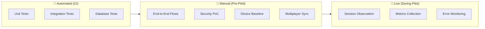

# SimOffice — Testing Plan v1.0 (Pilot Edition)

> **Status:** Draft · **Edition:** Pilot (Single-College Phase 0)
> **Last updated:** 2026-08-02

---

## 1. Purpose & Inputs

This document defines the testing strategy, scope, specific test scenarios, and pass criteria for the SimOffice Phase 0 pilot build. It is the plan against which the team measures "are we ready to run this in a real classroom?"

**Inputs (upstream documents):**

| Document | Testing-relevant sections |
|---|---|
| [PRD v3.1](SimOffice_PRD_v3_1.md) | §5.1 (Phase 0 scope), §5.2 (exit criteria), §12.13 (resilience requirements), §16.2 (device baseline), §17 (success metrics) |
| [SAD v1.3 (Pilot)](SimOffice_SAD_v1_3_Pilot_Edition.md) | §7 (trust-zone), §10 (session lifecycle), §11 (sequence diagrams), §14 (error handling) |
| [TSSD v2.1 (Pilot)](SimOffice_TSSD_v2_1_Pilot_Edition.md) | §5.8 (device testing), §6 (compatibility matrix), §10 (PoC items) |
| [TDD v1.0 (Pilot)](SimOffice_TDD_v1_0_Pilot_Edition.md) | §3 (core algorithms), §7 (scheduled jobs), §11 (validation performed) |
| [API Spec v1.1 (Pilot)](SimOffice_API_Spec_v1_1_Pilot_Edition.md) | §3 (auth), §5 (session management), §7 (workstation), §13 (error codes), §15 (resilience traceability) |
| [DBD v1.1 (Pilot)](SimOffice_DBD_v1_1_Pilot_Edition.md) | §6 (DDL), §8 (retention/anonymization), §10 (views) |
| [SSD v1.0 (Pilot)](SimOffice_SSD_v1_0_Pilot_Edition.md) | §14 (security verification plan) |
| [GDD v1.0 (Pilot)](SimOffice_GDD_v1_0_Pilot_Edition.md) | §3 (animation state machine), §5 (interaction) |
| [UIUXD v2.1 (Pilot)](SimOffice_UIUXD_v2_1_Pilot_Edition.md) | §6 (screen specs), §10 (accessibility) |

---

## 2. Testing Philosophy

### 2.1 Pilot-scale principles

SimOffice is a **single-college pilot** deployed on one VPS with a teacher physically present during every session. This shapes the testing approach:

- **Automated tests** focus on the backend logic that is hardest to verify manually and most dangerous to get wrong (verification integrity, session state machine, data retention, auth guards).
- **Manual testing** covers the 3D client, multiplayer sync, and device-baseline validation — these require real hardware, real visual observation, and real multi-user interaction.
- **No formal QA team.** The developer(s) building the system are also the testers. This document ensures they test systematically, not ad hoc.

### 2.2 What must be tested before any real classroom session

The following are **non-negotiable gates** — a classroom session must not be run until all pass:

1. ✅ Trust-zone tamper resistance (SSD §14.1, PoC #1)
2. ✅ Cross-environment isolation (SSD §14.1, PoC #2)
3. ✅ Resource ceiling enforcement (SSD §14.1, PoC #3)
4. ✅ Device baseline measurements recorded (PRD §16.2)
5. ✅ Full session lifecycle (create → join → start → verify → end → teardown) completes without errors
6. ✅ Debrief screen renders for both resolved and unresolved teams

---

## 3. Test Categories & Coverage Strategy



| Category | Scope | Tooling | When |
|---|---|---|---|
| **Unit tests** | Pure functions, state machines, algorithms | Jest/Vitest | Every commit (CI) |
| **Integration tests** | API endpoints, DB queries, auth guards | Jest + Supertest + test DB | Every commit (CI) |
| **Database tests** | DDL validity, views, retention functions | pg_tap or raw SQL assertions | Schema changes |
| **End-to-end flows** | Full user journeys (teacher + student) | Manual + Playwright (non-3D UI) | Pre-pilot milestone |
| **Security PoC** | SSD §14.1 verification items | Manual, purpose-built scripts | Pre-pilot, once |
| **Device baseline** | FPS, join time, check latency on real hardware | Manual measurement, recorded | Pre-pilot, once |
| **Multiplayer sync** | Multi-client state consistency, reconnection | Manual with multiple browser tabs/devices | Pre-pilot |
| **Live observation** | Teacher-observed session quality | Teacher + Sentry | Every pilot session |

---

## 4. Unit Tests

### 4.1 Session state machine (TDD §4)

| Test case | Input | Expected |
|---|---|---|
| Valid transition: `created` → `provisioning` | `trigger: 'start'` on `created` session | Status updates to `provisioning` |
| Valid transition: `active` → `ended` | `trigger: 'end'` on `active` session | Status updates to `ended`, `end_reason` set |
| Invalid transition: `ended` → `active` | `trigger: 'start'` on `ended` session | Throws `INVALID_STATE_TRANSITION` |
| Exhaustiveness | Every `SessionTrigger` value | Has a handled case (TypeScript strict union exhaustiveness) |
| Abandoned timeout | `trigger: 'abandoned_timeout'` on `active` | Status → `ended`, `end_reason` = `abandoned_timeout` |

### 4.2 Outcome derivation (TDD §3.4)

| Test case | Input | Expected |
|---|---|---|
| All `full_fix` checks pass | 2 full_fix checks, both pass | `'resolved'` |
| One `full_fix` fails | 2 full_fix, 1 pass + 1 fail | `'in_progress'` |
| Only diagnostic checks pass | 1 diagnostic pass, 1 full_fix fail | `'in_progress'` |
| No full_fix checks defined | 0 full_fix checks | `'in_progress'` (content error guard) |
| Latest run wins per check | Same check run twice (fail, then pass) | Uses latest run → `'resolved'` |

### 4.3 Animation state machine (GDD §3.3)

| Test case | Input | Expected |
|---|---|---|
| EMOTE during emote | `current: 'emote_wave'`, `action: EMOTE` | Returns `'emote_wave'` (reject, queue at controller) |
| MOVE during `land` | `current: 'land'`, `action: MOVE` | Returns `'land'` (protected fixed-duration) |
| MOVE during `standUp` | `current: 'standUp'`, `action: MOVE` | Returns `'standUp'` (protected) |
| MOVE during `idle` | `current: 'idle'`, `action: MOVE` | Returns `'walk'` or `'run'` |
| SIT action | `current: 'idle'`, `action: SIT` | Returns `'sit'` |

### 4.4 Passcode generation (TDD §3.3)

| Test case | Input | Expected |
|---|---|---|
| Unique generation | Empty class | Returns `WORD-NN` format |
| Collision retry | Class with 6300 existing passcodes | Retries and finds a unique one |
| Exhaustion | Class with all 6400 combinations used | Throws `PASSCODE_GENERATION_EXHAUSTED` |
| Format validation | Any generation | Matches `/^[A-Z]+-\d{2}$/` pattern |

### 4.5 Contribution event buffer (TDD §10)

| Test case | Input | Expected |
|---|---|---|
| Debounce: rapid edits | 5 edits within 2s | 1 event flushed after debounce window |
| MaxWait: sustained typing | Continuous edits for 15s | At least 1 event flushed at 8s (maxWait) |
| Flush on disconnect | Client disconnects mid-buffer | Pending event flushed immediately |

### 4.6 Fix attribution (TDD §3.5)

| Test case | Input | Expected |
|---|---|---|
| Single editor | 1 student's edits before pass | `confidence: 'single_editor'` |
| Multiple editors | 3 students' edits before pass | `confidence: 'last_editor_before_pass'` |
| No edits before pass | Passing run with no preceding edits | `confidence: 'no_edits_found'` |
| Failed run | Run with `result: 'fail'` | Returns `null` |

---

## 5. Integration Tests

### 5.1 Auth & identity (API Spec §3)

| Test case | Method | Expected |
|---|---|---|
| Teacher login — valid | `POST /auth/login` | `200`, JWT with `role: 'teacher'` |
| Teacher login — wrong password | `POST /auth/login` | `401 INVALID_CREDENTIALS` |
| Teacher login — deactivated | `POST /auth/login` | `403 ACCOUNT_DEACTIVATED` |
| Teacher login — rate limited | > 5 rapid `POST /auth/login` | `429 RATE_LIMITED` after 5th attempt |
| Student join — new | `POST /sessions/join` (no passcode) | `201`, new `rosterEntryId`, passcode echoed |
| Student join — returning | `POST /sessions/join` (with passcode) | `200`, same `rosterEntryId`, `last_seen_at` updated |
| Student join — wrong passcode | `POST /sessions/join` | `401 INVALID_ROSTER_PASSCODE` |
| Student join — invalid code | `POST /sessions/join` | `404 INVALID_JOIN_CODE` |
| Student join — ended session | `POST /sessions/join` | `409 SESSION_NOT_JOINABLE` |
| Student join — roster full | `POST /sessions/join` (new student, at capacity) | `409 SESSION_ROSTER_FULL` |
| Student join — returning at capacity | `POST /sessions/join` (returning student, at capacity) | `200` (exempt from cap) |
| Student join — rate limited | > 10 rapid `POST /sessions/join` | `429 RATE_LIMITED` after 10th attempt |

### 5.2 Authorization guards

| Test case | Method | Expected |
|---|---|---|
| Student token on teacher route | `GET /classes/{id}` with roster token | `403 FORBIDDEN` |
| Teacher token on student workstation | `GET /teams/{teamId}/workstation/files` with teacher token | `403 FORBIDDEN` (or allowed if spec permits) |
| Student token — wrong team | `GET /teams/{otherTeamId}/workstation/files` | `403 FORBIDDEN` |
| Expired token | Any authenticated route | `401 UNAUTHENTICATED` |
| Missing token | Any authenticated route | `401 UNAUTHENTICATED` |
| Malformed token | `Authorization: Bearer garbage` | `401 UNAUTHENTICATED` |

### 5.3 Session lifecycle (API Spec §5)

| Test case | Method | Expected |
|---|---|---|
| Create session | `POST /sessions` | `201`, session in `created` status |
| Start session | `POST /sessions/{sessionId}/start` | `200`, status → `provisioning` → `active` |
| End session (teacher) | `POST /sessions/{sessionId}/end` | `200`, status → `ended`, all environments torn down |
| End already-ended session | `POST /sessions/{sessionId}/end` | `409 INVALID_STATE_TRANSITION` |
| Clone session | `POST /sessions/{sessionId}/clone` | `201`, new session with same config |
| Clone — no eligible variant | `POST /sessions/{sessionId}/clone` (all variants used) | `409 NO_ELIGIBLE_VARIANT` with available variants list |
| List sessions | `GET /classes/{classId}/sessions` | `200`, paginated array, correct fields |
| End with grace period | `POST /sessions/{sessionId}/end` | `sessionEnded` broadcast, then 2-3s delay before room disposal |

### 5.4 Workstation operations (API Spec §7)

| Test case | Method | Expected |
|---|---|---|
| List files | `GET /teams/{teamId}/workstation/files` | `200`, file tree |
| Read file | `GET /teams/{teamId}/workstation/files/{path}` | `200`, file content |
| Write file | `PUT /teams/{teamId}/workstation/files/{path}` | `200`, file saved |
| Run check (informal) | `POST /teams/{teamId}/workstation/run-check` | `200`, check result |
| Submit verification | `POST /teams/{teamId}/workstation/submit-verification` | `200`, verification runs array |
| Workstation before env ready | Any workstation endpoint | `409 ENVIRONMENT_NOT_READY` |
| Workstation — wrong team | Workstation endpoint with wrong team's token | `403 FORBIDDEN` |

### 5.5 Debrief (API Spec §9)

| Test case | Method | Expected |
|---|---|---|
| Team debrief — resolved | `GET /sessions/{id}/debrief` | Includes `outcome_state: 'resolved'`, passed check counts |
| Team debrief — unresolved | `GET /sessions/{id}/debrief` | Includes `outcome_state: 'unresolved'`, partial progress shown |
| Student contribution summary | `GET /sessions/{id}/debrief` | Every team member appears (including zero-activity students) |

---

## 6. Database Tests

### 6.1 DDL validation

| Test | Method | Pass criterion |
|---|---|---|
| Full DDL applies cleanly | Run all DDL from DBD §6 against a fresh Postgres instance | No errors |
| Seed data loads | Insert `departments` seed data (DBD §12) | 4 rows, no constraint violations |
| FK constraints hold | Attempt to delete a class with active sessions | `RESTRICT` prevents deletion |
| Join code partial index | Insert two sessions with same `join_code`, both active | Unique violation |
| Join code reuse after end | Insert session with same `join_code` as an `ended` session | Succeeds (partial index scoped to active) |

### 6.2 View correctness

| Test | Query | Pass criterion |
|---|---|---|
| `team_debrief_summary` — basic | Team with 3 checks, 2 passed | `passed_checks = 2`, `total_checks = 3` |
| `team_debrief_summary` — no double-count | Same check run 3 times (2 fail, 1 pass) | `passed_checks = 1` (COUNT DISTINCT) |
| `student_contribution_summary` — idle student | Team of 3, one student with zero activity | All 3 students appear in result |
| `student_contribution_summary` — zero events | LEFT JOIN produces NULLs, not missing rows | `event_count` defaults to 0 |

### 6.3 Retention & anonymization functions

| Test | Method | Pass criterion |
|---|---|---|
| Age-based anonymization | Insert events > 180 days old, run `anonymize_expired_contribution_events(180)` | `roster_entry_id` nulled on old events; recent events untouched |
| On-request anonymization | Run `anonymize_roster_entry(id)` | Display name → 'Deleted Student', passcode invalidated, `contribution_events.roster_entry_id` nulled, `team_memberships` untouched |
| Idempotency | Run `anonymize_roster_entry` twice on same entry | No error, no additional changes |

---

## 7. Security PoC Tests

> These are the pre-pilot verification items from SSD §14.1. Each must be explicitly performed and the result recorded.

| # | Test | Method | Pass criterion |
|---|---|---|---|
| **S-1** | Trust-zone tamper resistance | Via workstation API: attempt `readFile('../../harness/check.ts')`, `writeFile` to harness paths, `deleteFile` on harness paths | All return 404/empty; no path resolves to harness |
| **S-2** | Cross-environment isolation | From Team A's sandbox shell: attempt to read Team B's filesystem, ping Team B's container | All fail; no cross-team access |
| **S-3** | Resource ceiling enforcement | Deploy a fork bomb (`:(){ :\|:& };:`) or `while(true){}` in student env | Environment contained/terminated within timeout; `app-server`, Postgres, Valkey, other teams unaffected |
| **S-4** | Sandbox egress control | From sandbox: `curl https://example.com` | Connection refused/blocked (if using E2B, validate SDK supports egress restriction) |
| **S-5** | Auth scope enforcement | Use Student A's token to call `GET /teams/{teamB}/workstation/files` | `403 FORBIDDEN` |
| **S-6** | Rate limiting | Script > 5 rapid `POST /auth/login` and > 10 `POST /sessions/join` attempts | `429` after threshold; server remains responsive |
| **S-7** | Verification result authority | Craft a WebSocket message with `{ type: 'verificationResult', result: 'pass' }` | Server ignores; only server-computed results appear in room state |

---

## 8. End-to-End User Journey Tests

> Manual tests performed with real browser sessions. Playwright covers the non-3D UI flows.

### 8.1 Happy path — full session lifecycle

**Actors:** 1 teacher, 2–4 students (browser tabs or separate devices)

| Step | Action | Verify |
|---|---|---|
| 1 | Teacher logs in | Dashboard loads, classes visible |
| 2 | Teacher creates session (Beginner, Backend, logic bug) | Session created, join code displayed |
| 3 | Student 1 joins with join code | Character creation screen shown, `201` response |
| 4 | Student 1 completes character creation | Avatar appears in lobby/building |
| 5 | Student 2 joins with join code | Both students see each other's avatars |
| 6 | Teacher starts session | Status → `active`, environments provisioning, mission briefing displayed |
| 7 | Student 1 walks to and sits at a workstation | Character sits, monitor activates, code editor visible |
| 8 | Student 1 reads files, makes an edit | File content loads, edit saves successfully |
| 9 | Student 1 runs an informal check | Check result displayed (pass or fail) |
| 10 | Student 1 submits verification (wrong fix) | `in_progress` outcome, partial credit shown if diagnostic passes |
| 11 | Student 1 applies correct fix, submits verification | `resolved` outcome, success feedback |
| 12 | Teacher ends session | All students see debrief screen |
| 13 | Verify debrief | Team summary: checks passed, outcome state. Student contribution summary: all students listed |
| 14 | Verify teardown | `environment_instances` table: all environments in `torn_down` status |

### 8.2 Failure & edge paths

| Test | Action | Verify |
|---|---|---|
| **Session timeout** | Let session time limit expire | Server auto-ends session; unresolved teams get non-punitive debrief |
| **Late join** | Student joins 5 minutes after session starts | Placed on team, sees current briefing and code state |
| **Disconnect/reconnect** | Student closes tab, reopens and re-joins | Character reappears, workstation state recovered, no desk freed mid-edit |
| **Desk conflict** | Two students interact with same desk simultaneously | One wins deterministically, other gets "desk occupied" feedback |
| **Teacher ends early** | Teacher ends with unresolved teams | Every team gets valid debrief, all environments torn down |
| **Abandoned session** | Start session, all participants leave | After 20 minutes of inactivity, session auto-ends with `abandoned_timeout` |
| **Roster full** | Set `max_roster_size: 2`, try joining a 3rd student | `409 SESSION_ROSTER_FULL` for new student |
| **Returning student at capacity** | Set cap to 2, join 2 students, have student 1 re-join after capacity filled | `200` — returning student exempt from cap |

### 8.3 Negative / error paths

| Test | Action | Verify |
|---|---|---|
| Invalid join code | Student enters wrong code | Clear error message, not a crash |
| Workstation before session starts | Student tries workstation in `created` session | `409 ENVIRONMENT_NOT_READY`, clear UI feedback |
| Environment provisioning failure | (Simulate: sandbox service down) | `502 PROVISIONING_FAILED`, user sees "something went wrong" |
| Database unavailable | (Simulate: stop Postgres) | `503 SERVICE_UNAVAILABLE`, frontend shows "server unreachable" |

---

## 9. Device Baseline Tests

> Implements: PRD §16.2, TSSD v2.1 §5.8

### 9.1 Method

Run the build on **the actual campus lab machines**. No emulator, no cloud device farm — real hardware, real network, real conditions. This *is* the device-baseline test at pilot scale (TSSD §6).

### 9.2 Measurements (must be recorded, not eyeballed)

| Metric | Target | Measurement method |
|---|---|---|
| **Initial page load (exterior)** | < 3 seconds, ≤ 2MB payload on baseline hardware (PRD§10.4) | Stopwatch from URL hit to access panel visible; DevTools network tab for payload size |
| **Auth-to-Lobby transition** | Seamless handoff, no latency added beyond the 2s camera path | Stopwatch from auth submit to avatar visible in Lobby |
| **Sustained frame rate** | ≥ 30 FPS floor on baseline devices | Babylon.js `engine.getFps()` averaged over 60 seconds of normal gameplay (walking, emoting, other players visible) |
| **Workstation check-run latency** | Per PRD §8.2's tiered targets (Beginner: a few seconds) | Stopwatch from "Run Check" to result displayed |
| **Memory usage** | No OOM or tab crash during a full session | Browser task manager, observed over a 30-minute session |
| **WebSocket stability** | No unrecoverable disconnects on campus network | Monitor Colyseus reconnection events during a full session |

### 9.3 Hardware to test on

| Device | OS | Browser | Notes |
|---|---|---|---|
| Campus lab machines (primary) | Whatever is installed (Windows/ChromeOS/Linux) | Chrome or Edge (latest campus version) | This is the target hardware |
| Chromebooks (if campus has them) | ChromeOS | Chrome | Low-end baseline |
| Developer laptop (reference) | macOS/Windows/Linux | Chrome | Comparison point, not the target |

### 9.4 Pass criteria (PRD §5.2, criterion 3)

The minimum spec set via these measurements is confirmed sufficient by actual classroom hardware. If any campus lab machine cannot run the MVP, document the failure and determine if tiered visual settings (shadows off, reduced particle effects, lower character density) bring it within spec.

---

## 10. Multiplayer Sync Tests

> Manual tests requiring 2+ simultaneous browser sessions.

| Test | Action | Verify |
|---|---|---|
| **Avatar movement sync** | Player A walks; Player B observes | Player B sees Player A's avatar move smoothly, no teleporting |
| **Desk occupancy visibility** | Player A sits at desk | Player B sees Player A's character seated, desk monitor active |
| **Emote visibility** | Player A triggers emote | Player B sees the emote animation play |
| **Chat delivery** | Player A sends chat message | Player B receives it within ~1 second |
| **Player join broadcast** | Player C joins mid-session | Players A and B see Player C's avatar appear |
| **Player leave broadcast** | Player A disconnects | Players B and C see Player A's character update (grayed/disappeared) |
| **Room state consistency** | After 10+ minutes of activity | All clients' room state matches server (spot-check via Colyseus debug tools) |
| **Reconnection** | Player A: close tab → reopen → re-join | Player A's avatar reappears; Players B/C see them return |

---

## 11. Accessibility Tests

> Implements: PRD §16.5, UIUXD v2.1 §10

| Test | Action | Verify |
|---|---|---|
| **Keyboard-only navigation** | Complete the full session flow using only keyboard | All interactions reachable (movement, workstation, emotes, chat) |
| **Keyboard traversal (onboarding)** | Complete the onboarding course with keyboard only | No frame-perfect inputs required; generous jump windows |
| **Audio-visual parity** | Trigger every audio cue (chime, alarm) | Each has a visible in-world caption/visual equivalent on the relevant object |
| **Text contrast** | Check all UI text | Readable contrast ratio (WCAG AA minimum) |
| **ARIA live regions** | Trigger a toast/error notification | Screen reader announces it (`role="alert"`, `aria-live="assertive"`) |
| **Reduced motion (Entry)** | Enable reduced-motion preference at login | Scripted camera fly-through is skipped; doors snap open; instant cut to Lobby (TDD§9.1) |
| **Reduced motion (In-game)** | Enable reduced-motion preference | Animations scale down, no motion-dependent information loss |

---

## 12. CI Pipeline Integration

### 12.1 Pipeline definition

```yaml
# Conceptual CI pipeline (GitHub Actions)
name: SimOffice CI
on: [push, pull_request]

jobs:
  lint:
    # ESLint + Prettier on client and server code

  typecheck:
    # tsc --noEmit (strict: true, experimentalDecorators: true)

  unit-tests:
    # Jest/Vitest: state machines, algorithms, pure functions
    # Coverage target: 80%+ on core modules (§4)

  integration-tests:
    # Jest + Supertest against test Postgres + Valkey
    # All API endpoints (§5), auth guards (§5.2)

  database-tests:
    # DDL + views + functions against a fresh Postgres instance
    # Schema migrations (§6)

  security-checks:
    # npm audit --audit-level=high
    # .env-in-VCS check (grep for secrets patterns)
    # Dependency license check

  build:
    # Full production build (client + server)
    # Validates no compile errors
```

### 12.2 Coverage targets

| Module | Target | Rationale |
|---|---|---|
| Session state machine (`SessionsService` / `applySessionTransition`) | 100% branch | Every invalid transition must be explicitly tested |
| Verification submission (`submitVerification`) | 100% branch | Core mechanic integrity |
| Auth guards (`TeacherGuard`, `RosterGuard`) | 100% branch | Every rejection case must work |
| Outcome derivation (`deriveOutcomeState`) | 100% branch | Drives the debrief display |
| Contribution event buffer | 90%+ | Debounce/maxWait edge cases |
| Passcode generation | 90%+ | Collision handling |
| Desk conflict resolution | 90%+ | Concurrent access handling |
| API endpoints (combined) | 80%+ | Standard CRUD + edge cases |
| Frontend components | 60%+ | Primary interaction flows |

---

## 13. Pre-Pilot Readiness Checklist

A single checklist combining all gates. **All items must be checked before the first real classroom session.**

### 13.1 Technical readiness

- [ ] Full DDL applied to pilot Postgres instance (DBD §18)
- [ ] `departments` seed data loaded (DBD §12)
- [ ] Scenario content package imported (1 scenario, 1 variant, Beginner, Backend)
- [ ] `experimentalDecorators`/`emitDecoratorMetadata` set in `tsconfig.json` (TDD §14)
- [ ] Docker Compose stack starts cleanly (`nginx`, `app-server`, `postgres`, `valkey`, `sandbox-orchestrator`)
- [ ] nginx TLS certificate configured and valid
- [ ] `.env` file excluded from VCS (`.gitignore` + CI check)
- [ ] Sentry SDK configured for both client and server

### 13.2 Automated tests passing

- [ ] All unit tests pass (§4)
- [ ] All integration tests pass (§5)
- [ ] All database tests pass (§6)
- [ ] `npm audit` shows no `critical` or `high` vulnerabilities
- [ ] Full build completes without errors

### 13.3 Security PoC completed

- [ ] S-1: Trust-zone tamper resistance verified
- [ ] S-2: Cross-environment isolation verified
- [ ] S-3: Resource ceiling enforcement verified
- [ ] S-4: Sandbox egress control verified (or gVisor confirmed as default)
- [ ] S-5: Auth scope enforcement verified
- [ ] S-6: Rate limiting verified
- [ ] S-7: Verification result authority verified

### 13.4 End-to-end validation

- [ ] Happy path (§8.1) completed successfully with 2+ simultaneous students
- [ ] Late join works (§8.2)
- [ ] Disconnect/reconnect works (§8.2)
- [ ] Desk conflict resolves correctly (§8.2)
- [ ] Unresolved-team debrief renders correctly (§8.2)
- [ ] Session timeout auto-ends correctly (§8.2)

### 13.5 Device baseline recorded

- [ ] Initial exterior load time measured and recorded: _____ seconds (Target <3s)
- [ ] Initial exterior payload size measured and recorded: _____ MB (Target ≤2MB)
- [ ] Auth-to-Lobby transition time measured and recorded: _____ seconds
- [ ] Sustained FPS measured and recorded: _____ fps
- [ ] Check-run latency measured and recorded: _____ seconds
- [ ] No OOM/crash during 30-minute session on campus hardware
- [ ] Results documented (not just "seemed fine")

### 13.6 Compliance gate (if real students)

- [ ] Privacy policy published and linked from login screen
- [x] Accessibility spike (PRD§9.6) signed off — Satisfied
- [ ] Pilot cohort age range confirmed and documented (PRD §16.6)
- [ ] Applicable compliance review completed (if minors: COPPA/FERPA/GDPR-K)
- [ ] Parent/guardian consent mechanism in place (if minors)

---

## 14. During-Pilot Testing

### 14.1 Per-session observation protocol

During each pilot session, the teacher/operator records:

| Observation | How to capture |
|---|---|
| Any student unable to join | Note the error code/message |
| Any visual glitch or desync | Screenshot or description |
| Any session-breaking error | Sentry alert + manual note |
| Any sandbox failure (provisioning or verification) | Sentry + application logs |
| Student engagement patterns | Are students moving, emoting, chatting, or just coding silently? |
| Session duration vs. configured time | Did the session end early, on time, or was it extended? |
| Team outcomes | How many teams resolved? How many unresolved? |

### 14.2 Post-session data collection

After each pilot session, query and record:

```sql
-- Session summary
SELECT id, status, end_reason, started_at, ended_at,
       EXTRACT(EPOCH FROM (ended_at - started_at))/60 AS duration_minutes
FROM sessions WHERE id = '<session_id>';

-- Team outcomes
SELECT t.id, t.outcome_state, COUNT(tm.id) AS team_size
FROM teams t
JOIN team_memberships tm ON tm.team_id = t.id
WHERE t.session_id = '<session_id>'
GROUP BY t.id, t.outcome_state;

-- Environment cleanup verification
SELECT id, status FROM environment_instances
WHERE team_id IN (SELECT id FROM teams WHERE session_id = '<session_id>');
-- Expected: all rows have status = 'torn_down'

-- Engagement signals
SELECT event_type, COUNT(*) FROM contribution_events
WHERE session_id = '<session_id>'
GROUP BY event_type ORDER BY count DESC;
```

### 14.3 Phase 0 exit criteria measurement

After the pilot cohort completes, measure against PRD §5.2:

| Criterion | Measurement | Target | Result |
|---|---|---|---|
| 1. Completion rate | % of teams reaching full or partial verified fix | ≥ 60% | ___% |
| 2. Technical stability | % of sessions with a session-breaking failure | ≤ 10% | ___% |
| 3. Device baseline | Campus hardware runs the build | All lab machines work | ☐ |
| 4. Teacher sentiment | Post-session rating | Net positive; ≥1 teacher wants a second session | ☐ |
| 5. Student engagement | Session duration, emote/chat frequency | Students use the spatial/social layer | ☐ |

---

## 15. Known Test Limitations

| Limitation | Why it's acceptable at pilot scale | When to address |
|---|---|---|
| No load/stress testing | Pilot targets 50 sessions, 20 teams/session, 6 students/team (up to 6,000 concurrent). The baseline load tests cover this threshold. | Before multi-institution deployment |
| No automated 3D client testing | Babylon.js scene testing requires visual observation; no reliable headless 3D testing tools | Production scale (consider screenshot regression) |
| WebGL fallback device testing | The WebGL-unavailable fallback (PRD§10.4) is tested by forcing it via flags, not by sourcing actual non-WebGL hardware | When expanding beyond campus labs |
| No formal penetration test | Supervised pilot with controlled participants | Before public-facing deployment |
| No cross-browser testing matrix | Campus uses one browser (Chrome/Edge); known environment | Multi-institution deployment |
| No automated accessibility audit | Manual keyboard/screen-reader testing is sufficient for pilot scope | Production scale (add axe-core to CI) |
| Multiplayer sync tested with browser tabs | Real multi-device testing is ideal but logistically harder pre-pilot | First live session is the real multi-device test |

---

## 16. PRD Requirement → Test Traceability

| PRD requirement | Test section(s) |
|---|---|
| §5.2 — Phase 0 exit criteria | §14.3 (measured during pilot) |
| §8.3 — verification, partial credit | §4.2 (unit), §5.4 (integration), §8.1 step 10–11 (E2E) |
| §8.5 — tamper resistance | §7 S-1 (security PoC) |
| §8.6 — resource ceilings | §7 S-3 (security PoC) |
| §12.13 — late join | §8.2 (E2E) |
| §12.13 — disconnect/reconnect | §8.2 (E2E), §10 (multiplayer sync) |
| §12.13 — desk conflict | §8.2 (E2E) |
| §12.13 — early end with unresolved | §8.2 (E2E) |
| §12.13 — abandoned session | §8.2 (E2E), §4.1 (unit) |
| §13.3 — non-punitive unresolved debrief | §5.5 (integration), §8.2 (E2E) |
| §15.5 — retention & deletion | §6.3 (database) |
| §16.2 — device baseline | §9 (device baseline) |
| §16.4 — session integrity / teardown | §5.3 (integration), §8.1 step 14 (E2E) |
| §16.5 — accessibility | §11 (accessibility) |
| §16.6 — privacy & compliance | §13.6 (compliance gate) |

---

## 17. Document History

| Date | Version | Author | Changes |
|---|---|---|---|
| [date] | 1.2 | Agent | Added initial exterior load (PRD§10.4) to §9.2 measurements and §13.5 checklist. Added WebGL fallback testing to §15 limitations. Clarified §11 reduced-motion test for the new entry sequence. |
| [date] | 1.1 | Agent | - Fixed D15: Set Test 7.5 (TP) rate-limit assertion from 100 to 50 requests/min, per cross-doc audit.<br>- Fixed D7: Updated API Spec v1.0 references to v1.1 throughout.<br>- Fixed D8: Updated `/session` endpoint paths to `/sessions`, per cross-doc audit.<br>- Fixed G5: Updated TP §12.2 to reference `SessionsService`/`applySessionTransition`.<br>- Fixed G9: Added Accessibility spike gate to §13.6 Compliance gate. |
| 2024-03-22 | 1.0 | Test Eng | Initial version covering backend, infrastructure, and multiplayer sync |
